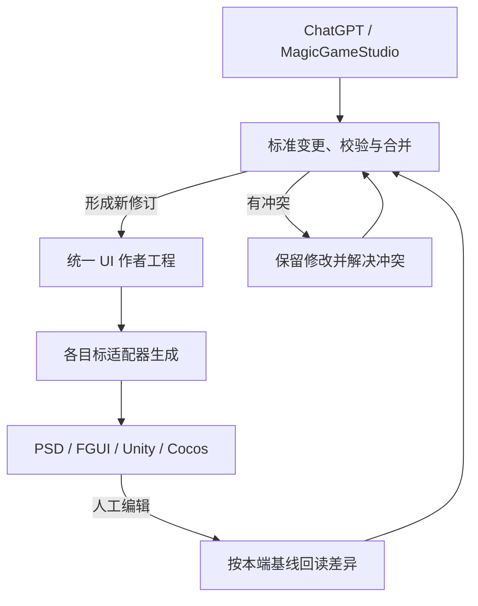

# MagicGameStudio：统一 UI 作者格式与多目标双向适配

状态：架构研究提案，尚未实现。日期：2026-10-10。

本文采用用户提出的方向：维护一份版本化的 UI 作者工程，PSD、FGUI、Unity、Cocos 等通过各自适配器生成；各端的编辑通过同一变更契约回到作者工程。它是本项目拟维护的标准，不宣称是已经存在的行业通用标准。

插件代码研究基线为 `ac4c92a548249640271618feceb6855624cfd496`，CLI 0.2.0。当前实现仍使用 `Scene schemaVersion: 1`；本文中的 v2、字段、目录和接口均为提案，不能直接提交到现有 `ui_set_scene`。本轮只修改设计文档，没有新增适配器、放宽 FGUI 解析器或修改活跃工程。

本文是总体架构。[FGUI 双向更新方案](ui-roundtrip-sync-proposal.zh-CN.md) 保留为第一个目标适配器的实施研究，其中的身份、三方合并、保存回读和未知字段规则继续适用。

## 1. 推荐的中心关系

共同作者工程负责语义、资产、组件、布局意图和修订；协调层负责变更、合并和目标状态；每个适配器负责本端原生格式及真实执行。适配器不需要知道其他目标如何保存按钮或图片。



每增加一种目标，增加其“标准到原生”和“原生到标准变更”的能力，并通过共同契约验收。无需为它与所有旧目标分别实现转换器。但一个目标内部的布局、脚本、字体和控件适配仍然要做；统一协议不会消除这些差异。

“共同作者工程为准”指被接受的共通语义和修订有明确归属。原生工程中的未同步修改仍然是需要保留的用户作业，不能因为它是生成物就直接覆盖。每个目标都有自己最后确认的基线，可以暂时落后于中心版本。

中心首先可以是插件电脑上的本地文件和服务，不要求额外云服务。标准文档应能随 Git/项目交付，脱离某一次 ChatGPT 对话或 job 仍可继续编辑；机器路径、鉴权和连接地址不进入可移植作者数据。

## 2. 标准需要定义什么

仅有 JSON 字段名不足以构成可互通的标准。至少需要一起维护：

1. **结构与语义**：Schema、稳定身份、属性单位、父子关系、控件功能、默认值和未设置值的区别。
2. **资源与依赖**：逻辑素材、不可变内容、字体、来源、目标变体和组件引用。
3. **变更契约**：作者修订、修改范围、前置条件、覆盖能力、冲突与删除规则。
4. **适配契约**：读取、生成、增量应用、保存回读、能力与保真报告。
5. **迁移与验收**：格式版本迁移、相同输入下的确定性、无改动往返、原生导入和交互验证。

MCP 是对话侧的工具/资源调用协议，JSON Schema 可描述结构，JSON Patch 可表达部分基础操作。这些基础机制都不能代替 UI 的组件语义、布局规则或跨文件保存确认。本方案不要求先升级现有 MCP SDK。

## 3. 四类数据必须分开

| 数据 | 保存什么 | 是否可以完整覆盖作者工程 |
| --- | --- | --- |
| 作者文档 `AuthoringDocument` | 稳定节点、组件定义与实例、素材、布局约束、文本、默认状态、业务绑定引用 | 中心通过校验后的新修订是下一份作者版本 |
| 布局与预览结果 `ResolvedView` | 指定画布、语言、状态和目标配置下的局部/全局矩形、裁剪、字形和显示顺序 | 否；这是求值结果 |
| 目标投影 `TargetProjection` | 原生对象、文件、身份映射、目标扩展、覆盖范围和保真结果 | 否；回读只形成有范围的作者变更 |
| 编辑会话/运行时状态 | 选区、dirty、当前查看页、运行时数值、滚动位置、调试状态 | 否；只有明确的作者编辑命令才能转换为作者变更 |

作者坐标和布局约束是输入，全局矩形是计算结果。统一布局清单仍输出完整画布坐标与父组件局部坐标，但不能让两个值成为互相独立的可编辑真值。需要固定求值上下文，才能有意义地比较 PSD 与引擎预览。

同样，40% 进度条的画面宽度不能替换最大填充宽度；编辑器里查看某个状态页不能自动改变游戏默认页；运行时输入和拖动的临时值不能自动成为设计默认值。

## 4. 通用核心、目标覆盖与原生扩展

### 4.1 通用核心

| 领域 | 建议保存的通用信息 |
| --- | --- |
| 工程与修订 | `documentId`、`schemaVersion`、不可变 revision、入口、参考画布、来源记录 |
| 节点身份与层序 | 稳定 node ID、显示名称、所属定义/实例、有序子节点、逻辑分组引用 |
| 组件 | 定义与实例的稳定 ID、由实例 ID 组成的定位路径、按 ID 寻址的属性覆盖、作用范围和复用依赖 |
| 布局 | 2D 坐标约定、单位、局部变换、尺寸策略、锚定/约束、流式或网格布局、裁剪 |
| 绘制与资源槽位 | 图片、可替换素材槽位、填充/适配意图、九宫格、透明度、遮罩等已定义能力 |
| 文字 | 真正的文本内容、字体资产、字号与行高单位、颜色、对齐、换行、自动尺寸、本地化引用 |
| 控件 | 按钮/单选/复选、输入、范围数值、显示进度、滚动容器、列表、下拉选择等功能契约 |
| 状态与交互 | 稳定状态集合/页面 ID、默认状态、各状态属性覆盖、事件意图、符号业务绑定 |
| 素材 | 稳定 asset ID、master 内容引用、像素尺寸、裁切偏移、来源、字体许可证、派生变体 |
| 设计说明 | 识别依据、人工决定、假设、重建标记、需要补充的业务行为 |

公共核心要有明确而有限的首版能力。可以先支持当前固定布局，再逐步增加约束、变换和布局容器；不能为了在 Schema 里列全所有字段，就把尚无可验证语义的功能称为已支持。

建议统一采用左上原点、向右为 x、向下为 y 的 2D 设计坐标，使用有明确含义的设计单位；图片像素与设计单位的比例在目标配置中定义。节点位置允许有限小数的能力与目标整数像素要求分开；旋转、轴心、变换顺序和颜色空间需要在实际 Schema 版本中明确。最初只支持已验证的 2D UI，不扩展成任意 3D 场景标准。

同级绘制顺序使用一个权威顺序；排序数值和展开顺序作为派生结果或有明确规则的独立排序上下文。逻辑 Group 只是成员集合，真正拥有子坐标的是容器/组件。不能因为某个目标把对象展示为文件夹，就改变作者父子关系。

组件定义、实例和内部节点分别有稳定身份。完整实例路径用于定位某次展开及覆盖范围，不作为唯一永久主键；改变父级或重构嵌套时，由明确的身份迁移记录更新定位关系，不能因路径字符串变化就删除并重建原对象。

### 4.2 控件保存“功能和部件角色”

一个按钮保留 button 语义、按压/选中模式、点击区域、标题、图标、可用状态和事件引用。皮肤是独立图像/文字部件，不能把一组 PNG 当作完整的按钮定义。

部件引用使用稳定节点 ID 和角色，例如 `background`、`label`、`icon`、`track`、`fill`、`thumb`。FGUI 适配器将其映射为实际支持的 `title`、`bar`、`bar_v`、`grip` 等名称和结构；其他适配器遵循各自目标的原生规则。既有工程中被代码访问的原生名称仍需保留并检查改名影响。

以下只是拟议模型片段，不是完整文档，也不是当前 v1 工具的输入：

```json
{
  "id": "node_confirm",
  "name": "confirmButton",
  "semantic": {
    "role": "button",
    "selectionMode": "momentary"
  },
  "parts": {
    "background": "node_confirm_bg",
    "label": "node_confirm_label"
  },
  "layout": {
    "mode": "absolute",
    "position": { "x": 140, "y": 620 },
    "size": { "width": 240, "height": 64 }
  },
  "events": {
    "activate": {
      "bindingRef": "action.character.confirm",
      "status": "unbound"
    }
  }
}
```

`bindingRef` 表达待接入的意图，不代表该游戏方法已经存在或已实现。原生脚本引用、生成代码及已绑定事件由目标适配层登记实际结果。

控件契约还必须区分显示、编辑、选择、焦点和事件传播等能力。首版只承诺已定义并验证的子集；“支持 Button”不能替代其全部参数和状态的能力表。List 也要分别定义可复用 item、设计预览数据、真实数据源引用和选择行为，不能把预览展开后的每一行认定为作者永久子节点。

### 4.3 目标覆盖与原生扩展的边界

| 数据位置 | 作用 | 例子 |
| --- | --- | --- |
| 通用核心 | 所有目标共同的设计意图 | 标题、按钮角色、布局约束、共享图片引用 |
| `targetOverrides` | 用标准属性表达、只影响一个目标配置的明确差异 | 某平台的间距或字体替代策略 |
| 版本化 `extensions` | 某个原生系统特有、其他适配器不解释的数据 | FGUI 特殊 Controller/gear、Unity 项目脚本字段、Photoshop 图层效果 |
| 原始附件与保留范围 | 适配器暂不能语义理解但需要保留的原生材料 | 未触及的源文件、未知字段、原生编辑文件 |

同一个可移植属性只设一个公共来源。目标覆盖有显式目标与优先级，不再复制一份完整 UI 作为新的长期主文档。原生扩展不能暗中覆盖核心同名属性；存在两个驱动来源时必须报告冲突。

扩展需要 namespace、version、引用依赖、归属实体、可读写能力及失效条件。看不懂的适配器保留引用和内容；它不能宣称已在本端实现相同效果。节点删除、改名、移动或身份迁移会影响扩展内部引用；不能可靠检查/改写相关引用时，阻止对应结构变更，不能盲目回放旧原生字节。保存原始字节也不证明 writer 能保真修改同一对象；无法保证未知内容不丢失时，限制对应写入。

同一属性已登记为目标覆盖时，回读继续进入该覆盖。普通受管共通属性形成公共候选变更。对于目标专有修正或范围不明的编辑，先保留原生事实，集中解决真正影响范围的歧义，避免把一个平台的调整意外扩散到全部平台。

## 5. 布局必须记录驱动方式

“距右边 24”与“当前 x 为 852”可能产生相同的一张图，但改变画布后行为不同。统一格式必须能够表示前者，并把后者作为指定画布下的计算结果。

Unity 官方资料区分 uGUI 的 GameObject/组件/Prefab 与 UI Toolkit 的 Visual Tree/UXML。两者的布局和回调绑定方式也不同。因此目标应区分 `unity.ugui` 与 `unity.ui-toolkit`，并读取具体项目版本和包配置，不能只用 `unity` 这个目标名代表完整格式。[U1]

UI Toolkit 的布局使用 Yoga/Flexbox 子集；未设置某个边距与设置成 0 的含义不同。公共模型应保留未设置、固定值、百分比和内容驱动的区别，不能把全部属性补成 0。[U2]

Cocos Creator 的 Widget 可以按父级/祖先对齐、使用百分比和双侧拉伸；持续更新模式会重新应用约束。用户调整该控件时，适配器要读取真正改变的边距、锚定或约束，不能把某一帧的 `x` 当作唯一作者属性。[C1] UITransform 的尺寸与锚点也参与布局和点击判断，映射必须按目标实际版本处理。[C2]

据此建议：

1. 公共布局模式有各自完整语义；某目标只能表达部分模式时按能力报告处理。
2. 精确等价转换才自动变成公共约束；目标独有行为保留在目标扩展中。
3. 固定画布可以生成一份已解析的视觉结果，但烘焙结果不能冒充可响应的布局规则。
4. 原生保存、重开、布局求值后再取预览。只读取编辑器当前属性值不等于读到了最终画面。
5. 选择特定目标预览时，PSD 与该目标使用同一作者修订和视口/状态；原生字体、舍入、效果差异通过报告说明。

此处 Unity 6.0 和 Cocos Creator 3.8 是本次研究资料版本，不是替用户选择的目标版本。

## 6. 素材主文件、变体和参考图

素材逻辑 ID 与内容版本分离。换 PNG 内容保持 asset ID，内容使用新的不可变 blob/hash；同字节的两个不同业务资源不自动合并身份。

主文件和目标变体通过明确关系关联。例如高清按钮底板是 master，FGUI 的缩小纹理、Unity 的导入配置、某字体子集是不同派生信息。派生记录应固定来源 hash、处理参数、实际尺寸和生成器指纹。目标纹理 atlas 的某个块也不是可直接替换 master 的完整素材。

变体还要标明是可再生成产物，还是人工维护的目标覆盖。master 变化后，前者按依赖失效并重建；后者保留已有内容、标记与新 master 的关系待协调，不能被自动生成覆盖。重新回到自动派生模式是显式的作者变更。

若用户只修改 FGUI 中的小纹理，先登记该目标内容变化。后续要么明确采用它作为新 master 并说明有效分辨率，要么重建相应高清版本，要么保留为目标覆盖并报告差异。不能保留旧高清 PNG 却声称所有目标的美术已同步，也不能自动放大后称作原高清源。

从 PSD 渲染叶层取出的像素可能经过裁剪、缩放、字体栅格化或图层效果处理。当前插件把祖先透明度合成为叶层的 opacity 属性并量化，并非一律烘焙进 PNG；后续第三方合并图层还可能把透明度烘焙到像素。回读应分别处理像素 alpha、图层 opacity 和作者局部透明度来源。只有可以证明为完整、独立、未破坏源信息的素材才能直接回写对应 master；其他情况需要重建、原生附件或新的实例专用资源。

共享素材内容修改要报告所有引用影响。对展开后的单实例绘画，不能在无明确归属时覆盖所有实例共用的源图；可表达时建立实例专用素材引用和覆盖。

普通文字仍保存真实文本。字体或文案改变后，其栅格参考图、字形子集、布局测量和预览缓存失效。初始批准设计稿保持原文件与 hash；新的界面版本生成自己的预览，不覆盖原始批准记录。

## 7. PSD 是有限回写的美术目标

PSD 原生保存像素、图层、文字/效果等信息。[P1] 游戏 Button、滑块范围、控制器、实例继承和业务事件并不由普通栅格图层完整表达。这是投影范围不同，需要通过作者文档和稳定映射补足。

当前插件的具体边界来自 [psd.ts](../src/ui/psd.ts) 和 [render.ts](../src/ui/render.ts)：

- PSD 图层整数 ID 每轮按输出顺序分配，尚无跨修订稳定映射。
- 同一语义 groupPath 为保持交错层序，可能形成多个非连续 PSD 文件夹；文件夹不等于唯一作者父容器。
- 组件已经展开到多个实例；祖先透明度合并至叶层 opacity 并发生 8 bit 量化，视口外像素已裁掉。
- 文字可能是栅格参考，图层外观不能证明存在可编辑文字。
- v1 实例覆盖仅支持部分文字/图标/颜色/字号，不能直接表达实例内部件位置覆盖。

因此新增 PSD 回写能力需要持久化导出 generation、原生 layer/group 映射、稳定作者/实例 ID、实例定位路径、未裁切边界和变换元数据。映射还要保存当前属性实际来自定义、实例覆盖、状态或目标覆盖的哪一层，避免把某一状态的位置改成所有状态的公共位置。只有经实际软件保存验证的元数据机制才能依赖；sidecar 应作为明确随包依赖，不能假设任意 PSD 软件都会保留自定义信息。

| PSD 中的编辑 | 回写原则 |
| --- | --- |
| 移动一个已明确映射的完整按钮实例 | 条件满足时更新该实例布局；Button、状态和业务绑定继续保留 |
| 只移动按钮的 background 叶层 | 只形成该实例内部底板的位置覆盖；不能推断整个按钮移动 |
| 对单实例底板重新绘画 | 判断完整像素与归属；必要时建立实例专用新素材，保留共享模板 |
| 修改真正的文本层 | 读取支持的文本和样式；不能从文字像素改动直接承诺准确文案回写 |
| 隐藏一个图层 | 根据已登记语义报告可见性变化；不能视为删除整个控件 |
| 复制、合并图层或丢失映射 | 检测身份变化；新对象分配新 ID，歧义形成待处理项 |
| 裁剪、合成透明度、复杂效果 | 仅在逆向归属明确时回写；否则保留原生编辑并报告需重建 |

具体例子：标准中有 `confirmButton`，包含背景和标题。假设身份和单位映射明确、没有裁切，父级为单位变换，底板使用直接绝对布局且无状态/约束覆盖其位置。PSD 中仅将背景向右移动 8 个设计单位，适配器报告“确认按钮这一实例的 background 部件局部 x +8”，中心增加该实例部件覆盖。标题、点击区域、button 语义和其他按钮实例均保持既有作者值。预览应显示底板与点击区域因此产生的偏移，不能自动扩大点击区域。若用户移动的是完整按钮实例，才修改按钮整体布局。当前 v1 尚不能表达前一种布局覆盖，实施前必须扩展并验证它，不能偷换成改共享模板。

其他情况下，由映射中的坐标变换和属性来源把像素位移转换为作者变化；无法确定应该改变约束、状态、实例还是目标覆盖时，先报告这一范围歧义。原生当前投影只与同规则下的原生基线比较，再提取真实变化；未编辑的图层不能因浮点到像素/8 bit 的量化而制造作者修改。

没有可信映射的任意 PSD 可以作为新设计输入，做一次素材与语义识别；不能自动冒充某个已绑定工程的无损回写。只含最终 PNG 的输入更不能自动恢复全部隐藏状态和业务信息。

## 8. 回写契约：有范围的变更，不是整份替换

适配器读取本端后提交作者变更集。它不需要也不允许把没读到的标准字段补空后覆盖中心。

建议每个变更集至少固定以下信息：

| 字段组 | 含义 |
| --- | --- |
| 协议与身份 | `changeProtocolVersion`、`documentId`、`changeSetId`、目标 `bindingId` |
| 基线 | 该目标的 `baseId`、对应作者 revision/hash、基线投影与映射版本 |
| 原生观察 | saved/session 模式、实际原生身份、快照 hash、会话与文档 revision |
| 可解释范围 | 读取覆盖字段、可逆范围、未知/保留范围、适配器能力指纹 |
| 修改 | 按稳定 ID 寻址的操作、旧值/前置条件、新值、涉及的素材内容 |
| 作用域 | 组件定义 ID、实例 ID 与定位路径、状态、共享属性或特定目标覆盖 |
| 证据与影响 | 来源、被影响实例/引用、需要重建的派生文件、未解决的歧义 |

基础属性可以使用 JSON Patch 的 `test`/`replace` 思路。[J1] 节点移动、模板修改、资源替换、删除被引用对象等应有可验证的领域操作，不能仅靠数组下标。未读取/不可表达、空值、隐藏和明确删除是不同状态。

### 8.1 每个目标独立保存共同基线

FGUI 可能最后确认了 r20，PSD 最后确认了 r18，中心已经是 r21。PSD 回写时要与自己的 r18 投影比较，再把得到的修改合并到中心 r21；不能以当前 FGUI 状态替代 PSD 的原始基线。

每个基线保存可读的原作者版本、原生快照、映射、投影、资产引用和能力版本，不只有 hash。目标首次绑定应读取实际安装结果，确认原生 ID；一个 ZIP 被导出并不证明它已经被实际工程采用。

### 8.2 中心仍需三方合并

以目标自己的最后确认版本 B、中心当前作者版本 C、目标当前回读 N 做语义比较。所有比较先投影到相同且明确的可同步范围：

- 只有 N 改：进入中心候选修改。
- 只有 C 改：保留中心修改。
- 两边同值：合并为一个结果。
- 不同且独立的字段：自动合并并验证依赖。
- 同一属性不同值、删除与修改、身份/拓扑不明：形成冲突。

例如 B 的按钮 x=140，FGUI 改为 160，中心只换了图片，通常可以合并；中心同时把 x 改为 180 时，需要解决这个位置冲突。约束与位置、字体与自动尺寸、图片尺寸与九宫格、数值区间与当前值等不是互相独立的字段，必须联合校验。

同一标准减少各端重复解释业务规则，但不会自动消除并发冲突。Git 可以保存历史；普通文本合并不能替代 UI 语义合并。第一阶段采用中心有序修订和版本前置条件即可，不需要为本需求直接引入多人实时 CRDT。

### 8.3 中心提交、目标应用与确认

中心校验并接受变更后产生新作者 revision。向任何其他目标传播前，也要将该目标的当前快照与它自己的基线比较，收集尚未进入中心的本地编辑；不能仅固定当前文件 hash 就覆盖计划生成前已存在的人工修改。可表达的本地修改先合并，不可处理的范围保留为 pending/conflict；若中心因此形成新 revision，基于旧修订的计划重新计算。

随后，对每个可应用的选定目标生成固定输入、差异、影响和保真报告的计划。计划绑定作者 revision、目标当前快照、profile、映射及适配器指纹；应用前重新核对，随后保存并实际回读。写前 hash 检查不等于跨进程锁；文件模式采用受控副本或协作写入窗口，活跃编辑器模式依赖真实宿主的版本前置条件与编辑命令。具体持久化与恢复边界沿用 FGUI 方案，并在各目标重新验证。

目标只有在实际回读符合计划、被声明保留的范围也保持后，才推进自己的确认基线。某个目标失败时，中心修订可以已经存在，其他目标可以成功；失败目标明确显示 pending/conflict/failed，不报告“所有端同步成功”。不能把多个编辑器/文件的依次写入说成全局原子事务。

重复操作使用稳定 operation ID，查询真实完成阶段后恢复；文件事件重新采集和比对，不用“忽略下一次事件”来避免回环。回退也要重新检查当前版本并形成逆向变更，保留用户后来完成的修改。

## 9. 适配器、MCP 和代码职责

### 9.1 适配器共同契约

以下是职责名，不是已上线工具或最终 wire API：

| 能力 | 责任 |
| --- | --- |
| `describeCapabilities` | 实际软件/源格式版本、UI 系统、可读写范围、保真和验证能力 |
| `captureSnapshot` | 获取指定 saved/session 状态、身份和实际内容；返回覆盖范围 |
| `deriveChanges` | 对该目标冻结基线生成作者变更及无法归属的原生变化 |
| `project` / `build` | 作者版本加目标配置生成候选工程、映射和保真报告 |
| `prepareApply` | 针对当前原生快照准备具体增量计划和依赖影响 |
| `apply` / `save` / `readback` | 按真实宿主约束执行；返回可核对的完成阶段 |
| `validate` / `render` | 对实际内容做静态、导入、布局/渲染和交互验证 |

读取和本地语义解释属于适配器；共同合并策略、作者 revision、目标基线和跨端协调属于中心。保存计划与操作记录必须持久化，不能依赖某个 MCP 请求的内存。

### 9.2 引擎内是否需要一个 MCP 服务

可以提供，但不是第一步的前置条件。优先让引擎端实现真实编辑器适配层，插件通过本机 IPC/JSON-RPC 等受支持方式调用；ChatGPT 继续使用现有 MagicGameStudio MCP 入口。这样只维护一套作者变更和同步规则。

如果还需要其他 AI 客户端直接操作 Unity、FGUI 等，可为同一适配层增加 MCP 外壳。独立 MCP 返回相同作者变更结构，仍经过同一中心协调，不在每个端各做一套“最终版本”。MCP 规范提供客户端/服务端工具、资源和能力交换；本项目的领域模型与同步规则需要自行定义。[M1]

FGUI 的 `.fairy`/XML 是数据，不是运行服务的宿主。Unity/Cocos 等目标亦须区分作者源接口与运行时对象接口。是否能读选区、未保存文档、Undo、事务和保存确认，必须由实际适配器能力证明。

### 9.3 保真与验证分别报告

保真是对转换含义的承诺，验证是已实际执行的证据。建议分成两个维度：

| 维度 | 建议报告 |
| --- | --- |
| 语义保真 | 可准确往返、可近似表达、仅保留原生信息、不支持 |
| 视觉保真 | 指定视口/状态下的实测差异、已知字体/效果差异、尚未测量 |
| 操作覆盖 | 能读取、能生成、能增量写回、能应用到 live 会话；分别声明 |
| 实际验证 | 静态检查、源保存回读、编辑器导入、原生预览、运行时交互、发布；各自结果 |

一个扩展可以“原生信息保留成功”但“其他目标视觉不支持”；一个 Button 可以“公共语义通过”但“原生点击未验证”。不能用一个全局 supported/pass 隐藏这类差异。公共核心校验通过但某目标不支持时，应报告该目标问题，不把整个作者文档宣判为无效。

## 10. 可移植工程和本机状态

建议逻辑上分为以下部分，物理命名在实施 Schema 时确定：

| 内容 | 建议位置/形式 | 版本策略 |
| --- | --- | --- |
| 工程说明、组件、样式、状态、素材索引 | 可读 JSON 作者工程，实体按稳定 ID 组织 | 随项目 Git；稳定序列化；有显式 schema migration |
| 图像、字体、参考稿、原生保留附件 | 内容 hash 引用的文件或可打包资源 | 不可变；交付时依赖齐全 |
| 目标配置与身份映射 | 可移植 target profile/binding 的项目部分 | 固定版本和来源；不保存机器绝对路径或凭据 |
| 修订基线、原生快照、计划与操作日志 | 插件持久状态；项目交接时可输出独立同步附件包 | 冻结且可追溯；按仍在引用的基线保留 |
| 本机工程根、下载目录、进程连接 | 现有本机配置，以稳定 binding/destination ID 关联 | 不作为作者 UI 属性 |
| PSD/PNG/FGUI/Unity/Cocos 交付和预览 | 构建产物目录 | 带作者 revision、依赖/profile/adapter hash 与映射 |

格式应允许目录形式供 Git 使用，以及带 manifest 的归档形式供传输；不必一开始发明新的二进制容器或自定义文件扩展名。同步附件不要塞进受限制的 FGUI 源导入根。完整输出目录和实际 FGUI 包继续遵守各自导入规则。

新电脑若只有生成物而没有可信共同基线，需要重新绑定/采用流程；不能从现存文件伪造旧作者历史。未来 Git 分支切换或工程移动后，也要核对逻辑身份及目标内容再应用。

## 11. 现有 Scene 的迁移依据

现有结构已经分离素材与语义、定义与实例、作者 Scene 与展开画面，这是可复用的基础。以下部分需要渐进重构，而不是简单把 `Scene` 改名为通用标准。

| 现有代码 | 当前耦合 | 迁移方向 |
| --- | --- | --- |
| [scene.ts](../src/ui/scene.ts)：`SceneAsset.fgui`、`SceneFont.fgui` | 专门为 FGUI 保存紧凑变体 | 通用 master/renditions 与目标配置 |
| 同文件：`SceneGear`、`SceneRelation.sidePair`、`PROPERTY_IDS` | FGUI Controller/gear/relation 和原生 property 编号 | 可精确抽象者进入状态/约束；其余保留在 FGUI 扩展及 writer |
| 同文件：`FGUI_TARGET_TYPES`、`targetFguiType` | G* 类名进入公共解析结果 | 移到目标映射报告 |
| 同文件：`Common/Check/Radio`、`valueAndmax`、数值 `keyboardType`、`ubb` | 目标字面值进入作者字段 | 通用意图加目标转换规则；不可逆部分保留扩展 |
| 同文件：`validateScene` | `grip` 必须 Button、bar 名称、max 不能为 0 等实际 FGUI 导入限制 | 拆为公共结构、公共语义、目标能力、原生结构四层校验 |
| 同文件：identity-only transform、整数布局、同尺寸实例 | 当前 v1 已验证范围 | 保留为 v1/profile 能力；按完整语义逐项增加 v2 能力 |
| 同文件：controller 名称、item name、property 名称路径 | 改名或重排影响引用 | 新增稳定 ID；保留旧引用到新 ID 的迁移映射 |
| [workflow.ts](../src/ui/workflow.ts)：`buildJob` | 所有构建都先要求 FGUI target，再固定构建三种产物 | 独立作者修订；每个输出目标有自身 profile、依赖、状态和产物 |
| [psd.ts](../src/ui/psd.ts)：`buildDocument` | 顺序图层 ID、展开文件夹 | 稳定的 generation/实例/图层映射和有限回写能力 |
| [fgui.ts](../src/ui/fgui.ts)：`exportFgui` | namespace 包含 job ID，原生对象 ID 包含 owner component | 持久目标 binding 和原生身份继承 |

公共文档的校验不因 FGUI 不支持某种布局就失败；选择该 FGUI 目标时，仍严格拒绝未支持的导出。`extention`、`scale9grid` 中心矩形、真实标签/属性、模板与实例覆盖继续按实际目标源码处理，不修改解析器来接受错误输出。

### 11.1 首先保留既有身份

当前 FGUI namespace 含 `MagicGameStudio/ui-production/v1/{jobId}/{scene.id}`。即使作者 Schema 升级为 v2，也不能顺手把此 namespace 的 `/v1/` 改为 `/v2/`，否则既有包/工程身份会改变。

导出的 resource/object ID 和实际安装后的 remap 优先作为迁移事实保存。已有节点键是 `(componentId,nodeId)`；若采用全局新 ID，要保留明确迁移表。跨组件移动、组件复制和改名具有不同身份含义，不能简单重新 hash 后当成原对象。

作者 `documentId` 应独立于 job 和机器路径。通过显式关联打开同一作者文档的新任务，延续原文档及目标绑定；不能按界面名称或像素相似度自动继承。确实复制一个新界面时创建新身份，并明确新建、复制或不继承目标绑定，避免两个文档意外写入同一个原生包。`buildInputHash` 是内容/构建指纹，不能替代文档或原生工程身份。

### 11.2 缓存与已有验证

构建键需要固定作者 revision/content、文档和目标绑定、profile、实际适配器/生成器指纹、素材与字体版本以及求值上下文。FGUI 的舍入规则归属其投影，不能没有声明地改变所有目标。

所有验证报告绑定实际内容和执行版本。旧导出通过不能自动成为 v2 迁移通过；新生成物也不能继承旧原生导入/交互 PASS。升级实现后需要证明旧合法案例、原生 ID 和声明的布局/语义保持。

## 12. 建议实施顺序

| 阶段 | 具体交付 | 完成判据 |
| --- | --- | --- |
| A. 格式与身份基础 | 核心 Schema、语义说明、稳定 ID、v1 迁移、目标扩展、适配器接口 | 现有案例迁移可追溯；不改变既有原生身份 |
| B. 拆出当前输出适配器 | PSD 与 FGUI 生成适配器、分层验证、逐目标构建 | PSD 单独构建不依赖 FGUI；现有交付能力保持 |
| C. FGUI 有限双向闭环 | 已保存受管源工程绑定、快照、语义差异、中心合并、应用回读 | 工程改布局回到作者文档并重建 PSD；换图不丢现有布局 |
| D. PSD 有限回写 | 稳定图层/实例映射、像素归属、布局覆盖、变化范围报告 | 支持范围内往返不丢控件语义，不误改其他实例 |
| E. 编辑器会话与新引擎 | 真实宿主命令/保存；具体 Unity UI 系统和 Cocos 版本适配器 | 每端通过同一契约套件并有实际原生验收 |

阶段 A 与 B 可以在实现中小步配合，先把当前成功路径包进适配器，再迁移作者格式。保留 v1 reader 和旧作业；v2 降到 v1 只允许明确的能力交集，不能截掉未知字段后继续导出。先把 FGUI 一条回写闭环做实，再扩展 PSD/新引擎，避免一次实现所有目标却没有可验收的路径。

## 13. 必须覆盖的验收场景

| 场景 | 预期结果 |
| --- | --- |
| 作者工程导出后未编辑立即回读 | 公共变更为空；不因默认值、省略字段或舍入产生回环 |
| FGUI 改位置，中心改图片 | 合并独立变更，生成的 PSD/FGUI 使用同一新修订 |
| 两端基于不同确认修订改同一属性 | 使用各自基线，报告真实冲突 |
| PSD 只移动按钮底板 | 只影响对应实例部件；按钮语义、事件、标题和其他实例保留 |
| PSD 合并/复制图层，映射失效 | 检测新身份或歧义，不按名称猜测旧对象 |
| Cocos 对齐控件改变边距 | 读取作者约束，经过布局求值后保持预期位置 |
| 仅改变目标覆盖 | 其他目标公共设计保持；报告局部差异 |
| 目标存在未知原生扩展 | 未触及内容保留；无法保真的写入明确停止 |
| 导入器只读到部分字段 | 未读字段保留；不产生删除 |
| 图像主文件、目标变体或字体变化 | 相关布局、参考栅格、图集、子集和验证按依赖失效 |
| 控件运行时数值/状态变化 | 不自动改作者默认值或最大皮肤尺寸 |
| 旧 Schema、ID、job 迁移 | 旧作业可读；同一原生工程不被当作全新包 |
| 中心提交后某个目标保存失败 | 分别报告中心版本、各目标确认版本与失败阶段 |
| 中心向尚有未同步编辑的目标传播 | 先回收其本地修改或保留冲突；不因当前 hash 匹配就覆盖它 |
| 应用前用户又编辑了工程 | 旧计划失效，重新比较，后来编辑可保留 |
| 保存后断线、重试或回退 | 按操作记录恢复，幂等且不覆盖第三方新版本 |

以上是未来验收要求，本轮没有执行这些新功能。静态格式通过、编辑器导入通过、运行时交互通过必须分别由真实结果证明；任何未执行项标记未验证。

## 14. 依据与待核对项

### 本地实现依据

- 当前插件 [scene.ts](../src/ui/scene.ts)、[fgui.ts](../src/ui/fgui.ts)、[workflow.ts](../src/ui/workflow.ts)、[psd.ts](../src/ui/psd.ts)、[render.ts](../src/ui/render.ts)、[target.ts](../src/ui/target.ts)。
- 已记录的实际 FGUI/工作台源码依据、能力边界和保存协议见 [FGUI 双向更新方案](ui-roundtrip-sync-proposal.zh-CN.md)。本轮 Windows MCP 仍返回 `Internal error`，没有重新确认现场宿主接口。
- 现有输出流程与已完成验证分别见 [ui-workflow.md](ui-workflow.md)、[validation-ui-production.md](validation-ui-production.md)。这些报告只证明现有 v1 能力。

### 官方原始资料

- [U1] [Unity 6.0：Migrate from uGUI to UI Toolkit](https://docs.unity3d.com/6000.0/Documentation/Manual/UIE-Transitioning-From-UGUI.html)：两种 UI 系统的作者结构、布局、复用与事件差异。
- [U2] [Unity 6.0：Position element with the layout engine](https://docs.unity3d.com/6000.0/Documentation/Manual/UIE-LayoutEngine.html)：布局引擎与绝对定位、未设置值的语义。
- [C1] [Cocos Creator 3.8：Widget](https://docs.cocos.com/creator/3.8/manual/en/ui-system/components/editor/widget.html)：对齐约束、拉伸和持续更新。
- [C2] [Cocos Creator 3.8：UITransform](https://docs.cocos.com/creator/3.8/manual/en/ui-system/components/editor/ui-transform.html)：内容尺寸与锚点。
- [P1] [Adobe Photoshop File Formats Specification](https://www.adobe.com/devnet-apps/photoshop/fileformatashtml/)：PSD 的原生图层、像素和附加数据格式；本文不据此宣称任意第三方 PSD writer 已实现全部能力。
- [M1] [MCP Architecture（2026-07-28）](https://modelcontextprotocol.io/specification/2026-07-28/architecture)：调用端角色与能力交换；UI 领域标准由本项目定义。
- [J1] [RFC 6902：JSON Patch](https://www.rfc-editor.org/rfc/rfc6902)：基础操作与 `test` 前置判断；不提供本项目跨编辑器保存事务。

Unity/Cocos 的实际项目、版本、组件包、源格式样例和编辑器入口尚未接入；它们只参与本轮架构对照。实施各自适配器时仍要研究实际目标，不能把本文件中的语义例子直接写成原生 XML、Prefab 或场景文件。
