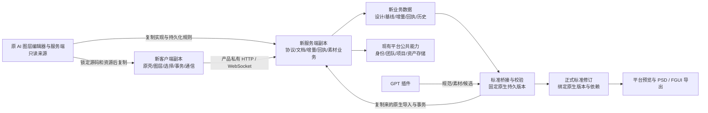
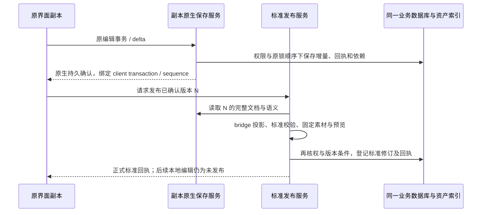

# UI 设计系统：复制式二次开发架构

## 当前优先级（2026-10-12 用户修订）

主线为平台统一标准与插件在线提交。停止持续开展原功能基线验收；完整源码和已有功能保持，只有实际阻塞这条主线时才处理相关基线问题。未验项目保留为后续按需事项，不作为 P1/P2/P3 开发的统一前置门槛，不宣称 B2 全部通过。

接下来按功能批次推进：共享规范在线发布与原生 checkpoint → 标准桥接、稳定语义和正式修订 → 插件受限授权、真实素材上传、在线提交与正式回执。每批先完成多项实现再统一验证。标准提交失败必须保留原生草稿，原生 ACK 不等于标准发布成功。

日期：2026-10-11。状态：基于[实际源码调研](ui-design-reuse-research.zh-CN.md)的目标架构，尚未实施副本系统。用户补充明确：以当前完整 AI 图层编辑器的源码、客户端功能和业务逻辑作为整体基线，增加本系统需求；不是抽取部分编辑、选择或撤销能力后重新组装。本文修订并取代此前“先新建作者会话/历史，再接几个原生绘图端口”的产品实施方向。已有契约、插件离线工具和测试保留为可用成果，不要求原编辑器迁就实验代码。

## 1. 必须遵守的边界

1. **整套 AI 图层编辑器产品复制为开发基线，再做需求增量改造。** 默认继承当前原客户端全部可用功能、界面、流程和业务逻辑，以及支撑它们的服务端实现。显示、图层、选择、编辑、Undo、通信和存储只是必须保留的例子，不是允许裁剪到的功能边界；不先挑部分底层能力再重新组装编辑器。
2. **原源码与旧业务不动。** 不修改原 AI 入口、原编辑核心、原服务、旧路由和存储业务来承载新 mode。新代码、新登记清单、新构建/profile、新 API 与业务存储属于本系统；旧产品仍绑定原实现。
3. **复制包含不同源码形态。** 已恢复 TS、维护 JS/ESM、共享脚本宿主和必要兼容资源均有明确来源、固定版本与构建身份；未完成翻译不意味着必须重写或等待整个客户端翻译完成。
4. **同一平台账号与项目体系继续使用。** 不复制用户、团队、登录会话成为第二套事实源；新设计关联现有项目。底层资产存储、权限、配额和存储后端通过明确公共边界复用，产品所属通信/存储业务在副本装配。
5. **先证明副本功能等价，再扩展标准/GPT。** 先让完整副本达到原产品全部已可用功能和流程的基线，其中图层显示、选择、编辑、保存与重开是先验证的关键路径，而非全部交付范围。统一标准通过导入/发布适配接入，不能为此前 0.1 实验契约或 reducer 拆掉原可用功能。

“复制”指新系统有固定且可独立维护的来源副本；开发/发布时不能继续读取原工作树的绝对路径、未锁定 HEAD 或正在变动的产物。未改动第三方库可用锁定包，资源字节可物理去重，但新发布清单必须自足且独立。原应用的当前发布指针、数据目录和进程不参与新系统运行。

### 1.1 完整基线与增量需求

“完整”指当前 AI 图层编辑器产品及其宿主/主页、全部功能入口、面板、设置、原始业务流程、后台通信与服务依赖的完整源码/资源实现。复制单位是这个完整产品，不是几个模块、截图中可见区域或新标准需要的编辑子集。未完全翻译的部分以固定、可运行的原实现/兼容资源补齐基线；不能因难读就换成新写代码。

先建立原产品功能目录，每项记录入口/触发条件、源码/资源/服务、当前可用状态、原测试和副本对照。默认处理为“原样继承”；只有新需求确实改变行为时才在副本增量适配，并明确影响范围。原本缺服务、无权限或待恢复的功能如实记录原状态，不把它们当作本次复制退化，也不能未经验证报为可用。

功能目录覆盖主页创建/打开/管理、完整导航与面板、素材/字体/上传、画布/页面/视图、图层/选择/编辑、原 AI 任务与结果、历史/恢复、保存/共享/下载等原产品实际存在的流程。该目录不预设这些功能全部已可用；以原应用证据为准。新增 UI 语义、GPT 候选、标准发布和目标导出叠加到此基线上，不替换原客户端的整体流程。

B1/B2 分包只用于降低施工风险，最终仍须交付完整副本。不能因为图层/Undo/保存几个关键路径通过，就把其他原功能留空、删除或永久禁用并宣布复制完成。优先复制源测试与现有实现，只新增产品绑定、新需求和隔离验证，以减少重复开发。

## 2. 总体结构



上述“标准桥接”是必要的产品新增逻辑；原编辑器与标准 UI 语义不同，不能宣称零适配。新增范围限于产品身份/路由/命名空间、标准语义与 ID 映射、候选接纳、正式标准修订和导出。原编辑、网络和存储算法应保留。

## 3. 客户端代码与资源如何复制

以下为拟定目录，实施前按完整产品功能与依赖清单确定实际文件，不在本轮创建代码空壳。继续使用独立稀疏工作树只是源码组织方式，不能成为裁剪原功能的理由；也不要求复制与 AI 图层编辑器无关的整个游戏/FGUI 工程：

```text
MagicGameClient/
  src/products/ui-design/
    upstream/                         # 完整 AI 图层编辑产品的固定私有副本
      business/                       # Home、AI layers、视图、选择、事务等
      shared-runtime/                 # 当前 core ESM + 必需宿主
      client-programs/                # 完整产品所用 profile/懒加载维护 TS 与契约
      source-runtime/                 # 壳、导航、加载、通信装配
      source-profiles/                # 同版本 HTML 壳/声明
      source-assets/                 # CSS、图标、字体等
    app/                              # 新入口、产品装配、需求增量扩展
    standard-bridge/                   # 标准导入/投影、稳定 ID、语义扩展
    manifests/                        # 副本专用 business/package/profile 登记
    upstream-lock.json                # 来源、hash、状态、依赖、补丁记录
  tools/ui-design/                     # 从现有构建/启动工具复制并适配的入口
  dist/ui-design-releases/<release>/   # 独立不可变发布包
  dist/ui-design-current.json          # 只推进新系统指针
```

既有 `src/app/ui-design/` 中的标准会话与 `ui-design-editor/controller.ts` 目前仅是实验准备。逐项评估后可迁入 bridge 的校验/测试工具；不把这套端口与历史强制设为原编辑器的控制器。自制 preview HTML/CSS/面板不进入副本产品。

### 3.1 复制清单及保留行为

| 必须复制/固定的能力 | 来源与保留内容 | 允许的产品差异 |
| --- | --- | --- |
| 主页入口与打开 | `home-magic-layers` 及实际 Home 注册/导航片段 | 在副本注册 `ui-design`；原 `magic-layers` 路径保持原用途 |
| 完整编辑壳与外观 | 原 document shell、source-runtime、当前 core/宿主、组件和 CSS/图标/字体 | 新产品标题、身份和功能入口；原布局与显示样式保持 |
| 图层列表与选择 | 原图层条目/缩略图/嵌套、selection store、画布与列表联动、右键与多选 | 接标准语义的附加信息；不得重建一个简化图层列表替代 |
| 编辑与事务 | 原拖动、尺寸、文字/IME、层序、显隐/锁定、复制删除、原生 Undo/Redo | 新标准导入/语义编辑进入相同事务；原本可用能力优先保留 |
| AI 层结果应用 | 原反序列化、素材导入、引用整理、插入、失效回滚及选中 | 新产品任务/候选来源；不重做显示与命中系统 |
| 通信 | 原 RPC transport、codec、懒加载 schema、轮询、WS 帧/重连/确认 | 产品私有地址、认证绑定和错误定位；不重写一套简化网络栈 |
| 构建/发布 | 原脚本编译、业务 selector、shared-unit/ESM 初始化、资源 hash、入口 SRI 与不可变发布 | 使用副本清单、输出根和私有资源绑定；原 build 与 release 指针不改 |

复制 Home 登记、通用宿主和构建脚本时使用新系统的装配副本/覆盖清单，而不是修改原文件再声明“只加了一个入口”。选择器只在新产品构建中作用于已锁定输入；同一 selector 不注册两份，两个运行时不在同一个 renderer 中共享可变全局对象。若现有工具参数不足，就复制该工具并改副本，不能反向侵入原构建器。

主页与新编辑窗口在新客户端发布包中接线。新主页保留原卡片行为，加入新卡片和新类型列表读取；打开旧设计仍走旧产品入口。最终推广是选择新发布包，不是在本轮覆盖正在使用的主 checkout。

### 3.2 翻译尚未完成时的规则

每个来源条目同时记录 `sourceForm`、`admission`、`semanticStatus`、`buildStatus`、`runtimeEvidence`，不使用一个“已恢复”布尔值混为一谈。

- 已具名 TS：复制入口、implementation、类型、导入图、原对照测试及 selector。
- 维护 JS/ESM：原样复制可构建实现，保留符号/ABI、可变绑定、初始化顺序，先不为“整洁”改名重写。
- 已准入但语义尚未恢复的 TS：原样复制并保留迁移审查；包装器/断言不自动证明业务语义已清楚。
- 必要的 pendingRecovery/兼容资源：固定当前可用原始字节与来源 hash，明确不可直接改动；需要新增行为时先在副本恢复那个最小单元并与原件对照。不能把未准入候选直接记成正式编译结果。
- 仅研究/历史目录：不作为运行输入。新的源码翻译必须显式准入后才替换副本中对应资源。

锁文件至少含原仓库 HEAD、原工作树文件 hash、源码/运行包/单元标识、原路径→副本路径、资源 URL、输出 hash、编译器/锁文件、初始化/懒加载依赖、已知未翻译项与验证证据。包内单元的模块 ID 和 ABI 可保留；产品发布 URL/profile/服务根隔离。复制范围从完整 AI 图层编辑器产品的功能目录、所有入口/profile/懒加载路径求依赖闭包，不从本次新需求或单条画布路径反推最小子集。首屏未加载、此次操作未触发的功能模块仍纳入；不复制整份运行数据，也不为了减小目录裁掉原功能。

### 3.3 持续翻译如何同步

维护三个版本：上次复制的来源基线、新上游翻译结果、本系统副本。只按选定模块做三方合并。稳定来源标识使用原包身份 + module/unit/selector，不依赖可能被翻译重命名的文件名。

每次升级同时核对源映射、资源 URL、schema/codec、初始化、CSS 与运行时依赖；更新锁文件与副本补丁记录后重跑受影响的原件对照和副本功能。禁止定时全目录覆盖、重新运行提取器覆盖已改源码、自动读取原工作区“最新代码”，也不把两个不同采集版本的 helper 拼在一起。

## 4. 服务端复制边界与部署

新服务端首先作为现有 Server 内独立的 `uidesign` 模块，使用同一平台账号与基础设施；开发验收用隔离服务配置和数据。新增包、Bean、Controller、entity/repository、迁移和配置，不修改旧 `recovery/stream`、`recovery/magiclayer` 或其原路由文件。

```text
Server/src/main/java/com/magicgamestudio/server/uidesign/
  nativecompat/{web,protocol,stream,media,magiclayer,design}/
                                      # 原实现的产品私有副本
  application/                        # 产品装配、项目绑定、候选与发布
  standard/                           # 与共享契约对接、桥接验证
  export/                             # 固定正式修订的导出编排
  persistence/                        # 新产品实体/仓库及补充表
  security/                           # 新产品 HTTP/WS 认证链与配对
```

| 部分 | 处理方式 | 必须防止的遗漏 |
| --- | --- | --- |
| 编辑壳/文档响应 | 复制 `NativeEditorShell`、所需 document shapes、resources/source-state 协议组装 | 使用新设计服务、媒体与字体清单；模板仍是原壳，不能只返回标准 JSON |
| 文档保存/历史 | 复制 stream handler、delta/replica、receipts、baseline、offline client、checkpoint 及包内 helper | Bean、entity 名、repository、直接 SQL、锁顺序、回执表、恢复序号一起替换；不能只复制 Controller |
| 设计业务/生命周期 | 复制设计/ACL/改名/复制/回收/恢复等必要实现 | 新产品表和正文读取器；保持 owner 与协作者权限区别，不调用旧设计正文修改器 |
| 素材与图层任务业务 | 复制上传/资源解析装配、文档依赖索引/导入、图层结果保存与任务状态 | 新 kind、资源类型、路径、设计权限与固定版本；不读取旧 job 工作目录作为新状态 |
| 公共账号与团队 | 调用现有真实身份、成员/项目事实与登录服务，原代码不改 | 不复制 Cookie 数据、用户表或管理员身份；包内适配代码需要时复制到新认证链 |
| 公共存储底座 | 固定依赖现有 StorageBackend/Router、AssetIndex、配额、transfer 与 artifact 能力 | 新产品产生自己的引用/版本/任务身份；同 hash 不能代替授权；需要修改业务适配时改副本 |

复制代码仍需要产品绑定调整：Spring 默认 Bean 名、JPA entity 名和包内可见类型会冲突，必须统一前缀/qualifier；静态缓存、线程池、任务目录、配置键、日志业务标识和后台恢复扫描也须分开。已有实现中的类型白名单、硬编码表名、来源类型和路径不能遗漏。例如 `NativeWorkRegistry` 的新 kind 在副本中扩展，原类不加新 mode。

## 5. 通信与存储命名空间

下面是拟定路由，不是已注册 API：

| 通道 | 新系统绑定 | 保留机制 |
| --- | --- | --- |
| 编辑壳与导航 | `/ui-design/design/{id}/edit` | 原壳/bootstrap、身份/版本校验及重开流程 |
| 原生 RPC | `/_ui-design/native/_ajax/...` | 对应原 `/_ajax` 的消息体、codec、错误、重试及资源依赖 |
| WebSocket | `/_ui-design/native/_stream` | 原 `cwsp` 与 stream/ripple 通道语义，使用副本 handler/store |
| 媒体传输/读取 | 新 profile 中的产品媒体路由映射 | 原上传、签名/读取、固定媒体版本和公共存储底座 |
| 标准与 GPT | `/api/ui-design/v1/...` | 规范、上下文、候选/上传、校验、条件接纳、正式回执 |

在复制后的服务工厂、bootstrap/profile 与宿主请求装配处集中绑定；已知未映射写请求明确失败，不自动调用旧写 API。账户/平台公共读取单独登记为允许依赖。传输保持原结构不等于权限自动成立：新增 HTTP/WS 路由明确使用真实会话或插件范围凭据，校验 Origin/CSRF、当前角色及设计绑定。旧 `/_stream` 的配置不照搬为新路由的默认授权。

### 5.1 新设计记录独立，项目仍共用

采用 `ui_design_record` 作为新产品设计实体，并复制对应设计业务；其 owner/team/project 引用平台既有身份与项目事实。新设计不注册成旧 `design_record` 中的一条原生设计再等待旧处理器猜类型。新主页/项目装配副本合并两种摘要并按显式 kind 打开；列表游标、标题、预览、移动/复制和回收处理必须包含产品类型。

这样旧业务的 repository 不会识别新设计为可编辑的旧文档，无需修改旧保存服务来阻止误写。两个产品的外部 ID 即使遵循同一原生格式，跨产品上下文仍以 `(kind, record UUID)` 区分；协议入口只在本产品仓库解析 ID。新系统项目关系使用独立关联表，读取和授权基于同一真实项目，不能只存一个未经校验的 folderId。

这是对 P0-A 早期“标准正文外键直接绑定原 design_record”的设计修订。原 SQL 仅为设计稿、尚未部署；不得直接执行旧稿。实际迁移在副本设计服务和所有外键/ACL 关系核对后另写。

### 5.2 新产品持久化

拟建 `ui_design_*` 的 design、document_baseline、ripple_delta、ripple_client、ripple_receipt、offline_client、native_revision、ACL/生命周期关系及标准发布表。以原迁移完整演进为来源，保留幂等、序号、唯一约束、外键、锁与恢复规则；表名是隔离，不是重写算法。业务代码中的 ORM 和直接 SQL 必须一起指向新表。

公共身份、团队、项目、asset workspace/blob/version/quota/backend 不再复制成另一份数据。新设计和任务在公共资产索引中使用独立来源类型/ID，固定图片/字体/原材料/导出依赖；已有可读素材可按原导入授权规则复用，协作者素材按原逻辑冻结到设计可持续读取的依赖。临时目录仍由 transfer/work 机制管理，不能成为正式存储替代品。

复制迁移时逐项区分“复制的产品表”和“引用的平台公共表”；只有前者改前缀。不得全局字符串替换后把公共用户/存储表也复制。新迁移编号现场选择，不重写已应用迁移。

## 6. 标准、原生编辑和保存如何协同

### 6.1 单一编辑模型，标准是确定版本的对外投影

保留副本原生文档和原生事务/Undo 作为编辑过程的唯一可变模型；服务端保留复制来的 baseline + 不可变 delta 持久化。统一标准继续用于 GPT 输入、校验、正式设计发布和引擎无关导出，但不强行替换原编辑模型或网络协议。

正式标准修订是**从明确的原生持久版本及语义元数据生成的不可变投影**，绑定 native sequence/checkpoint、标准/manifest hash、bridge 版本、能力版本及素材/字体依赖。不让用户分别编辑两份正文，不运行两套 Undo，不在保存时对两份自由变化 JSON 做猜测同步。

既有 `@magicgamestudio/ui-design-contract` 0.1、预检和样例保留。它当前固定二维和有限操作的范围是实验边界，不是要求原编辑器删功能的理由。复制基线中已可用但当前标准未覆盖的能力，优先扩展标准与桥接；在扩展前保存原生草稿并明确标准发布/目标导出能力，不静默丢弃、不把文字降为图片、不以普遍禁用原功能充当完成。真正无后端或无权限的入口按原组件显示状态。

### 6.2 稳定 ID 与 UI 语义

标准节点、component/instance、slot/state、业务绑定等元数据须随原生文档事务持久化并支持 Undo/Redo。先查明原 codec 的扩展承载点；证明未知字段的序列化、重开、复制、撤销保持后才能选用。不能假设内存 Map、DOM 属性或只在插件文件中保存就足够。

如果原 codec 没有合适扩展位，允许在**副本协议/模型**增加明确的产品扩展及对应服务端处理，或实现与原生事务号绑定的原子元数据操作；这属于必要新增适配，不重写原编辑器。选型前必须验证一条真实元数据修改/撤销/重开链。未验证前不能开启会丢失标准语义的编辑。

原导入可能重分配 native 引用，bridge 必须记录实际导入结果的稳定映射，支持嵌套坐标、层序、真实文字/字体、显隐/锁定、模板与实例覆盖；不能假定原生 ID 等于标准 ID。重开后映射从持久记录恢复，不能靠画面识别重建。

### 6.3 保存与发布的顺序



“草稿已保存”由真实原生持久确认支撑；“标准修订已发布”由正式回执支撑。校验失败保留已保存草稿，原已发布修订保持；不能把原生 ACK 或离线预检当成标准发布成功，也不能发布旧预览冒充当前版本。

复制原有编辑存储逻辑；只在发布边界新增快照与标准校验。重建/渲染可在事务外执行，最终登记使用与副本保存一致的锁/权限顺序，并核对所读取的 native sequence/head。期间变化则重新计算或返回冲突，不将旧校验结果绑定新 head。迟到回执只确认它对应的版本，不能清除后续编辑状态。

### 6.4 GPT 候选接纳

GPT 仍提供完整标准设计、真实 RGBA/文字/组件、原材料及拼接图。插件获取标准和上下文、上传、预检、提交及查回执；在线认证仍在 P1/P3 完成，不复用浏览器 Cookie。

接纳前将候选与其准确的已发布基线及当前原生持久版本关联。先做有边界的合并、标准校验和 native bridge 试编译/重放；使用复制来的原生导入/事务能力及副本服务端文档操作机制将结果变成一个可验证变更。bridge 不手造未经原 codec 验证的增量。

最终在同一数据库业务事务、同一设计锁下登记实际原生变更、语义、依赖、标准正式修订、发布指针和成功回执；对象字节预先暂存并固定，不宣称数据库与对象存储全局原子。客户端收到新持久版本后使用原重载/同步机制；有未确认本地编辑时按原 flush/conflict 流程协调，不能覆盖它。

原 AI 拆层机制可以复制保留为新系统能力；GPT 候选是另一种业务输入，不自动触发旧拆层 pipeline。正式回执继续区分候选摘要和最终提交摘要，记录实际合并版本和 native checkpoint。新增字段及版本迁移要更新共享契约与插件，不能悄悄改 0.1 语义。

### 6.5 bridge 与渲染的执行位置

标准 Schema/hash 校验继续使用已建立的共享包。原生文档的读取与增量重放在复制后的 Java 文档服务执行；标准与原生模型的字段/语义转换属于明确版本的 bridge。需要原客户端 codec、引用归一化、文字布局或导入逻辑时，使用平台管理的固定副本运行包执行，不把这些函数未经验证当成 Node SDK。

若这些依赖需要浏览器环境，worker 使用隔离的无界面浏览器及同版本完整壳/运行时，以受控文档和资源输入运行；不驱动用户桌面窗口，也不持有用户浏览器会话。worker 输入固定 native checkpoint 或标准候选、素材清单和桥接版本，输出原生候选/映射、标准投影、预览及分项报告；无权直接推进数据库 head。

Java 服务复核结果身份、hash、完整依赖和原生重放可接受性后才进入最终条件提交。启动依赖、codec 可用性与文字/图片还原是 P1a 的实际门槛，当前未验证；不能用旧自制预览或模型声称的图片一致代替。大文件、字体渲染和导出在 worker 中执行，不占浏览器 UI 或长数据库事务。

## 7. 分阶段工作包与验收

| 工作包 | 交付与责任范围 | 通过条件 |
| --- | --- | --- |
| R0/B0：固定来源和详细依赖 | 本调研继续补齐实际运行版本和全部原功能目录；完整产品的界面/业务/通信/存储调用图、闭包、翻译状态、clone map、服务/表/配置清单 | 每个必需能力有实际来源；未知项具体定位；来源 hash 与当前发布一致或差异已解释；原代码未改 |
| B1：原样副本装载 | 客户端完整壳、原组件/样式、选择和必要通信装配的副本，独立发布/profile；服务端只读文档/媒体装载副本 | 原应用与副本同条件区域/交互对照；图层列表和画布选择联动；实际读取本系统端点；无自制壳 |
| B2：副本原能力闭环 | 复制服务端文档、增量、回执、媒体、引用和必要任务代码与表；客户端保留原事务/保存协议 | 关键路径上传 → 原图层显示/选择/编辑/撤销 → 保存确认 → 关闭/重启后重开；再通过全部原可用功能目录对照，新旧业务与数据互不串写 |
| P1a/P2a：标准桥接最小闭环 | 原生扩展位/稳定 ID、标准导入与投影、正式修订和回执；保留原编辑模型 | 同一标准样例经原界面修改、原生保存、标准发布再重开；文字、层序、素材、语义和实例覆盖保持 |
| P1b/P2b：完整标准业务 | 可恢复上传、原材料、候选、有限合并、最终重校验、角色、生命周期及能力扩展 | 原可用功能逐项保留；所有已宣称标准能力双向桥接验证；失败不丢原生草稿或旧修订 |
| P3：GPT 在线链 | 插件升级规范、配对授权、真实上传/提交/修复/回执 | 全稿进入副本原界面，真实持久化和标准发布；断线、重试、并发、撤权均有确定结果 |
| P4：导出 | 从固定正式标准修订执行 PSD/FGUI 任务，使用平台资产依赖 | 文件可回读；目标导入/运行分项验收；失败不影响原生编辑保存 |

每包先记录原行为，再检查副本行为。无需重新实现原已有测试算法，复制并调整其产品绑定后复用原对照测试；新增测试只覆盖隔离、适配和新协议。不能以原仓库历史通过数替代副本验收。

### 完整原功能对照与重点验证矩阵

先按 R0 的完整功能目录逐项对照副本；以下是重点验证项，不是可缩减到的全部功能清单。

- 图层条目/缩略图、层级展开、画布点选与列表点选、多选、选择切换、隐藏/锁定与右键操作；以原实际可用行为为准逐项对照。
- 移动/尺寸、原已支持变换、文字与 OS 中文 IME、图片替换、层序、复制/删除及 Undo/Redo；一次原事务在副本仍是同一事务。
- 保存中断、重试、回执丢失、乱序/同事务不同内容、关闭/重连/重开、服务重启、权限变化；版本号不能混为一谈。
- 图片与字体上传/读取、固定版本、历史依赖、远程存储/路由、配额、共享素材冻结、任务恢复与取消；不依赖旧原用户缓存或捕获数据。
- 新入口、新 API、新表、新任务 kind、新目录和独立发布指针；原入口/旧业务对照保持，源码 hash 不因本任务改变。

## 8. 开发控制与回滚

所有实现只在现有两个 `codex/ui-design-platform` 工作树推进；原工作区仅作只读来源。源码复制是必要范围的受控快照，不复制 Cookie、私钥、数据库、安装依赖或全部脏工作树。当前稀疏范围需按已核对依赖逐批扩充，先更新来源清单再纳入文件。

新产品发布、Electron profile、服务端口、数据库/测试数据、存储根与任务目录使用独立配置。旧代码 diff 作为每包验收项；若上游并发变化，报告来源变化并更新快照，不把别人的变更归为本任务。回滚只切新产品发布指针或停用新注册，不覆盖/回滚原 AI 编辑器源码、旧数据库或其他开发线。

本架构禁止将 `game-ui` 迁移线用作新系统基础。公共文件确有不可绕过的注册需求时，先寻找现有扩展点；没有扩展点就使用新产品装配副本。在“原代码保持不动”约束下无法完成的接入点必须作为明确架构问题列出，不能先改旧实现再解释。

## 9. 既有成果的处理

| 既有成果 | 当前定位 |
| --- | --- |
| 契约 0.1、Java/TS 校验、素材样例、插件离线工具 | 保留；作为 bridge 与后续标准版本的基础，不代表原生能力上限 |
| 自建标准 session/reducer/projection controller | 留作语义、校验和变更测试参考；不作为产品的第二套编辑/Undo 引擎 |
| 自制 native preview 界面与裁剪启动探针 | 未通过产品要求；不作为正式复制入口或发布实现 |
| 旧 P0-A SQL 与“正文直接绑定 design_record”设计 | 历史稿，未部署；由本架构的新产品实体、复制持久化与正式标准投影模型替代 |
| 原 AI 编辑器及服务端实现 | 只读来源，代码保持；所有产品适配在副本进行 |

当前完成的是调研与架构文档。副本构建、完整图层运行基线、通信隔离、数据库和桥接均未在本轮实施或验收；后续按工作包逐项给出证据。
