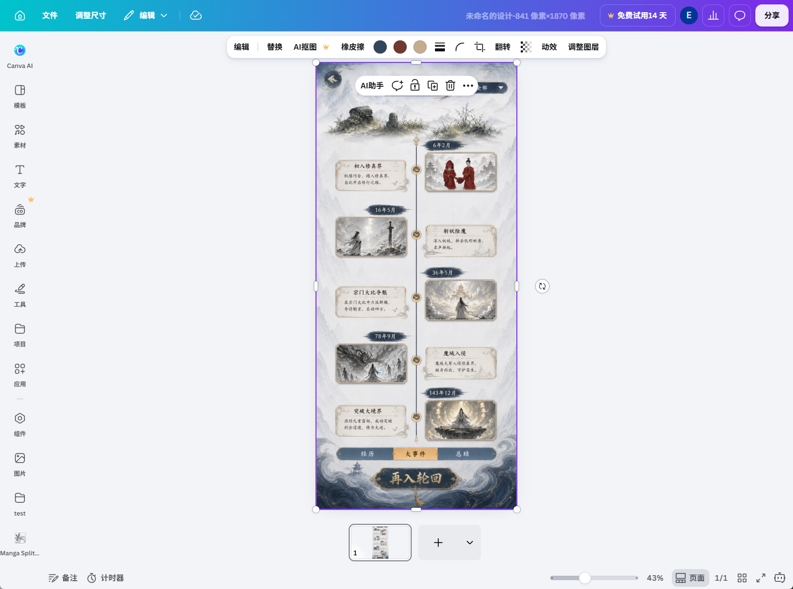

# UI 设计编辑器：原界面基线与开发约束

更新：2026-10-11。本文与[主方案](ui-design-platform-integration.zh-CN.md)、[交接文本](ui-design-platform-handoff.zh-CN.md)共同约束实施。用户要求原代码保持不动，将已有代码复制形成新系统后再二次开发；以当前完整 AI 图层编辑器源码、功能和业务逻辑为整体基线；默认继承全部原可用功能，再增量实现新需求。界面、图层、选择、编辑、通信与存储只是其中的重点，不是有限保留清单。前后端细节见[复制架构](ui-design-copy-architecture.zh-CN.md)，实际证据见[源码调研](ui-design-reuse-research.zh-CN.md)。

## 1. 用户提供的视觉基线

原图由用户于 2026-10-11 提供，1433 × 1066 像素，原样归档，未裁切或改色。文件 SHA-256：`dc9d50c68b95e99960e607be2ced0d83c5e3c512a04ef9db1b2bff66db20387b`。

截图固定了界面方向，但只展示一个选中图片的状态。中央游戏画面属于设计内容；设计名称、841 × 1870 的稿件尺寸、43% 缩放和账号信息都不是新产品必须硬编码的常量。未展开的图层面板、菜单和文字编辑状态需要从原应用与源码继续核对，不能凭这张图自行设计。

| 区域 | 截图可确认的原界面特征 | 新窗口的实施要求 |
| --- | --- | --- |
| 顶部全局栏 | 青蓝到紫色渐变，首页、文件、调整尺寸、编辑、保存状态、标题及分享等区域 | 沿用原组件、排列、图标和样式资源；标题、保存与业务动作接入新会话 |
| 左侧导航 | 窄图标栏，带文字的 AI、模板、素材、文字、上传、工具、项目、应用等入口 | 沿用导航组件与面板展开方式；审计截图中的内置入口与用户安装项，不把全部项目硬编码成新产品导航 |
| 编辑工作区 | 浅灰背景、居中的画布、原有留白和滚动/缩放布局 | 沿用工作区布局和视口计算；支持不同画布尺寸与窗口大小 |
| 上方上下文工具栏 | 白色浮动圆角工具栏，内容随选中对象变化 | 使用原工具栏组件、选择状态和样式；操作沿用副本原生模型、命令和历史 |
| 对象浮动工具栏 | 选中对象附近的操作浮层 | 沿用定位、层级、图标、菜单与交互，不用另做的固定属性栏替代 |
| 选择与变换反馈 | 紫色轮廓、尺寸控制点、旋转手柄 | 保留原选择与命中反馈；保留原已支持变换和原生保存；标准发布/目标导出的限制单独报告 |
| 页面区 | 画布下方的页面缩略图、页号、添加入口 | 沿用原页面组件与布局；页数与操作按原实际可用能力保留，必要时扩展标准桥接 |
| 底部状态与视图栏 | 备注、计时器、缩放滑块、百分比、页码及视图控件 | 沿用原布局、样式与已支持视图行为；业务能力逐项标明 |

原图中的试用、分享、AI 与账号入口不证明新业务已具备相应权限或服务。保留组件的视觉结构，依据实际能力绑定、禁用并说明原因，不能展示可点击但无效的保存、分享或收费操作。禁用应使用原组件的状态样式，不能因此另造一套工具栏。不能仅因实验契约 0.1 只支持固定二维，就禁用原已可用操作；原生草稿保持，标准发布按实际桥接能力报告。

## 2. 代码复用边界与当前认识

除标有 `Server/` 的条目外，下列路径均相对于 `MagicGameClient/`，是已核对的接入线索；它们不是完整样式映射或已通过的可行性结论。

| 来源 | 已确认职责 | 下一步必须核对 |
| --- | --- | --- |
| `src/business/development/home-magic-layers/` | 主页媒体选择、创建意图和进入原生编辑器 | 复制新入口及导航；这个目录不包含完整编辑器界面 |
| `src/business/development/ai-layer-tasks/` | AI 任务、原生图层插入、选择有效性、事务与回滚 | 选取必要业务模块，替换任务与结果接入；仅复制此目录不能得到原界面 |
| `src/shared-runtime/editor-core-current-0cdd-esm/` | 当前维护的原生编辑核心与视图依赖 | 顶栏、左栏、上下文工具栏、选择、页面、缩放的实际组件、初始化与命令端口 |
| `src/shared-runtime/editor-current-b29e/` | 核心依赖的原生宿主基础与初始化链 | 完整壳启动所需依赖、状态、样式载入和服务端口，哪些副本可原样使用、哪些需产品私有适配 |
| `src/app/source-runtime/editor-document.ts`、`editor/session.ts` | 原生文档壳、设计身份和 bootstrap 载入校验 | 沿用壳结构和视图启动方式，复制原生文档加载与保存服务绑定，标准通过后续 bridge 接入 |
| `tools/client-build/`、`tools/admission-window/` | 资源装配、发布清单、窗口与请求许可 | 原 CSS、图标、字体、懒加载资源到正式新 profile 的完整映射 |
| `Server/.../NativeEditorShell.java` | 原生编辑壳模板与实时 bootstrap 组装 | 原编辑器视图依赖的模板、样式与数据；装载新产品原生持久数据、固定依赖及语义；旧表和路由保持 |

`editor-layout/implementation`、`editor-text/implementation` 中的布局/文字辅助实现，以及可以单独调用的原生绘图函数，都不能代替完整编辑器界面。服务端 `magiclayer/panel-inject.js` 的“魔法黑板”浮层也不是这张图的编辑器壳；不得将它或另一开发线的 `game-ui` 当成界面基础。

将产品所需完整入口、壳、组件/样式/资源、基础运行时、图层/选择、事务与通信实现固定复制到新产品范围；记录来源、混合源码状态、依赖与差异，使用自己的构建、装配和发布标识。未完成翻译的必要资源固定可用字节，不用猜写替代实现。不得覆盖旧产品资源或通过同一个全局资源 URL 偷换两份不同字节。

## 3. 先完成原能力副本，再接入标准桥接

### P0-B0：原代码、样式和二次开发可行性审计

先建立覆盖完整原客户端所有入口、面板、设置、业务流程与对应服务的功能目录，默认原样继承；再交付可核对审计，至少包含：

1. 原 AI 入口到完整编辑窗口的调用链、实际源码版本、必要未提交输入的路径/hash、构建与运行条件。
2. 上述各界面区域的组件/符号、文件、样式资源、图标/字体、状态来源、事件/命令端口和懒加载依赖。找不到的明确记为待查，不用猜测的文件名补齐。
3. 同一视口、系统缩放、主题、字体和素材就绪条件下的原应用截图与交互记录：未选中、图片选中、文字编辑、图层/位置面板、菜单、缩放；多选等支持状态逐项核实。
4. “副本原样使用 / 复制后改产品绑定 / 原无服务或权限 / 尚未定位”的逐项表；重点核对图层树与画布选择、拖动、IME、原 Undo、通信、保存与重开所需依赖，不能拆掉它们另做。
5. 具体可行性结论及阻塞点：说明能保留哪些原组件、要接哪些端口、如何验证。单独渲染图片/文字成功不算完整界面二次开发可行性通过。

本轮已补充核心/宿主/翻译状态、图层面板候选、原生插入与选择、HTTP/WS 和服务端 baseline/delta/回执/素材链的静态调研；完整组件/CSS/依赖闭包与实机基线仍未通过，不能据此声称原界面已成功移植。依赖困难时继续定位原实现与最小必要依赖，不能退回自制编辑器界面。

### P0-B1：原界面复用与视觉对照

在独立入口、窗口和 profile 中运行来自原源码的完整编辑器壳，使用受控样例和隔离会话，保持原布局、浅色工作区、渐变顶栏、左侧导航、浮动工具栏、图层面板与选择联动、页面区和缩放区。此阶段尚未接通的写操作禁用，不调用旧保存链。

验收同时需要源码来源和可见效果证据：

- 保存原应用与新窗口在相同条件、相同选中状态下的成对截图，并逐区域核对组件、尺寸、间距、字体、颜色、阴影、层级和面板行为。
- 固定原应用运行基线后记录可复现的区域截图差异；动画、光标闪烁、账号/标题等动态内容单独说明。不能通过遮掉整个工具栏、换主题或大幅放宽差异范围来宣称一致。
- 提供源码/资源清单与新构建指纹，证明真实使用原组件和样式；新写 HTML/CSS 仿出近似外观也不算完成代码复用要求。
- 用户提供的截图用于方向和结构核对；像素检查以受控的原应用对照为准，不能把不同画布内容与尺寸造成的差异误判为壳差异。

本门槛尚未通过。首个可审阅交付应是原界面的独立窗口与对照证据，不是新的编辑器视觉方案。任何保留不下来的区域都要作为失败/待修复列出；新增功能只能使用原有组件体系和扩展位置，不能借机改成深色界面或固定三栏布局。

### P0-B2：副本原能力、通信与持久化闭环

通过 B0/B1 后，接通复制来的原生编辑、事务/Undo、HTTP/WS、上传、baseline/delta、回执和重开服务。使用私有路由、`ui_design_*` 业务表及独立配置；公共身份/项目/资产底座依明确边界复用。原生模型是唯一可变编辑状态，不接第二套标准 session/history。

逐项对照原图层列表与画布选择、多选、显隐/锁定、拖动/尺寸、文字/中文 IME、换图、排序、复制删除、Undo/Redo，以及上传、保存确认、断线重试、关闭/主页重开和服务重启后恢复。这些是重点路径，完整基线仍须逐项通过原全部可用功能目录。每轮核对组件、样式及实际请求；新产品不写旧 baseline/Ripple/job，但完整使用复制来的相同机制。

### P1a/P2a：标准桥接与发布

在原能力闭环后接稳定 ID、UI 语义、标准导入和固定 checkpoint 的标准投影。元数据必须参与原事务、撤销、重开和复制；标准发布生成不可变修订和正式回执，不成为另一份独立编辑正文。原可用能力保留，标准不足时扩展 bridge/契约，不能用禁用原能力代替适配完成。

## 4. 已有成果与偏离处理

P0-A 契约、插件离线规范/预检，以及标准作者会话和命令测试可以保留，其中旧标准会话/命令仅作测试与语义参考，产品使用复制来的原生模型/历史；契约和预检作为 bridge 基础。它们没有决定界面外观，也没有证明 P0-B 通过。

2026-10-11 的自制预览采用了自建工具栏和面板；用户已明确指出其与目标不同。该预览是未通过的技术实验，不能作为产品界面基础、发布入口或 P0-B 验收成果。其原生绘图/输入探针只能作为独立技术线索记录，不能把测试数量折算为界面复用通过。当前相关未提交实验文件保留在施工工作树，本次文档修订不将其提交为正式实现。

当前先完善静态调研与架构；实施前补齐 B0 运行基线、完整依赖和 clone map，再依次 B1 原界面、B2 原能力持久化、P1 标准桥接。GPT 插件工作仍属于计划：保留已实现的离线能力，在线授权、上传、提交与回执按 P1/P3 接入，不以插件进展替代客户端界面门槛。
