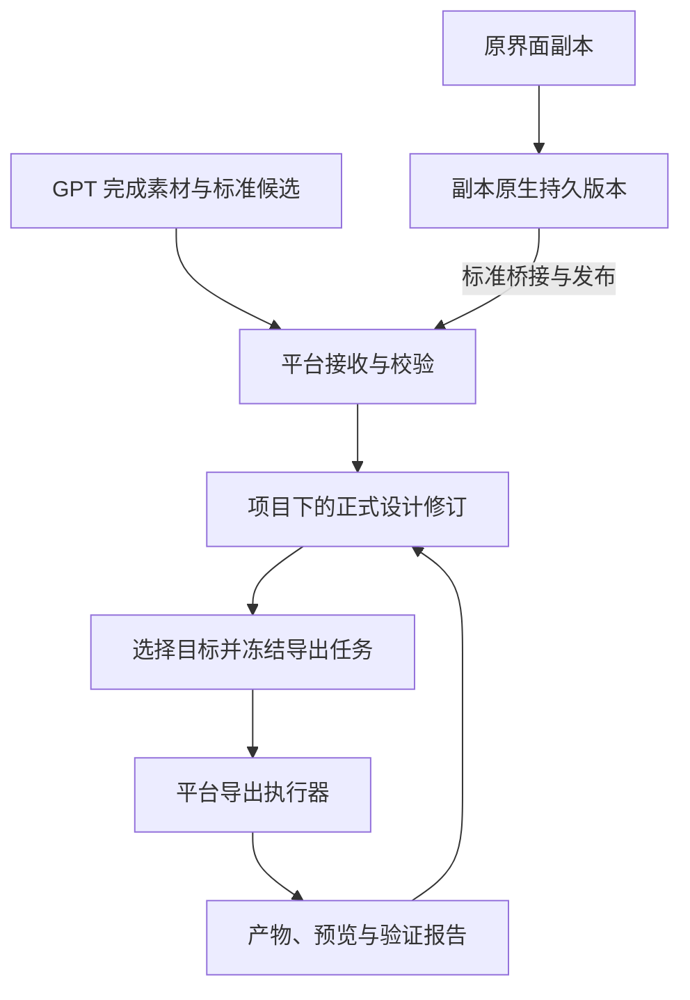

# UI 设计平台：复制 AI 图层编辑器客户端与服务器的实施方案

2026-10-12 标准主线进展：平台提交 [`fd2ed9a897`](https://github.com/bambom/GameMagicTool/commit/fd2ed9a897762c5cc12d4feae93be39d9653950c) 已实现完整候选在线接收：以 request UUID 幂等开始，固定当前 native checkpoint 与标准版本，不可变绑定文档/清单，按 hash 和长度保存真实文件，查询逐文件状态并支持取消。插件新增在线协议及 submission begin/status/upload/cancel 工具；上传只读取工作区文件，先全包校验，再补传缺失文件。共享包升级为 0.2.0，作者标准 0.1.0 摘要不变，独立在线接收协议为 1.0.0。59 项共享契约检查、14 项插件检查、2 项真实接收集成和 3 项标准在线集成通过；真实插件 8 文件上传、1+7 续传及重复零上传已有证据。BUNDLE_STORED 仅表示字节留存，`submitted=false`、`published=false`；原生桥接、视觉校验、正式提交和回执继续实施。见[在线接入与证据](https://github.com/bambom/GameMagicTool/blob/fd2ed9a897762c5cc12d4feae93be39d9653950c/docs/ui-design/STANDARD-INTEGRATION.md)。停止独立基线推进。

## 当前优先级（2026-10-12 用户修订）

主线为平台统一标准与插件在线提交。停止持续开展原功能基线验收；完整源码和已有功能保持，只有实际阻塞这条主线时才处理相关基线问题。未验项目保留为后续按需事项，不作为 P1/P2/P3 开发的统一前置门槛，不宣称 B2 全部通过。

接下来按功能批次推进：共享规范在线发布与原生 checkpoint → 标准桥接、稳定语义和正式修订 → 插件受限授权、真实素材上传、在线提交与正式回执。每批先完成多项实现再统一验证。标准提交失败必须保留原生草稿，原生 ACK 不等于标准发布成功。

2026-10-12 实施进展：最新平台提交 [`3e3b53a2e1`](https://github.com/bambom/GameMagicTool/commit/3e3b53a2e19c5b49e3b26adbbf02d4e6c282c12d) 已按“多项实现后统一验证”完成文字预设、公共设计类型查询/解析与品牌摘要组合投影这一批：48 项模块检查通过，原生窗口/数据库场景七项通过。原生标题插入、撤销、重做和重开保留真正的文字元素，与矢量形状合计六条增量及六条回执；查询、预览及跨团队拒绝有接口证据。此前收藏持久化/并发去重、图片上传插入、文字/位置/字体的 JVM 重启恢复已通过。完整 B2 功能对照尚未完成，现按用户要求暂停持续推进，部分公共规格、原站素材/特效目录与品牌能力策略仍有缺口；标准 checkpoint、GPT 在线链和导出尚未验收。见[运行证据与功能对照](https://github.com/bambom/GameMagicTool/blob/3e3b53a2e19c5b49e3b26adbbf02d4e6c282c12d/docs/ui-design/NATIVE-RUNTIME-ACCEPTANCE.md)。

初稿：2026-10-10。当前修订：2026-10-12，按用户“原代码不动、复制可用实现后在新系统二次开发”的要求完善客户端与服务器架构。

本轮已做[源码与服务端调研](ui-design-reuse-research.zh-CN.md)，形成[复制式二次开发架构](ui-design-copy-architecture.zh-CN.md)与[来源观察清单](ui-design-source-audit-2026-10-11.json)。P0-A 契约、插件离线规范/预检和实验会话已有实现；自制预览未被接受，旧实验会话/历史不作为产品基础。该次静态调研没有实施副本系统；随后实施结果见本文开头的最新进展。

执行顺序为 R0/B0 来源与依赖 → B1 原界面/图层/选择副本 → B2 复制通信和持久化闭环 → P1a/P2a 标准桥接与正式修订 → 完整接收、GPT 与导出。[执行交接](ui-design-platform-handoff.zh-CN.md)同步本次架构；旧 SQL、标准 session 替换原生历史等设计不再作为实施依据。

## 实施与验证节奏（2026-10-12 用户要求）

按功能批次连续实现多个任务，再统一编译、测试和集成验证，减少小步骤验证对推进速度的影响。

- 每批开始列出多个具体功能项、完成条件和受影响范围；完成这些实现后再进入统一验证，不把每个文件、接口或小改动都拆成测试轮次。
- 批内以源码、协议和调用链核对推进。只有阻塞后续实现、必须通过运行结果才能决定下一步的问题，才提前做最小范围验证。
- 批末统一执行一次覆盖本批改动的编译、定向检查及必要的原生界面/持久化回归；不因合并验证而降低原有验收门槛。
- 验证发现问题后集中修复，再重跑受影响检查；已通过且未受后续修改影响的检查不重复，跨批复用仍有效的证据。
- 进度按“本批已实现、待统一验证、验证结果、下一批任务”记录。未测试的实现明确标为待验证，通过后统一提交并更新证据。

原生多页、组合/解组、复制/删除及保存重开批次已经通过一个集中场景、15 次持久事务；不再安排后续独立基线批次。下一批转入规范在线发布、原生 checkpoint 与标准/插件接入。

## 1. 产品与复制边界

**以当前完整 AI 图层编辑器产品的源码、客户端功能和业务逻辑作为开发基线，复制后增加新需求，原代码保持不动。** 默认保留其全部可用功能及对应服务端链路。界面、图层、选择、编辑、Undo、通信和存储只是关键例子，不是从原产品中筛选出的有限保留范围；不抽取部分能力重新组装编辑器。

首页新增独立“UI 设计”入口。原 `magic-layers` 按钮、窗口、任务与保存流程保持原用途；不给旧业务增加一个 mode。新产品登记在独立装配副本和清单中，不能以“只加注册”为由修改原源码。

顶栏、左栏、浅色工作区、浮动工具栏、图层树、选择反馈、页面与缩放使用复制来的组件和样式，见[原界面基线](ui-design-editor-baseline.zh-CN.md)。新语义、候选、修订和导出功能使用原组件体系与扩展位置。

设计仍属于现有平台账号、团队与项目。产品所属前后端业务复制并隔离，公共身份/项目事实和存储基础设施不另造第二套数据；新设计有独立产品记录和项目关联，在新主页装配副本中按显式 kind 与旧设计共同展示。

`MagicGameClient/src/app/game-ui` 和服务端 gameui 是另一开发线，不作为本次基础。FGUI 只是平台未来输出目标之一。

| 工作 | ChatGPT / GPT 插件 | 客户端、Server 与平台 worker |
| --- | --- | --- |
| 规范 | 读取确切版本、样例和能力 | 维护共享契约、bridge、发布版本与符合性 |
| 设计、拆分、补全、小图、文字和 UI 语义 | 完成整稿与原尺寸拼接，记录来源/假设/字体 | 接收真实材料，保留并校验 |
| 图层显示、选择、编辑、通信和保存 | 不替代客户端实现 | 复制原 AI 编辑器可用链路后适配产品绑定 |
| 正式设计、素材、历史与权限 | 保留准备暂存与平台回执 | 平台唯一正式维护；原生持久状态与标准修订明确绑定 |
| PSD/FGUI 等 | 新流程不在插件生成 | 平台按固定正式修订按需导出和验证 |
| 本机目录交付 | 可下载平台结果 | 桌面端或本机交付端写入指定目录，路径不混入作者格式 |

## 2. 真实源码与服务链调研

观察来源为原工作树 `codex/replay-storage-fixes-20260918`，HEAD `78aef8f75f6ccf092a1d4f05184595dd05e9dc8f`，但选定范围仍有未提交项。54 个文件的工作树 hash、清单状态和 3 个实际构建产物的核验见来源观察清单；它不是全部依赖闭包，也不是运行验收。

### 2.1 客户端源码形态

- 当前正式核心是 `src/shared-runtime/editor-core-current-0cdd-esm`，240 个 ESM / 14,650 单元；保留有序初始化与宿主端口。
- `editor-current-b29e` 是公共宿主，230 个定义文件 / 17,883 有序单元，仍按共享脚本装配；不能随意拆成独立初始化。
- 业务登记在观察清单采集时已有 452 个单元（当前发布 catalog 为 450 个，源码与发布尚不完全一致）；client-programs 有 15,261 条，15,251 ready、10 blocked。维护 JS、具名 TS、准入 TS 与待恢复资源并存，数量不是功能完成率。
- 旧 `dist/client` 与当前 `client-current.json` 指向的不可变发布目录不同。复制必须绑定源码、profile、发布包、样式/字体和懒加载资源，不混用不同阶段。

### 2.2 图层、选择与编辑已有实现

主页 `home-magic-layers` 的选图、尺寸和创建导航进入完整编辑壳。`ai-layer-tasks` 是任务与结果应用链，不是完整界面。

`insert-native-layers.ts` 使用原反序列化、页面转换、素材导入、引用归一化、集合插入与失效回滚，并进入 `__c.itb(presenter.undo, ...)` 原生事务；`present-layers.ts` 调用 `presenter.le.Yp(...)` 选中结果。图层/位置面板候选 `client-programs/editor/lazy/35cebe4e3e65eb87.ts` 含真实面板/菜单/重排线索，其产物已在当前发布 catalog 中核验；具体运行链和样式映射仍需补齐。

完整图层列表、缩略图、嵌套展开、画布/列表选择联动、多选、层序、显隐/锁定与右键必须整体复制保留，不能用 AI 输入选区适配或自制 selectedIds 列表替代。

### 2.3 通信和服务器保存已有实现

RPC 工厂保留原 designgeneration 方法与 codec；source-runtime 处理壳、身份、实时文档和创建转交；`NativeEditorShell` 使用真实账号/设计/字体/媒体组装原 bootstrap。

保存链为原 HTTP/WS → `NativeRippleReceipts` / `StreamRippleDeltaService` → baseline + 不可变 delta → `StreamRippleReplicaService` 重开重放 → checkpoint/资产引用。上传、媒体读取、共享导入、字体、路由和任务结果持久化也有原实现。详见调研第 4–5 节及架构第 4–5 节，不重新写全量 JSON 覆盖保存器取代。

## 3. 客户端与服务器架构决策

### 3.1 原源码不动，副本有独立装配

客户端拟以 `src/products/ui-design/upstream/` 固定完整 AI 图层编辑产品的 business、core/宿主、client-programs、source-runtime、全部相关 profile/懒加载模块、样式及资源依赖闭包；扩展在 `app/` 与 `standard-bridge/`。复制构建/宿主工具并用私有清单，发布到 `dist/ui-design-releases/`，只推进新指针。

服务端拟以 `uidesign/nativecompat/` 复制必要 web/protocol/stream/media/magiclayer/design 实现，包含 entity/repository、直接 SQL、包内 helper、事务、回执和配置；以新 Bean/路由和独立产品表装配。公共账号/团队/项目和通用资产存储经明确边界调用，原代码不改。

每项来源记录 hash、翻译/准入状态、module/unit/selector、映射副本、资源及补丁。未完成翻译的必要兼容字节可以固定保留，需要修改时先在副本完成最小恢复和对照。上游翻译按“旧来源基线 / 新上游 / 产品副本”三方合并，不能自动覆盖或读取原工作区的最新状态。

### 3.2 保留原生模型、选择和单一 Undo

副本继续使用原文档模型、图层组件、selection store、变换、IME、事务/Undo/Redo 和保存协议。已有实验 session/reducer/projection 仅作语义和变更验证参考，不成为第二套编辑/历史。

标准 UI 语义和稳定 ID 必须随原生事务、撤销、保存、重开与复制保持；先验证 codec 的扩展位，必要时只扩展副本模型/协议。不能假设内存 Map 或 DOM 属性能够保存语义。

### 3.3 原生持久化与标准正式修订

复制原 RPC/codec、任务状态机、HTTP/WS、断线重连、回执、baseline/delta 和重放，在产品装配处绑定私有路由及新表。未映射写请求失败，不能自动回落旧接口。

原生持久草稿是单一编辑模型的持久状态。标准正式修订是绑定准确 native sequence/checkpoint 的不可变投影，用于 GPT、校验和导出，不是另一份可独立编辑或撤销的正文。候选接纳经 bridge、原导入/事务及服务端重放验证；实际原生变更、语义、标准修订、依赖和正式回执在有版本条件的业务事务中一致登记。

bridge 的执行环境、受控 worker、原生 codec 验证、标准发布失败与并发处理见架构第 6 节；不能将原绘图函数误认为已经独立的 SDK。

### 3.4 项目与生命周期

复制设计业务到 `ui_design_record` 及独立 ACL/项目关联；旧设计继续原记录。公共账号/团队/项目共用，新主页/目录装配副本合并摘要并按 `(kind, record UUID)` 导航，双方 handler 只解析各自产品身份。

改名、移动、复制、回收/还原、分享、封面、重开均复制对应业务后改产品绑定；原生文档、标准修订、语义和素材/字体依赖一起处理。保留原权限、锁与业务墓碑，不把协作者编辑权限当成生命周期所有者权限，不级联删除共享素材。

## 4. 平台维护的统一标准

建议采用独立命名的、版本化的 UI 设计标准；名字不带 FGUI、PSD 或某个编辑器内置类型。当前插件 `Scene schemaVersion: 1` 是旧工具输入，不能简单改名就当作新平台协议。

平台应同时发布机器可读 Schema、中文语义说明、完整示例、限制、兼容策略和校验案例。客户端、Server 接收端、执行 worker 与 GPT 插件固定同一规范版本和内容摘要。Java 服务端与 TypeScript 生产/编辑端至少共享同一组正反向符合性案例；生成与校验不能因语言不同各自解释坐标和默认值。

| 标准领域 | 首版必须表达的内容 |
| --- | --- |
| 身份与来源 | 稳定设计/组件/节点/素材 ID，原图与批准定稿引用，来源、拆分/重建标记 |
| 画布 | 原始宽高、方向归一化、颜色空间、像素单位、左上原点 |
| 素材 | 原尺寸/高清 master、实际使用版本、真实 RGBA、裁切偏移、hash 与版本引用 |
| 层级与布局 | 容器、局部坐标、尺寸、轴心/必要变换、有序子节点、裁剪；全局矩形为派生结果 |
| 文字 | 真文本、字体引用、字号、颜色、描边、行高、对齐、换行和自动尺寸策略 |
| 组件与实例 | 可复用定义、稳定实例、实例属性覆盖、部件引用 |
| 控件 | 图片、可替换图片槽、文字、输入、按钮、Slider、Progress、List、Scroll、Combo 等真实语义 |
| 状态与交互意图 | 默认状态、数值范围/当前值、部件角色、已知事件意图及未绑定说明 |
| 目标信息 | 版本化目标覆盖/扩展，与通用核心分开；未知字段按覆盖能力保留 |
| 证据和待确认项 | 识别依据、补全标记、假设、字体替代及未定义业务行为 |

已实现的契约 0.1 先覆盖固定 2D 画布和有限控件子集；这是标准桥接起点，不是复制编辑器的能力上限。原本可用的多页、变换和图层功能仍由复制来的原生模型保存，按实际需要扩展标准与 bridge。复杂响应式约束、任意原生扩展和所有引擎控件，不因在 Schema 中出现一个名字就视为支持。普通文字不能因为素材是 PNG 就降级为图片，逻辑 Group 也不能误作坐标父容器。

素材逻辑 ID 表示同一个资源槽位，内容 hash 表示某版真实字节。换图保持逻辑身份并创建新内容；文件名和 hash 都不能作为节点永久 ID。进度填充保存完整最大皮肤和当前数值，不能仅提交当前短条。被遮挡的底板必须补全并标为重建；透明 PNG 的 alpha 存在本身不能证明底板没有旧文字或棋盘格。

原始上传字节保持不变。若方向元数据需要归一化，另存工作图；标准画布与工作图绑定，记录其与原文件的关系。普通透明文字参考图、`ui_semantics.json`、位置清单与总览均从同一正式标准修订导出；该修订绑定确定的原生持久版本与语义，不成为第二套可分别编辑的语义/坐标真值。

### 4.1 P0-A 必须交付的可执行契约

平台仓库维护一份契约源，客户端、Java 服务端、渲染器和插件读取有版本与摘要的同一发布物；不能四端分别手写一份相似格式。P0-A 需选定包的实际路径、分发方式与版本规则，记录在包内说明中。以下名称为交付建议，实施时可以按仓库约定调整：

| 交付物 | 必须固定的内容 | 通过条件 |
| --- | --- | --- |
| `authoring.schema.json` 与中文语义说明 | 节点/定义/实例/素材身份，字段类型、缺省与 null、引用、局部坐标、层序、裁切、文字、状态及扩展 | 完整样例通过；悬空引用、循环及不支持能力被定位拒绝 |
| `capabilities.json` | 分开声明可保存、可编辑、可渲染、可导出能力；列明控件、样式、变换及限制 | 不以枚举存在或保留原始字段宣称功能已支持 |
| `commands.schema.json` | 按稳定 ID 寻址的标准变更、作用域、前置条件和修改范围；用于候选、桥接与符合性 | 实际界面操作仍进入复制来的原生事务和 Undo；标准命令不能另立第二套历史，数组位置不充当身份 |
| 提交 API 契约与数据库迁移设计 | 第 6 节接口的请求/响应、错误码、版本条件、状态迁移、唯一约束和锁顺序 | 客户端与服务端以同一请求/回执夹具联调，不依赖口头字段约定 |
| 稳定序列化说明与 hash 向量 | UTF-8 字节、属性排序、数组顺序、数值/负零/精度、Unicode、缺省值及规范化时机；正文/manifest/spec 各自摘要范围 | Java/TypeScript 对相同夹具产生相同规范字节与 SHA-256；拒绝重复键及非法数值 |
| `fixtures/` 与符合性执行入口 | 正向完整设计、非法设计、命令前后状态、合并冲突、规范字节与预期摘要 | Java/TypeScript 两端均可执行；报告固定契约版本、输入与结果 |

P0 的最小样例必须包含嵌套容器、带透明裁切偏移的真实 RGBA、固定字体的真实文字、一个按钮定义及两个实例（其中一个含覆盖）、隐藏状态和需保留的目标扩展。它用于证明核心路径，不替代全部控件覆盖。P0-A 同时定义首版 Button、Input、Slider、Progress、List 的必要部件、默认状态、数值/文本规则和合法/非法案例；完整编辑与渲染能力在 P2 补齐，未完成项不能对外宣称可编辑。

布局首个验证范围为固定 2D 像素画布、左上原点、嵌套局部坐标和轴对齐尺寸；P0-A 必须明确子坐标是否随容器尺寸变化、裁切/透明度的继承、图片适配、文字测量和组件/实例/状态覆盖顺序，并给出数值案例。0.1 的标准投影不支持旋转、斜切、响应式约束等能力时，发布/导出明确报告限制；原编辑器已可用的功能仍保留原生草稿，不静默烘焙或丢弃。正式宣称标准支持前须升级契约和 bridge 并增加案例，不要求重新实现原布局系统。

兼容策略必须区分可保留的未知扩展和无法解释的核心版本。前者在未触及范围完整保留并限制可能破坏引用的操作，后者不得以旧 reader 写回。每次契约调整更新版本/摘要与符合性案例；所有消费者升级后才能启用新能力。

## 5. GPT 应提交的完整结果

下表是提交清单，不要求 HTTP 必须采用 ZIP。支持分文件上传时，平台可以在最后再提供可下载标准归档。

| 建议文件/角色 | 内容 |
| --- | --- |
| `manifest.json` | 提交、设计、基线、规范版本/摘要，文件角色、逻辑素材 ID、相对路径、长度和 SHA-256 |
| `design.json` | 符合平台标准的完整作者候选或有明确范围的变更 |
| `original/` | 原始参考图及其他用户材料，保留原字节 |
| `approved/` | 本次实际采用的完整定稿；与原图相同时可引用同一内容 |
| `assets/` | 拆分/补全后的独立 RGBA；未裁断主素材、高清源及实际使用版本 |
| 字体引用或 `fonts/` | 平台已有字体固定版本，或实际字体文件及许可信息 |
| `preview/reconstructed.png` | GPT 按标准布局完成的原画布尺寸拼接 PNG |
| `preview/assets-overview.png` | 全部散图总览 |
| 派生清单 | `ui_semantics.json`、局部/全局坐标、文字字体、部件和状态映射 |
| `provenance.json` | 拆分与重建来源、假设、未确认业务、人工/模型处理记录 |

**PSD 和 FGUI XML 不再是 GPT 提交物。小图、语义、统一布局和拼接 PNG 仍是必需工作。** 原始输入若本来是 PSD，可以作为来源附件保存，与“插件生成 PSD”是不同的文件角色。

平台根据收到的完整素材和标准文档独立重建预览，核对 GPT 提交的拼接结果。这是接收校验，不是让平台重复图片理解、补全美术或重新猜坐标。平台必须能获得真实持久素材；聊天临时链接、过期 URL 或模型声称已生成的文件名不能作为完整提交。

## 6. 平台与插件的提交协议

以下接口为拟新增设计，不是当前已存在的 Server API。推荐平台提供一套 HTTP 领域接口，MCP 工具转发相同操作，不在 MCP 内另做一套保存协议。

| 建议接口 | 用途与关键约束 |
| --- | --- |
| `GET /api/ui-design/v1/spec` | 返回确切规范、摘要、示例、素材/字体限制、兼容能力；支持按版本读取 |
| `GET /api/ui-design/v1/context` | 有界返回当前有权使用的主页项目/目录、目标设计及字体/素材目录；以现有领域服务为基础，不让 GPT 解释原生二进制列表协议 |
| `POST /api/ui-design/v1/designs` | 绑定现有主页项目/目录上下文，创建设计登记、持久类型和正文容器；幂等 |
| `GET /api/ui-design/v1/designs/{id}` | 返回有权访问的正式修订、素材引用、编辑范围与接收能力 |
| `POST .../designs/{id}/submissions` | 建立提交草稿，固定 baseRevision、specDigest、幂等键和编辑范围 |
| `POST .../submissions/{sid}/files` | 声明文件清单，返回该设计上下文可复用内容与需要上传的对象 |
| 文件上传/完成操作 | 实际传输、完整解码、长度/hash 检验；支持受限断点续传；完成前不可正式引用 |
| `PUT .../submissions/{sid}/candidate` | 写入候选正文与清单，带草稿版本前置条件；编辑内容后旧验证失效 |
| `POST .../submissions/{sid}/validate` | 运行服务端接收校验，返回绑定准确候选摘要的报告 |
| `POST .../submissions/{sid}/commit` | 对准确候选/清单/基线/验证执行版本检查，形成正式修订并返回可查询回执 |
| `GET .../submissions/{sid}` | 查询上传、校验、冲突、已保存修订及真实回执；断线后可恢复 |
| `POST .../designs/{id}/exports` | 平台界面选择某修订、格式和目标配置，建立独立导出任务 |

平台可以把候选提交、验证和 commit 包装为连续执行操作。这里的 commit 是有版本检查的数据操作，不额外增加一轮人工许可。已有设计发生同字段冲突时才需要保留两项候选并解决真正的歧义。

### 6.1 完成状态和重试规则

上传完成、文件校验通过、候选设计校验通过、正式设计保存成功、目标产物生成成功是不同状态。只有收到平台正式回执，GPT 才能报告“已保存到平台”。

回执至少包含真实 designId、submissionId、draftVersion、规范版本/digest、baseRevision、mergeHeadRevision、committedRevision、nativeCheckpoint/nativeSequence、bridgeVersion、submittedDocumentHash、submittedAssetManifestHash、committedDocumentHash、committedAssetManifestHash、validationId、分层检查结果、警告与设计打开地址。`baseRevision` 是生产者读取的版本，`mergeHeadRevision` 是合并采用且提交时再次核对的服务端 head。候选与最终保存内容可能因合并或规范化而不同，不能共用一个含义不明的 documentHash；接口如提供该别名，只能明确指向 committedDocumentHash。若平台规范化或映射了客户端临时 ID，必须在回执中返回映射；节点稳定身份不能每次重试重新分配。

上述 native/bridge 字段属于下一版共享契约，当前 0.1 离线工具尚不提供。复制原生保存的 ACK 只证明草稿持久化，不能代替正式标准回执。

同一个幂等键和同一内容重复提交返回原回执；同一键对应不同内容报冲突。文件内容改变后使用新的内容版本，不能在旧验证结果下替换素材。验证完成到最终提交之间仍要检查基线、清单与正文摘要，避免检查 A 却提交 B。

账号、拥有者和项目/设计权限由平台已有身份系统判断。插件已连接本机工作区不自动获得 Server 登录态；实施时使用平台认可的用户授权会话或服务连接，绝不复制浏览器 Cookie、复用任意管理员身份或让模型指定 actor。

建议在现有平台账号体系内增加一次性配对的服务连接：用户在平台选择允许的设计操作和范围，插件换取并保存可撤销的受限连接凭证。现有认证中间件继续解析真实用户，新连接不新建另一套账号。若复用已有正式授权流程能提供同等能力，则直接对接；此处不是声称已实现了平台配对接口。模型只能看到连接身份、可用范围和连接状态，不能读取凭证。

授权是 P1 的接口前置决策和 P3 的端到端门槛。P0-A 记录现有登录态如何进入新窗口 API；P1 明确插件服务连接的签发/配对、凭证保存、有效期/续期、撤销、操作与设计/目录范围，以及相关 HTTP 请求的身份与 CSRF/CORS 处理。优先复用能满足这些约束的正式授权机制，否则实现上述配对方案。凭证范围与实时设计权限取交集，不以签发时有权限替代提交/下载时核权。先用现有真实用户会话完成 P1a/P2a，不用管理员身份或复制 Cookie 模拟插件授权。

### 6.2 GPT 与平台同时修改

标准 head 可能落后于用户已保存的原生草稿。合并前必须取得当前 native checkpoint 的标准投影并固定其版本；若当前能力无法无损投影，返回定位限制，不把旧标准 head 当作最新原生内容覆盖保存。最终同时核对标准 head 和原生持久版本。

例如 GPT 在 r7 开始重绘按钮图，期间用户在新窗口把按钮移到另一位置并保存 r8。提交仍携带 r7 基线和“替换此素材”的范围，平台比较 r7、GPT 候选和当前 r8，将独立变化合并为 r9。

如果双方都改变同一属性，返回定位到稳定节点/字段的冲突。不能把 `expectedRevision` 简单改成最新值后整份重发旧文档。GPT 没有读取或没有编辑权限的字段、状态、业务绑定和目标扩展必须保留；未出现在局部提交里不等于删除。

首版合并采用明确白名单：固定布局下，不改变素材逻辑尺寸、裁切、九宫格等关联属性的素材内容替换，与节点位置修改可独立合并。文字与自动尺寸、图片尺寸与九宫格、min/max 与当前值、删除与修改、定义与实例覆盖等需要联合校验；没有实现相应规则时返回定位冲突，不按“字段名不同”自动放行。P1a/P2a 先完成准确基线的条件保存与旧基线拒绝，P1b 补齐上述有限合并及验收；这不推迟首版 GPT 与平台并发的要求。

合并后的正文是新的待校验内容。以基线 B、候选 N、当前 head C 形成结果 M 后，对 M 及其最终依赖重新执行结构、语义和所需布局/重建检查。检查依据、报告与预览固定到 M 的摘要、C、规范和渲染器/字体版本。最终事务再次检查 head 仍为 C；变化时在有界重试内重新合并并校验，或返回冲突，不重用旧报告。不能拿候选 N 的合格报告批准未经检查的 M。

### 6.3 对模型暴露的工具范围

下表是建议工具职责，可沿用当前工具命名风格；不是要求模型先学习第二套标准。

| 建议工具 | 模型得到或提交什么 |
| --- | --- |
| `ui_design_spec` | 平台固定版本规范、完整样例和检查要求；记录 specDigest |
| `ui_design_context` | 当前授权项目/设计、修订、素材与字体，使用有界查询 |
| `ui_design_prepare` | 建立本机可恢复准备作业，关联平台 design/submission，检查作者候选 |
| 现有文件导入/分块上传的兼容工具 | 将真实原图、小图和字体传入准备区；完成字节检查后登记 |
| `ui_design_reconstruct` | 依据标准候选生成实际尺寸小图、透明文字参考、完整拼接与总览；不要求 FGUI target |
| `ui_design_submit` | 将准确候选和文件清单交平台，连续完成允许的校验及提交，返回真实状态 |
| `ui_design_status` | 节点/字段/素材级错误、冲突、修复范围和正式保存回执 |

图片理解与新美术生成仍由 ChatGPT 和图像能力完成，工具不会把“收到图片”伪装为自动拥有完整语义。工具说明必须要求模型先检视全稿，再拆分、补全、赋予语义、拼接核对，直到平台确认接纳；只有部分小图完成时不得报告整项流程完成。

建议接收错误返回 `code`、`severity`、`nodeId/assetId`、JSON 属性路径、实际值/预期规则和可重试条件。例如缺少 slider thumb 应定位对应组件部件；字体文件缺失应定位 font 引用，而不是返回笼统的“数据不合规”。

新建采用完整候选；修改已有设计支持限定范围的候选或领域命令。整个提交的身份与内容至少固定以下字段（占位示例，不是可直接提交的生产数据）：

```json
{
  "designId": "<server-design-id>",
  "submissionId": "<server-submission-id>",
  "specVersion": "<exact-platform-version>",
  "specDigest": "<sha256-of-platform-specification>",
  "baseRevision": "<revision-read-before-generation>",
  "draftVersion": 3,
  "idempotencyKey": "<stable-key-for-this-operation>",
  "documentHash": "<sha256-of-exact-canonical-candidate>",
  "assetManifestHash": "<sha256-of-complete-file-manifest>",
  "editScope": [
    { "entityType": "asset", "id": "asset_button_background", "operation": "replaceContent" }
  ]
}
```

这里的候选可以包含完整文档用于检查，但正式可应用修改仍受 `editScope` 和 base 的约束。重新生成一个已验证文档的不同序列化形式，需要按平台稳定序列化规则重新计算 hash；不能把 ZIP hash、JSON hash 和素材集合 hash 混为一个值。

### 6.4 接口、状态与幂等的实施约束

P0-A 固定契约，P1 实现下列状态。文件接收状态和提交状态分开；`VALIDATED` 只表示某个准确候选通过，合并结果仍受第 6.2 节约束。

| 对象 | 状态与允许迁移 | 持久化约束 |
| --- | --- | --- |
| 上传对象 | `DECLARED → RECEIVING → READY`；完成检查失败为 `FAILED`，主动取消/超时为 `ABORTED/EXPIRED` | READY 内容不可改写；记录总长度、块/偏移、hash、真实格式和存储版本；失败后按协议恢复或创建新对象 |
| 提交草稿 | `DRAFT → CANDIDATE → VALIDATING → VALIDATED → COMMITTED`；校验失败或冲突记录为 `INVALID/CONFLICT` | 提交正文和清单变化须递增 draftVersion，使旧报告失效；修复回到 CANDIDATE；COMMITTED 不可修改 |
| 放弃的提交 | 非终态可进入 `ABORTED/EXPIRED` | COMMITTED 不得被超时清理或取消；残留字节依照引用和保留策略处理 |
| 验证/提交尝试 | 每次固定 submission、draftVersion、输入摘要、基线与规则版本 | 迟到验证不能更新新候选状态；冲突、拒绝与成功分别保留可查询结果；未知事务结果先查询 |

实施 API 时必须一并给出：分页与大小上限、上传完成与候选更新的版本条件、错误结构、报告失效条件，以及草稿/文件保留期限。首版分块采用服务端 nextOffset 驱动的顺序追加；已接收块仅在偏移、长度和字节摘要完全一致时返回原结果，拒绝内容变化、重叠范围和越界写入，重启后从持久接收记录恢复。P1a 可先使用有界单次文件上传；P1b 必须完成断点恢复和重复块检查，才可通过完整 P1。

幂等键作用域固定到服务器解析的 actor、操作种类与目标身份（设计操作使用内部 ui_design_record 主键；创建设计尚无目标身份，使用 actor + createDesign + key 的唯一约束）。同一作用域/键只能绑定一个请求指纹；指纹覆盖基线、候选版本、正文/清单摘要、规范和编辑范围，创建请求的指纹覆盖规范化目录、尺寸等输入。创建参数属于指纹而非唯一键作用域，防止同一 key 换参数绕过冲突检查。数据库唯一约束负责仲裁并发请求；重试查原记录，不能只用进程内缓存。修复已尝试提交的内容时使用新的操作键，保留原尝试回执；同一成功键不得重新计算另一版结果。

数据库迁移至少约束：设计绑定唯一、文档内修订身份唯一、提交操作键唯一、上传对象/块偏移唯一及顺序追加条件、每次成功提交只产生一个正式修订。GPT 接纳事务原子写入经验证的原生变更、语义、标准修订、固定依赖、head 和成功回执；外部字节接收不在该事务中。错误响应至少包含稳定 code、对象/字段路径、可重试条件、当前候选/基线信息和查询身份；具体状态码由 API 契约固定，客户端不解析自然语言猜测下一步。

## 7. 服务端数据与事务边界

复制原设计、协议、文档、增量、回执、素材业务到 `uidesign/nativecompat`，改为产品私有路由、Bean 与表；公共账号、团队、项目事实和资产存储底座继续复用。以下均为**拟新增实体**，不是已部署表。早期 P0-A 以原 `design_record` 外键绑定新正文的 SQL 设计未部署，已被本架构替代，不得直接执行。

| 建议实体 | 保存内容 |
| --- | --- |
| `ui_design_record` 与 ACL/项目关联 | 独立产品身份、owner/team、真实项目关系与原设计授权/生命周期规则的副本 |
| `ui_design_document_baseline` / ripple delta、client、receipt、offline client | 复制原生存储与序号、事务 hash、幂等和恢复规则；原生编辑的持久真值 |
| `ui_design_native_revision` / checkpoint | 固定可重放的原生版本及语义、素材/字体依赖；沿用原 checkpoint 验证机制 |
| 标准发布 head 与 `ui_design_revision` | 不可变标准投影、native checkpoint、bridge/规范版本、精确正文/manifest hash、实际作者与合并依据 |
| `ui_design_asset_binding` / revision 依赖 | 稳定逻辑素材身份和实际公共 storage asset/version/hash；历史引用不可被换图改写 |
| `ui_design_submission` / 文件接收记录 | actor、设计、基线、候选版本、范围、幂等身份、上传/校验及正式回执 |
| 设计素材导入记录 | 来源、上传者、目标设计所属固定版本、hash 与处理身份 |
| `ui_design_export_job` / attempt / 产物 | 固定修订、执行器、依赖、租约/重试/取消、实际文件与验证证据 |

表名前缀不能替代完整隔离：entity/repository、直接 SQL、Bean 名、静态状态、后台扫描、任务目录和配置键必须一起核对。迁移复制现有产品表的完整规则，公共用户/团队/项目/asset 表不复制。新主页装配按显式产品 kind 合并摘要，原处理器不会因同一 ID 而初始化旧正文。

### 7.1 接收字节与登记精确依赖

现有 `TransferSpool`、`MediaUploadService`、`ArtifactStorageService` 和存储路由提供真实字节传输、版本、长度/hash、配额及后端定位能力；产品适配复制后使用这些公共能力。原媒体/字体上传、资源解析、固定版本读取与图层结果持久化优先保留，不能另做临时目录存储代替。

新增标准结果包的 manifest、可恢复上传会话和正式依赖登记；已有实现能覆盖的部分直接复制或调用。未完成文件只能保留为草稿，不能进入正式修订。标准引用解析器将素材、字体、原稿与预览解析到实际就绪版本，并核对用途和权限；原 `AssetReferenceExtractor` 只识别既有文档，不能假设扫描任意 JSON 的 hash 就完成引用登记。逻辑素材 ID、存储 asset/version 和内容 hash 不互相替代，知道 hash 不代表有权读取。

### 7.2 共享设计的素材归属和授权

新服务从真实平台会话确定 actor，使用**复制后的**设计服务、ACL 和 `lockForEditing` 规则锁定 `ui_design_record`。保留原设计/品牌锁顺序、owner 与显式 EDITOR 的区别；只读/评论角色不能写正文，项目成员关系也不代替设计授权。旧 `DesignRecordService` 是来源，不直接用它创建或修改新产品设计。

共享素材沿用 `NativeDesignDependencyImports` 的受限导入原则：核验上传者可访问的真实来源，在设计锁下取得实际 owner，将固定版本归档为设计可持续读取的依赖并记录来源。`WorkspaceAccess.ensureImportScope(owner)` 与 `ArtifactStorageService.preserveImported` 仍遵守真实授权和写事务前提；不能让插件指定 owner 或绕过配额。默认保存到上传者个人空间不足以保证协作设计长期可用。

读取和下载经副本设计访问规则与精确依赖校验，不向协作者开放 owner 的全部素材。上传后、正式接纳前撤权时重新核权并拒绝推进 head；已收字节依草稿保留策略处理。HTTP/WS 新路由明确装配认证、Origin/CSRF 和设计绑定，不能假定原登录过滤器自动覆盖新地址。

### 7.3 正式提交、回执与生命周期

客户端普通编辑使用复制来的 native delta/receipt 持久化；标准发布固定一个已确认 native checkpoint，投影、校验和渲染后再以版本条件登记标准修订。校验失败保留原生草稿，旧标准修订保持。GPT 接纳则先完成标准合并和原生桥接试编译/重放，再在同一设计锁和业务事务内登记实际原生变更、语义、标准修订、依赖、指针及成功回执，详见架构第 6 节。

长时间传输、解码和渲染在事务外执行；最终重新检查角色、生命周期、native sequence、标准 head、候选摘要、bridge/规范版本、报告和就绪依赖。worker 只输出候选与证据，无权直接推进 head。原生回执和标准回执身份不同，通过 checkpoint/事务身份关联，不能互相冒充。

数据库与对象存储不宣称全局原子；失败字节按引用和保留策略处理。事务结果未知时按原请求身份查询，不盲目重复创建。迟到回执只确认对应版本，不能将后续编辑标成已保存或已发布。

复制、改名、移动、回收/还原、分享和永久删除采用复制后的生命周期实现，并包含原生正文、语义、标准历史与完整依赖。保留原业务墓碑和锁，不级联删除公共共享素材；迟到任务不能复活已删除设计。撤权后拒绝继续下载，不改写此前已经接纳的内容。

## 8. 接收校验与目标验收分开

| 检查 | 平台实际检查的内容 | 结果含义 |
| --- | --- | --- |
| 文件完整性 | 长度、SHA-256、真实格式、完整解码、尺寸、依赖闭包与访问权限 | 素材确实可读、可持久引用 |
| Schema | 版本、字段、枚举、类型、允许能力与限制 | 结构符合声明版本 |
| UI 语义 | 稳定 ID、组件与实例、循环、文本/控件类型、部件和数值规则 | 数据能作为可编辑设计理解 |
| 布局与重建 | 画布、局部/全局转换、裁切、层序、比例、透明度与统一拼接 | 作者数据和所交拼接图对应 |
| 视觉审阅 | 采用定稿与重建图的漏项、错字、边缘、底板残留、字体差异 | 单独记录审阅方式与未确认项 |
| 目标能力 | 选定 PSD/FGUI 等所需特性、字体和目标 profile | 此修订是否能按所选目标生成 |
| 目标原生验收 | PSD 回读，FGUI XML/依赖、实际编辑器导入及控件交互等 | 仅报告实际执行项，不由语法通过推定运行通过 |

GPT 提供的 `confidence` 或“passed”属于生产者说明，不能作为服务器已经执行检查的证据。像素差异需要固定字体、渲染器、画布和状态；存在字体舍入差异时记录范围，不能仅靠一个统一差异阈值证明文字和 UI 语义正确。

通用设计有效与某个目标可导出分开。例如一个设计可以完成保存，而某个 FGUI 版本尚不支持其特性；导出任务明确报告该限制。业务回调未绑定和真正的结构错误也要区分，不因未知业务接口把明确控件降级为图片。

### 8.1 接收渲染器前置到 P1

标准重建与原生桥接是 P1a/P2a 的前置能力，不等 P4。固定布局/hash 校验使用共享包；原生读取/重放使用复制后的 Java 服务，涉及原客户端 codec、导入、引用归一化与文字布局时调用平台管理的固定副本运行包。若依赖浏览器环境，使用隔离无界面浏览器及同版本完整壳，输入固定 checkpoint/候选和依赖，输出映射、原生候选、标准投影、预览和报告。当前尚未证明可拆成 Node SDK，不先承诺只用 Node/Sharp 就能覆盖原渲染。

插件现有 Node/Sharp/Pango 的素材准备与标准 PNG 拼接可继续拆为独立模块；其输出必须按适用能力验证，不能替代原生 bridge 的验证。所有 worker 不驱动用户窗口、不持有用户浏览器 Cookie、不在浏览器 UI 或长数据库事务中运行。

接收检查报告区分阻断错误与警告。缺失依赖、无效结构和不支持的声明能力阻断接纳；视觉差异需保留对照图、实际测量与审阅状态，不用生产者自报 passed，也不默认逐像素必须相等。P0-A 选定并记录首版视觉差异的警告/阻断规则及样例；人工视觉审阅未执行时标记未验证，不自动增加每次保存的人工许可步骤。

已被用户编辑或服务端合并的修订应生成自己的预览。GPT 拼接图继续绑定原提交候选；不得因用户后来移动节点而要求最终修订与旧拼接图相等，也不能把候选的视觉审阅沿用为合并结果通过。合并后新增预览及其审阅状态与准确修订关联。

## 9. 平台按需导出及本机交付

导出任务固定设计 revision、document/asset hash、目标种类、真实工程 profile、字体与图片派生规则以及导出器版本。不能在任务执行时读取“当前最新设计”替换已冻结输入。



按第 8.1 节先在 P0/P1 拆出并接通引擎无关重建，再于 P4 迁入已有插件的 PSD/FGUI 输出能力，最后增添其他目标。`render.ts` 中实际尺寸素材处理、字体参考和 PNG 拼接仍可供 GPT 准备使用，也作为平台独立校验服务；它依赖 Node、Sharp/Pango 等，不能直接拷进浏览器当作 UI 代码。`psd.ts`、`fgui.ts`、目标研究及原生验证移到平台任务执行层。

任务持久化与执行需要新增标准导出领域。现有 `recovery/magiclayer/MagicLayerJobService.java` 以本机子进程和内存运行表管理 AI 任务；`ManagedLayerStorage` 可恢复输入与输出，但这不等于进程重启后已具备通用导出续跑。可借鉴 `storage/StorageCopyTasks.java` / `storage/StorageCopyWorker.java` 已实现的数据库领取、租约令牌、心跳、重试和过期执行者隔离，再为设计导出实现自己的授权、依赖冻结和发布规则。原存储复制任务要求存储管理员及相应管理权限，不能直接让普通设计用户调用它作为导出接口。

新增 worker 在短事务中领取固定任务，编码、原生软件调用与大文件传输在事务外执行，每次尝试写独立暂存结果。完成时核对租约、尝试身份、取消状态、设计生命周期、当前授权及产物 hash/长度，再登记可下载结果。失去租约的旧执行者不能发布成功，也不能覆盖新尝试的文件；重启恢复必须能区分“已有验证结果”“需重试执行”和“已取消/无权继续”。

平台导出 FGUI 时仍按实际目标源码、版本、XML 样例和导入限制实现，保留 `extention`、真实类型标签、模板/实例覆盖、九宫格中心矩形及资源 ID 规则。新窗口无需先打开 FGUI 工程才能保存或拼接标准设计。

若目标需要本机软件，由平台管理的本机执行端领取固定任务并返回真实证据；它不是 GPT 插件重新承担导出。浏览器下载使用正常下载/目录选择能力；要持续写入 `E:\...` 等指定目录，需要平台桌面壳或已配置的本机交付端。通用标准只记录产物身份，本机绝对路径保存为交付配置。

r12 导出尚在运行时用户保存 r13，r12 产物完成后仍标为 r12，不能覆盖 r13 的预览或冒充最新输出。生成、存储、下载、本机应用、原生导入、运行时交互和游戏发布分别报告。

## 10. 已有插件的迁移

以下依据已完成的 `feat/ui-production-workflow` 分支源码；这是已有分支能力，不表示当前 `main` 已合入或运行中的 MCP 已加载对应工具。

| 现有文件 | 本次改造方向 |
| --- | --- |
| [src/ui/scene.ts](../src/ui/scene.ts) | 保留语义、组件、文字与布局经验；公共部分进入平台标准，FGUI 字段下沉目标适配 |
| [src/ui/render.ts](../src/ui/render.ts) | P0/P1 先拆出不依赖 FGUI profile 的素材准备、透明文字参考、原尺寸重建和总览；P3 接插件，P4 供导出复用 |
| [src/ui/workflow.ts](../src/ui/workflow.ts) | 新主流程变为 prepare → precheck → upload → submit → receipt；不再以 FGUI target ready 作为构建 PNG 前提 |
| [src/ui/tools.ts](../src/ui/tools.ts) | 暴露平台规格、准备状态、素材传输、提交、错误修复和回执查询 |
| [src/ui/storage.ts](../src/ui/storage.ts) | 仅用于本机生产/上传恢复，关联平台 design/submission/baseRevision |
| [src/ui/psd.ts](../src/ui/psd.ts)、[src/ui/fgui.ts](../src/ui/fgui.ts) | 迁入平台导出 worker，由平台标准适配输入 |
| [src/ui/target.ts](../src/ui/target.ts)、[src/ui/native.ts](../src/ui/native.ts) | 迁入平台目标配置与原生验证体系 |
| workflow guidance、工具描述和 `skill/ui-production/SKILL.md` | 与实现同步切换到新规范；GPT 完成全部素材与 PNG 后交平台接手 |

旧作业先保留为只读兼容和显式迁移来源，不能升级插件后默默重写已交付文件。旧场景、素材、来源、ID 映射通过专门导入变成平台设计；已被游戏采用的 FGUI 包/资源 ID 必须继承已确认映射，不能因换了平台设计 ID 而重算。

## 11. 可直接拆成实施任务的顺序

| 阶段 | 具体变更 | 完成门槛 |
| --- | --- | --- |
| R0 / P0-B0：来源与依赖 | 固定源码/发布/profile、混合源码状态和全部原功能目录；补齐完整产品业务/界面/通信、服务/表及资源闭包和 clone map | 每项能力有来源、hash 与运行证据；未知项具体列出；原代码保持不动 |
| P0-B1：完整原界面副本 | 私有构建/profile 装载原组件、样式、图层/选择；服务端壳、文档与媒体只读装载副本 | 同条件区域与交互对照；图层/画布选择联动；实际读取本系统端点，自制界面不通过 |
| P0-B2：原能力保存闭环 | 复制原事务/Undo、HTTP/WS、上传、baseline/delta、回执/重放和必要任务；独立表/路由 | 原功能保持，新旧不串写；完整对照是后续按需事项，不再阻塞标准/插件开发 |
| P1a/P2a：标准桥接最小闭环 | 稳定 ID/语义持久化、标准导入/投影、native checkpoint 与正式标准修订/回执 | 同一样例导入、原界面编辑、原生保存、标准发布再重开；语义、文字、实例及素材保持 |
| P1b/P2b：完整标准业务 | 上传恢复、完整包、共享素材、有限合并与最终重校验、控件/组件语义、生命周期 | 原可用功能保留；声明的标准能力可往返；并发/撤权/中断不丢原生草稿或已发布修订 |
| P3：GPT 在线接入 | 真实规范/上下文、授权、准备、上传、提交、定位修复与回执 | 全稿进入副本原界面、真实持久化并发布；不依赖 FGUI/PSD 工程 |
| P4：平台导出 | 固定正式修订的 PSD/FGUI worker、依赖、产物与验证 | 可下载并回读；实际目标导入/交互分项验证；失败不影响编辑保存 |
| P5：未来回写 | 目标绑定/回读、各自基线、范围合并和更多引擎 | 目标修改可有界合并，冲突不静默覆盖；后续单独安排 |

P0-A 0.1 契约已实现，保留其校验和样例；旧 SQL/会话架构不能直接作为副本产品架构。实施从 R0/B0 继续，以现有可用副本进入标准桥接；B2 未验余项仅在阻塞新需求时处理。契约在桥接需要时显式升级并更新插件，不把 0.1 当作原编辑能力上限。

### 11.1 P0-B 通过门槛

先完成完整原功能目录及[原界面基线](ui-design-editor-baseline.zh-CN.md)的来源/样式/运行对照。原可用功能必须保留，未验项目按需处理；以下是在实际副本发布包和隔离服务中优先验证的关键路径，不是复制范围的上限：

1. 新入口、主页项目列表与窗口按产品 kind 导航，刷新仍装载私有端点与原组件。
2. 原图层列表、层级/缩略图、画布与列表点选、多选、显隐/锁定和右键按原可用行为保持；不重新实现简化选择器。
3. 拖动/尺寸、文字与 OS 中文 IME、换图、排序、复制删除及撤销重做使用原模型和单一原生事务/历史，前后结果一致。
4. 上传及固定图片/字体读取、原生保存确认、关闭/重开与受控服务重启后恢复完整；重开从持久 baseline/delta 得到同一状态。
5. 保存中断、重试、同事务不同内容、回执丢失与重连按复制来的规则处理；原权限、依赖引用和恢复约束保持。
6. 实际请求、服务记录和数据库证明只写 `ui_design_*` 业务；旧 baseline/Ripple/job 不被新产品写入，公共存储以明确来源身份登记。原 AI 入口/任务/保存重开回归保持。

证据包括 clone map、源码/资源 hash、原应用与副本成对截图、构建指纹、原生事务/版本与请求/服务记录。旧 reducer 测试、手写预览、只有图像能画出都不能替代验收。B1 未接写操作可暂时禁用；B2 不能以普遍禁用原功能作为完成，其他原功能也不能在几个关键路径通过后留空。

### 11.2 P1a/P2a 的标准桥接验收

标准完整样例 → 复制来的原生导入/事务 → 原图层界面检查并编辑 → 原生保存确认 → 固定 checkpoint 投影与校验 → 标准正式回执 → 关闭/主页重开 → 核对文字、层序、UI 语义、稳定身份、实例覆盖和素材版本。受控重启服务后仍能读到同一原生版本、标准修订及回执。

语义修改参与同一 Undo/Redo 并能重开/复制；元数据扩展位未经验证不能开放相关功能。发布失败保留原生草稿，迟到回执不清除后续编辑状态。GPT 提交基于当前原生持久版本合并并在最终事务核对双版本；旧标准 head 不能覆盖较新的原生草稿。

### 11.3 阶段记录与推进规则

每阶段记录来源与副本、实际修改、契约/bridge/构建指纹、运行条件、通过/失败/未验证项、证据和提交。已有可用能力优先复制，新增适配明确说明原实现不能覆盖的部分。原代码变动、遗漏通信端口、不可无损投影等问题具体定位并解决，不用另一套实现绕过。当前用户要求先完善计划与架构，本轮不施工、不启动应用或执行数据库迁移。

## 12. 验收用例与本轮状态

| 用例 | 必须观察的结果 |
| --- | --- |
| 完整原产品功能与逻辑继承 | 功能目录覆盖原客户端所有入口/面板/流程/服务；原可用功能逐项对照保持，新需求仅在副本增量改造；只保留部分编辑和历史不通过 |
| 原 AI 编辑器界面复用 | 组件和样式来源可追溯，顶栏/左栏/工作区/浮层/选择/页面/缩放与原应用对照一致；只复用绘图函数或仿写界面判为不通过 |
| 图层、选择与原可用功能 | 原图层树/缩略图/层级、画布/列表选择联动、多选和原命令保持；新增业务沿用原组件，不能因 0.1 标准未覆盖而删掉原能力 |
| 原图上传后关闭 GPT，会话未完成 | 平台设计草稿保留原图及已完成素材，后续可继续 |
| 完整标准包接收 | 每张小图、真文本、组件与布局可在新窗口检查，拼接为原画布尺寸 |
| 重新从主页打开新设计 | 正确进入独立窗口；旧 AI 设计仍进入旧窗口 |
| 移动按钮、改标题、换底板后保存重开 | 稳定节点/组件身份、素材引用、层序与文字均保持 |
| 画布编辑含未显示的状态/扩展 | 原生模型和语义元数据完整持久化；标准投影保留声明能力，不能覆盖或丢弃未映射的原生数据 |
| Java/TypeScript 处理同一正文与清单 | 规范字节及 hash 一致，非法数值/重复键拒绝；旧版本不会丢弃未知核心字段后保存 |
| 中文输入、一次拖动、关闭重开 | 原生单一历史与画面一致，持久版本/语义/稳定映射保持，只调用复制后的保存链 |
| GPT 基于旧修订返回结果 | 独立改动合并，同字段冲突清楚定位，不覆盖平台后续编辑 |
| 候选通过但合并结果违反范围/尺寸/部件约束 | 最终结果重新校验并拒绝推进 head；候选 PASS 不能替代合并 PASS |
| 合并校验期间 head 再次变化 | 重新合并并校验或返回冲突；不使用旧 head 的报告提交 |
| 用户移动节点后接纳 GPT 的换图 | 保留双方合法改动；生成最终修订预览，旧 GPT 拼接图及审阅继续绑定原候选 |
| 上传中断、重复提交、回执丢失 | 可以恢复或查询真实结果，不形成重复设计和伪成功 |
| 文件分块缺失、重复块内容变化、完成时长度/hash 不符 | 上传会话定位错误并拒绝登记就绪素材；未完成文件不能成为正式依赖 |
| 同一幂等键换正文/素材 | 明确拒绝重用旧成功或验证结果 |
| 旧候选的校验晚到、新候选已提交 | 旧报告保留原身份，不能覆盖新候选状态或成为其提交凭据 |
| 两次提交争用同一基线、数据库提交成功后应答丢失 | 只有符合版本条件的提交推进 head；旧提交返回可定位冲突，重查原身份返回同一真实回执 |
| 未授权项目/设计/资产和只读分享 | 按现有权限拒绝相应写入/读取，不因为知道 ID/hash 就放行 |
| owner、显式 EDITOR、VIEWER/COMMENTER 分别操作 | 按既有设计授权允许对应读取/编辑；共享编辑不自动取得复制、回收、分享等所有者权限 |
| 上传时有权限、接纳前被撤权 | 重新核权后拒绝推进 head，已收文件按草稿保留策略处理，不产生可越权下载的地址 |
| 插件连接失效或被撤销 | 后续请求拒绝，凭证不暴露给模型；已有工作区连接不能绕过平台设计授权 |
| 协作者提交后离开，或个人源素材不再可用 | 已接纳修订仍有设计所属固定依赖可读；离开的协作者不能继续读取受限设计及产物 |
| 拿其他设计 asset ID/hash 请求引用或下载 | 核对精确依赖和实际设计访问权，不能跨设计获取 owner 的私有空间内容 |
| 改名、移动、复制、回收/还原 | 主页元数据、正文及完整依赖一致；副本身份独立 |
| 新设计拥有自己的原生 baseline/delta 与标准发布记录 | 列表、标题、封面、复制、回收和重开均走副本处理器；旧产品记录不被初始化或改写 |
| 设计删除后长任务才结束 | 保留真实尝试记录并按策略处理残留字节，不能登记当前可用产物、恢复已删除设计或更新其 head |
| worker 崩溃、租约过期、重领、取消后旧执行者才返回 | 只有有效尝试可登记成功；旧结果不能覆盖新尝试，失败/取消/可重试状态与实际文件一致 |
| PSD 和 FGUI 分别导出 | 固定同一修订，真实文件可下载；原生验证分项记录 |
| r12 导出完成时已有 r13 | 产物仍标 r12，不覆盖新修订预览和“最新”状态 |
| 原 AI 图层工作流回归 | 选图、拆分任务、插入、Undo、原生保存和主页重开保持 |
| 新旧编辑器和服务端业务同时使用 | 原 AI 按钮、窗口、magiclayer 接口与任务正常；新入口调用副本原生业务与标准桥接服务，基线/增量/修订/任务记录不混写 |

**本轮完成只读源码调研、前后端架构和计划更新。** 54 文件来源观察、混合源码状态、实际发布资源、图层/选择线索和服务端持久化链已有证据，详见[调研](ui-design-reuse-research.zh-CN.md)。完整组件/CSS/依赖闭包、原应用运行基线及 B1/B2 副本验收仍未完成，不能把静态发现当作已运行成功。

既有契约与插件离线预检保留；自建标准会话仅为实验参考，自制预览未被接受。用户随后授权实施，已在平台提交 [`b640cf7a00`](https://github.com/bambom/GameMagicTool/commit/b640cf7a0062def34d056674a66a37fc192e65cf) 固定完整登记客户端来源及服务端来源参考，完成独立完整构建与静态入口/Worker 绑定检查。详情见 [源码与构建基线](https://github.com/bambom/GameMagicTool/blob/b640cf7a0062def34d056674a66a37fc192e65cf/docs/ui-design/SOURCE-COPY-BASELINE.md)。这是首次复制阶段的结果；后续私有后端和文本保存重开已通过，完整原功能及依赖仍在对照。本文开头记录最新进展，不能把关键路径通过计为 B0/B1/B2 全通过。

关联背景：[统一作者标准](ui-canonical-format-proposal.zh-CN.md)；[未来 FGUI 目标回写研究](ui-roundtrip-sync-proposal.zh-CN.md)。后者涉及的独立 FGUI 编辑器源码仅是历史目标研究，不是本次新窗口的开发基础。
