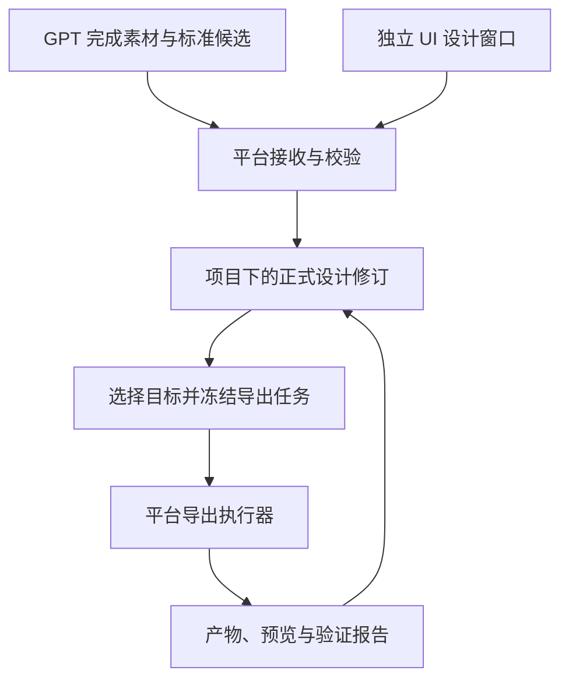

# UI 设计平台：独立编辑窗口与 GPT 结果接入实施方案

日期：2026-10-10。状态：基于实际源码的实施方案，功能尚未实现。

2026-10-11 实施进展：P0-A 的独立契约包及插件离线规范/预检工具已实现并验证，详见 [首批实现记录](ui-design-contract-progress.zh-CN.md)。后续窗口、保存、在线提交与导出仍按阶段门槛实施；契约检查不能计作整个平台通过。

实施准备评审结论：可以启动 P0；P1/P2 的完整展开以契约和画布验证通过为前提。本次调整将 P0 拆为 P0-A/P0-B，将最小保存闭环提前为 P1a/P2a，并明确合并后校验、接收渲染器和授权的依赖。第 11 节是当前任务顺序；[执行交接文本](ui-design-platform-handoff.zh-CN.md)用于交接。本文的表、状态和交付文件仍是实施要求，不代表代码、Schema 或接口已经存在。

## 1. 已确定的产品边界

**在 MagicGameClient 中，基于主页 AI 图层编辑器及其相关代码，复制出一个独立的 UI 设计编辑窗口。设计归现有主页项目管理；平台维护统一标准、保存原材料与正式设计，并按需生成 PSD、FGUI 等产物。**

**入口也必须新建。** 用户 17:11 的进一步要求是：主页增加独立按钮/卡片，新入口、新编辑器、新客户端业务流程和新服务端业务流程；将 AI 图层这套相关代码复制一份后写新逻辑。原 `magic-layers` 按钮、一次性 AI 功能意图、原窗口及其接口继续保留。实施不得变成点击原按钮再选择模式，也不得把新标准设计伪装成旧 AI job 的另一个 mode。

新的设计类型仍接入现有主页项目、账号/设计权限和素材存储这些平台公共能力。这与复制独立产品流程并不冲突：独立的是功能入口、编辑会话、标准正文、业务接口与任务，不重复建立一套账号或脱离主页的项目系统。

ChatGPT 继续完成整张设计、素材拆分与重建、真实 RGBA 小图、文字、UI 语义、组件树、统一布局和原画布拼接 PNG。GPT 插件向模型提供平台发布的规格及工具，负责准备、预检、上传、提交和读取回执。平台接收到的应是完整可编辑设计结果，不需要再次从拼接图片识别整套 UI。

用户已明确排除 `MagicGameClient/src/app/game-ui`：它是另一条 FGUI 编辑器迁移开发线，虽然也基于 AI 图层编辑器开发，但不作为本次新窗口、作者格式、保存链路或服务端改造的基础。本方案不修改它。FGUI 只是新平台未来可选择的输出格式之一；输出库可以从已有插件实现迁入平台。

| 工作 | ChatGPT / GPT 插件 | MagicGameClient 与 Server |
| --- | --- | --- |
| 规格与标准 | 获取准确版本和示例，按该版本生产 | 维护 Schema、语义、兼容版本、校验规则 |
| 完整设计、拆分、补全、出小图 | ChatGPT 完成，插件提供必要文件处理 | 接收并保留原始材料与结果 |
| 普通文字、组件语义、布局 | 生成真实可编辑数据与原画布拼接预览 | 校验、展示、编辑和形成正式修订 |
| 设计身份、项目归属、权限 | 使用平台返回的上下文和授权范围 | 沿用现有主页设计与目录/项目管理 |
| 正式设计、素材及历史 | 仅保留可恢复的提交暂存与回执 | 唯一正式维护方 |
| PSD、FGUI、Cocos、Unity | 不在新生产流程中生成 | 按固定修订和目标配置创建导出任务 |
| 目标导入及交互验证 | 不作为 GPT 提交的前置步骤 | 由对应导出/执行适配器实际验证 |
| 本机指定目录 | 如需要，可只接收平台已生成文件 | 下载或平台本机交付端负责写入 |

平台职责包含客户端、服务器和平台管理的任务执行进程，并不意味着 PSD 编码等重任务必须放进浏览器主线程。MCP 是插件的工具入口；正式设计和任务状态保存在平台，不能依赖一次对话的内存。

## 2. 本轮实际源码核对结果

2026-10-10 16:55（上海时间）之后，MagicGameStudio MCP 已重新成功读取现场工作树。工作区报告分支 `codex/replay-storage-fixes-20260918`、提交前缀 `2024464eff`、`dirty: true`。下表依据实际读取的源码，不以提交号推定全部未提交文件内容。本轮未启动、修改或发布这些应用。

### 2.1 正确的 AI 图层入口和编辑链路

以下路径相对于 `MagicGameClient/`。

主页实际卡片登记在 `src/client-programs/home/lazy/d7ebfb88351c21e7.ts`，键为 `magic-layers`，标题本地化键 `rDGJMg` 对应“AI可编辑图层”。`src/client-programs/home/lazy/b071cec016a0a547.ts` 的功能分支 `case 46` 加载模块 `908435`，进入 `__c.WzG`。维护入口随后进入 `home-magic-layers/entry-factory.ts`、`factory.ts` 和 `HomeMagicLayersController`。创建导航通过 `args.Ia.yMa(intent)` 委托 `src/client-programs/home/lazy/8c61a626be828190.ts` 的 `bep / NYd`，把原图尺寸、mediaId 和功能意图带入完整原生编辑窗口。

| 实际位置 | 已确认的职责 | 对新窗口的影响 |
| --- | --- | --- |
| `src/business/development/home-magic-layers/controller.ts` | `openPicker → select → create`；根据原图尺寸创建带 mediaId 和功能配置的设计 | 复制主页选图及启动体验，改为新设计领域的创建/打开操作 |
| 同目录 `factory.ts`、`entry-factory.ts`、`contracts.ts` | 原生 Home factory 绑定媒体选择、配额、设计模式和导航；已登记模块分别包含 `416179` 与入口 `908435` | 复制相关应用代码和明确端口，给新卡片独立行为；原入口继续使用原 factory |
| `src/business/development/editor-photo-routing/controller.ts` | `routePhotoFeature()` 将 `PHOTO_DECOMPOSITION` 映射到 `imageOutputtingEffects / F7g` | 保留旧 AI 路径；新标准设计具有自己的窗口启动逻辑 |
| `src/business/development/editor-photo-intent/factory.ts` | 准备完成后消费 `ui` 中的一次性 `D.J.D` 意图，通过 `history.replaceState` 清除 | `ui` 只能触发动作；新设计重开必须查询服务端持久编辑器类型或正文绑定 |
| `src/business/development/ai-layer-tasks/editor-result.ts`、`editor-transaction.ts` | 当前接收 `SUCCESS / DESIGN` 原生结果，按媒体 `id:version` 缓存；事务只支持固定文档并读取首个 page | 复制结果呈现及编辑操作组织，替换正文契约；现有结果应用成功不等于新标准已保存 |
| 同目录 `workflow/insert-native-layers.ts`、`geometry/`、`selection/` | 显式提供图层导入、坐标变换、引用规范化、选择和 Undo 事务，并检查异步目标是否仍有效 | 保留几何与事务能力；新结果经稳定节点映射和标准命令应用，原生图层类型不承担 UI 控件语义 |
| `src/business/development/home-design-list/contracts.ts`、`controller.ts`、`factory.ts` | `DesignRow` 供缩略图、标题、状态和菜单使用；`link()` 仅接受既有 `Iu` 值 `1…9`；打开委托 `options.Ia.rF({id, extensions, Mb}, {target})` | 按服务端持久类型分派打开地址；不把新增类型塞入未经定义的 `Iu`，也不挪用 `extensions.default` 的原生路由用途 |
| `src/app/source-runtime/domain/design-route.ts`、`home/design-navigation.ts` | 校验现有设计 URL、`/design?create` 和编辑壳路径，并分类主页导航 | 新路由要同时进入导航分类与独立窗口许可，支持主页重开、直接链接和刷新 |
| `src/app/source-runtime/editor-document.ts`、`editor/session.ts` | `composeEditorDocument()` 检查设计身份、构建及原生 `Pm.E` bootstrap；`createEditorSessionService()` 处理创建重定向、实时文档获取与壳验证 | 复制窗口载入和身份绑定流程，新增标准正文装载端；现有函数不能直接接收标准作者 JSON |
| `src/shared-runtime/packages.json` → `src/shared-runtime/editor-core-current-0cdd-esm/` | 当前正式核心源码包含浏览器、状态、文档和协议模块；经 `index.js`、`runtime-ports.js`、`entry.js` 初始化 | 作为画布、文本、图层及状态依赖的实际来源；依赖顺序和 native ports 需要完整接线 |

当前正式 core 输入是带 `-esm` 的目录；`src/shared-runtime/editor-core-current-0cdd/` 为历史对照，不能据它实施当前复制。`editor-layout/implementation` 和 `editor-text/implementation` 也是相关维护代码，应按新窗口实际使用的视图继续收敛依赖；本轮没有逐函数核对这两个目录，不能把它们视为已验证的独立 SDK。

现有 AI 图层能力沿“主页功能入口 → 完整原生编辑窗口内的 AI 图层模式”运行。新产品需要复制入口、产品壳和相关业务代码，并替换会话、命令及保存端口；只更改 `ui` 参数无法让设计永久归属新编辑器。底层仍有原生依赖和初始化约束，实施应先打通一个标准设计的真实编辑、保存及重开闭环。

### 2.2 对应服务端可复用的基础

以下路径相对于 `Server/src/main/java/com/magicgamestudio/server/`。

服务端也采用“复制相关 AI 业务代码后形成新的一套，再编写新逻辑”的边界：拟新增 `uidesign` Controller、应用服务、素材接收、Submission、Revision 和 Export 流程，独立接口与业务记录。原 AI 图层按钮对应的 `magiclayer` 接口、任务和原生保存流程继续保持。下表的“复用”限于真实设计身份、公共项目/目录、鉴权和存储底座，以及可借鉴的实现规则，不是给原 AI job 增加一个 mode 来承载新功能。

| 实际位置 | 已有能力 | 新功能的处理 |
| --- | --- | --- |
| `recovery/protocol/DesignCreateFormController.java`、`recovery/design/DesignRecordService.java` | `/design` 创建表单经 `mintFromNavigation` 登记当前用户的设计身份、原图、尺寸和缩略图 | 复用身份和来源校验规则，新增标准设计的创建与持久类型绑定；新正文不走原生初始化 |
| `recovery/protocol/OwnedFolderService.java`、`recovery/protocol/SemanticVfoldersComposer.java` | 主页项目/目录、设计卡片组合、移动和列表 | 新设计继续参加这些列表和目录操作，不新增平行项目体系 |
| `recovery/design/DesignSharingAccess.java` | 实际设计共享授权，区分拥有者、显式共享及成员状态 | 新 API 复用真实设计权限；项目可见不等于所有设计和资产可读写 |
| `recovery/magiclayer/ManagedLayerStorage.java` | 输入、layers 清单、PNG、预览与结果持久化，临时工作目录可恢复 | 借鉴输入/产物完整保存方式；新标准修订不能直接等同旧 MagicLayer job |
| `storage/TransferSpool.java`、`storage/ArtifactStorageService.java`、资产索引与存储路由 | 接收真实字节、hash、固定内容版本和实际存储位置 | 新提交服务通过受限的设计素材接收端口调用这些底层能力 |
| `recovery/protocol/NativeDesignDependencyImports.java`、`storage/WorkspaceAccess.java` | 先核对设计编辑权限，再为设计拥有者建立受限依赖导入与来源记录 | 新增标准素材接收服务，沿用设计锁下核权和精确依赖导入的方式；不直接照搬原生媒体请求 |
| `recovery/protocol/NativeDocumentShapes.java` | 原生文档初始形状、设计元数据与主页卡片 | 增加按持久编辑器类型分派的标准设计元数据供应端 |
| `recovery/stream/DesignTitleService.java`、`recovery/protocol/NativeDesignCopies.java` | 改名会追加原生修订；复制会读取原生正文并复制其媒体/字体依赖 | 新增标准设计的改名/复制处理，不能把原生正文服务直接接到新窗口 |
| `recovery/protocol/DesignTrashService.java`、`recovery/protocol/OwnedDesignPreviewService.java` | 回收/还原与业务墓碑；依据原生正文渲染当前版本预览 | 生命周期增加标准设计分派；标准预览依据冻结修订读取或生成 |
| `storage/StorageCopyTasks.java`、`storage/StorageCopyWorker.java` | 数据库持久任务、租约、重试和过期执行者隔离 | 借鉴任务调度方式新增导出任务；原复制任务的存储管理员权限不用于普通设计导出 |

当前 `ui` 创建参数不是持久编辑器类型；`DesignRecord.creationKind` 也已有创建来源用途，不能直接挪作新编辑器类型。建议增加独立的 `editor_kind` 或等价设计正文绑定，旧设计默认进入现有编辑器，新标准设计进入新窗口。

`ManagedLayerStorage` 和 `NativeWorkRegistry` 带有现有任务种类、目录和拥有者限制，不宜直接作为通用提交库。`ArtifactStorageService.preserve` 默认落当前用户个人空间；针对共享设计，新接收服务须先取得有权编辑的真实 design owner，再遵循已有受限导入模式。插件不能自行指定 owner/workspace 参数来绕过这层判断。

原生正文的当前内容来自 `recovery/stream/StreamRippleReplicaService.java` 对 `design_document_baseline` 与已提交 `stream_ripple_delta` 的重放，原生回执也绑定其客户端事务和序号。新标准应复制其中身份校验、固定来源和精确回执的处理原则，另建自己的修订/提交记录；原生事务号不是标准修订号。

`recovery/protocol/ObservedBlobUploadController.java` 对应现有单次媒体上传，`recovery/media/MediaUploadService.java` 校验真实长度、hash 和同一媒体版本的重复写入。这些源码提供流式接收与相同内容重试的基础，**尚不能证明已有面向标准结果包的通用分块续传协议**；第 6 节的上传会话、分块和完成操作均需新增。

## 3. 新窗口的代码组织与复制边界

### 开工基线

2026-10-10 复核时，插件本地 `main` 为 `21a02a44788714aaa66ee95a785c3244f94075a7`，原方案分支为 `docs/ui-roundtrip-sync`、原方案提交为 `fe6f09a2db63a441c3a7d9bfcfa07e45de5ec6cb`，可迁移能力位于 `feat/ui-production-workflow` 的 `ac4c92a548249640271618feceb6855624cfd496`。实施时读取文档分支最新提交；这些历史标识不证明运行中的插件已升级。

MagicGameStudio 工作树仍有大量修改和未跟踪文件。开工先保存本任务依赖清单：仓库/分支/HEAD、相关已修改与未跟踪源码的路径和 hash、构建入口、锁文件及实际运行版本。需要隔离开发时，把必需的未提交输入纳入可恢复的本地快照或受控副本，并核对清单；仅从 HEAD 创建 worktree 不能重现现场。不要把无关修改、凭证或运行数据一并提交。先记录旧 AI 入口的实际运行基线，已有失败与本次回归分开报告。

以下均为拟新增模块，最终名称可按仓库命名约定调整，职责不能互相混合。

| 拟新增位置 | 主要职责 | 从何处复制或复用 |
| --- | --- | --- |
| `MagicGameClient/src/business/development/home-ui-design/` | 新增主页“UI 设计”卡片，独立 key 建议为 `ui-design`；自己的媒体选择、原图尺寸、项目上下文、创建和打开流程 | 复制 `home-magic-layers` 的 entry/factory/controller/contracts 到新目录，编写新逻辑并独立注册；原卡片不承担新功能入口 |
| `MagicGameClient/src/app/ui-design/` | 独立 `editor.html` / 入口、路由、产品工作区、素材/修订/提交问题/导出面板 | 复制原生 AI 编辑窗口的产品接线与相关视图组织，建立自己的标准正文加载流程 |
| 其中 `session/`、`storage/` | `authoring-session`、标准 commands/history、设计 API 和保存协调；维护唯一作者状态、基线及脏状态 | 新增标准文档会话；复制现有窗口身份及生命周期模式，替换原生正文的加载/自动保存端口 |
| 其中 `canvas/`、`inspectors/` | `native-canvas-host`、标准到原生视图投影、操作到标准命令的适配，以及 UI 类型/部件属性 | 复用当前 `editor-core-current-0cdd-esm` 的未修改依赖；按实际依赖复制原生图层、文字、属性相关业务代码 |
| `MagicGameClient/src/business/development/ui-design-editor/` | 新产品 factory、媒体与结果呈现适配、标准操作入口及窗口生命周期接线 | 复制 AI 编辑器相关业务模块，参考 `ai-layer-tasks/workflow/insert-native-layers.ts` 的显式能力端口；原模块继续供旧入口使用 |
| 新产品的构建入口、资源清单与窗口 profile | 把以上代码注册到真实发布构建，固定入口文档、脚本资源及窗口配置 | 扩展现有 `tools/client-build/` 和 `tools/admission-window/main.cjs` 接线；如需私有 core 改动，为新产品登记独立 bundle URL |
| 平台维护的 `ui-design-contract` 共享包 | 标准 Schema、语义说明、稳定序列化、校验案例、版本迁移 | 吸收已完成插件的语义/布局能力；不以目标引擎格式作为公共核心 |
| `Server/.../uidesign/` | 正式设计正文、修订、素材接收、GPT 提交、导出任务及类型分发 | 现有 design、权限与 storage 公共服务；新领域独立 |
| 平台 `ui-design-renderer` / `ui-design-export-worker` | 统一拼接、验证、PSD/FGUI 等任务执行 | 已有插件 renderer 和输出模块，通过标准适配 |

不要求为本需求先大规模重构原 AI 图层编辑器。允许复制相关功能代码，在新窗口中建立独立业务状态；基础组件、登录、项目列表、媒体选择与公共存储按已有边界复用。复制后需要记录来源及接入点，避免长期依赖不受控的全局 monkey patch。

### 3.1 新窗口只保存一份标准作者文档

新功能从新增按钮/卡片启动，建议使用独立 key `ui-design`，由自己的 `entry-factory`、factory 和 controller 调用新设计流程并打开新窗口。原 `magic-layers` 卡片、`case 46`、`__c.WzG` 及其 controller 完整保留原用途；不给原按钮增加一个新 mode，也不让它改为打开新功能。主页设计列表依据持久类型重开标准设计，属于两类设计共同使用的项目管理接线，与这两个独立启动入口分开。

窗口内部有三类不同数据：

- **标准作者文档**：组件、素材版本、文字、布局和语义的唯一编辑工作副本，保存后形成平台修订。
- **编辑视图投影**：为复制来的画布/图层控件计算出的原生显示对象、矩形、命中区域及媒体句柄，可从标准文档重新生成。
- **编辑会话状态**：选择、缩放、当前查看状态、拖动过程、基线、脏状态和单一撤销历史。

产品入口、AI 结果呈现和相关应用业务代码复制到新目录；未修改的画布、文字、状态等底层代码继续依赖当前 core 源码及明确端口。不能因为目录已经拆成 ESM 就跳过其初始化图；先在 `native-canvas-host` 中保留必要依赖，再逐项接入标准操作。新窗口的原生正文装载和自动保存端口要替换为标准服务，渲染所需的原生树仅存在于投影层。

支持的操作按以下顺序处理：

1. 由视图对象映射回稳定的标准节点或组件实例，确定本次修改模板还是实例覆盖。
2. 形成标准命令，例如调整局部位置尺寸、改文字、替换素材内容、移动层级或修改语义类型；命令携带目标与编辑范围。
3. 校验父子关系、坐标、素材版本和部件约束，更新作者工作副本，并写入一份可逆历史。
4. 根据同一作者状态增量刷新画布、图层树和属性面板；保存时提交标准正文及基线，重开由已保存修订重建视图。

上述命令名称和接口由新标准模块定义，并非当前已有 API。原生导入后的 `normalizeReferences` 可能改变内部引用，因此原生对象 ID 只作会话映射，不能替代标准稳定 ID。普通文字、控件类型、实例关系、状态及未编辑扩展须保留在作者数据中，不能由最终画面重新识别。原生视觉 group 也不能自行决定标准中的坐标容器与逻辑 Group。

拖动中的临时画面允许直接更新投影以保证响应，结束时经标准命令确认，拒绝时恢复投影；一次拖动合并为一条撤销记录。原生 Undo/Redo 入口转到同一标准历史，或与作者变更绑定为一项可验证事务，不能两套历史各自前进。尚未适配的原生操作先在新窗口关闭，避免能改画面却不能完整保存。不能维护一份“原生图层 JSON”供编辑，再另存一份“导出 JSON”尝试事后同步。

异步图片结果固定目标节点、素材槽位、会话与基线；目标被删除或会话关闭时不得落到另一个选中对象。现有 `insert-native-layers` 的目标有效性检查及回滚可以作为实现依据，但新结果应用后还需走标准保存回执，不能把内存图层插入当作已入库。

#### 构建与窗口接线

下表路径相对于 `MagicGameClient/`，均为本轮确认的实际接入点；新产品 profile、入口和资源标识仍需新增。

| 接入点 | 实际约束 | 新窗口实施动作 |
| --- | --- | --- |
| 主页卡片登记及新增 `home-ui-design` entry/factory | 原 `magic-layers` 卡片行为绑定其模块与 `__c.WzG` | 新增 `ui-design` 卡片、独立行为注册与自己的 controller；公共登记增加新条目，原卡片、`case 46` 和原 AI 任务链维持原用途 |
| `src/business/development/modules.json`、`tools/client-build/business-modules.mjs` | 按源码 SHA 和 webpack/AST selector 登记替换，只编译登记入口及其导入；重叠替换触发 `BUSINESS_OVERLAPPING_SELECTORS` | 新 business 入口及导入图必须登记；不能复制一份相同 selector 试图让两个 factory 同时替换原位置 |
| `src/shared-runtime/packages.json`、当前 core 的 `modules.json`、`tools/client-build/core-esm-package.mjs` | 当前 core 绑定全局资源 `https://static.canva.com/web/84ccfad1a68789bd.js`；ESM 文件须符合登记和实际 import 图 | 共用未修改依赖；需要产品私有 core 改动时登记独立 bundle URL/profile，不能让同一全局 URL 同时代表两份不同字节；新增 ESM 模块同步登记与初始化 |
| `tools/client-build/build.mjs`、`entry-documents.mjs`、`runtime.mjs` | 构建同时生成业务模块、脚本包、入口绑定、runtime 资源及发布清单 | 新 HTML、入口脚本、资源目录和源运行时接入完整构建；仅新增 TS 文件或开发时注入不足以进入正式产物 |
| `src/app/source-runtime/domain/design-route.ts`、`home/design-navigation.ts` | 主页导航与已有设计路径具有明确分类规则 | 增加新窗口路由分类；按服务端持久类型派发，支持项目卡片、直接链接和刷新，不依赖一次性 `?ui` |
| `src/app/source-runtime/editor-document.ts`、`editor/session.ts` | 现有壳装载校验原生 bootstrap、设计身份和版本 | 复制会话装载模式，为标准正文提供独立 adapter；不要将标准 JSON 塞入原生 `Pm.E` |
| `tools/admission-window/main.cjs` | `setWindowOpenHandler`、后续导航配置及允许请求共同控制独立窗口；当前有主页设计分类和单独 FGUI 例外 | 为新产品登记独立许可与窗口 profile，保留上下文隔离、沙箱和导航校验；不借用其他产品例外作为新入口 |
| `package.json`、`tools/launch-client.mjs` | `build` 走正式构建脚本，`start:client` 校验发布资源及 hash 后启动 | 验收从实际发布包启动，核对新窗口使用新入口和正确设计身份，不能只依据源码文件存在判断已接入 |

首次实现的最小能力包括：主页项目下创建/导入与重开，对照原稿和拼接图，画布缩放/平移，图层选择、排序、可见性和锁定，位置尺寸及保持图片比例，素材替换，普通文字和已支持样式，UI 类型与部件关系编辑，保存与修订冲突提示，撤销重做，GPT 提交问题及平台导出任务查看。缺少业务回调不阻止 Button 以真实语义保存。

第一条运行验收链应为“打开一个标准设计 → 移动节点并改字 → Undo/Redo → 保存 → 关闭 → 从主页重开”，同时核对局部坐标、语义、实例覆盖和素材版本。随后验证原 AI 卡片的媒体选择、`PHOTO_DECOMPOSITION`、结果图层插入、Undo、原保存与重开路径，确保共享依赖接线没有影响旧产品。本轮只核对源码，以上新窗口与旧路径运行回归均尚未执行。

### 3.2 原生项目与设计生命周期的接入

新设计仍使用现有 `design_record` 身份和主页目录关系。创建时在一个业务事务中完成设计登记、编辑器类型、正文容器绑定和经授权的目标目录关系。原图和后续材料分阶段上传并保全到该设计的提交草稿；大文件传输不放进这段数据库事务，未完成的传输不能充当已就绪依赖。

除了首次创建，还必须逐项接入：

| 用户操作 | 现有接入点 | 新标准设计的行为 |
| --- | --- | --- |
| 主页/项目列表与重开 | `SemanticVfoldersComposer`、`NativeDocumentShapes.metadata/lifecycleCard`、`NativeEditorShell` | 列表读取标准修订摘要，依据服务器持久类型打开新窗口；不要求存在原生 baseline |
| 改名 | `recovery/stream/DesignTitleService.rename` | 按设计类型分派，在标准修订事务中更新标题并同步 `design_record` 投影；不追加原生 Ripple |
| 移动到目录/项目 | `recovery/protocol/OwnedFolderService.createItems/moveItems` | 复用现有目录权限及关系操作，补齐新类型的合法设计卡片；正文和节点 ID 保持 |
| 复制设计 | `recovery/protocol/NativeDesignCopies` 所在的复制入口 | 分派至新增标准复制处理器，冻结源修订及完整依赖，新建设计身份并保留来源；不复制活跃任务、共享可变 head 或目标工作副本绑定 |
| 回收站与还原 | `recovery/protocol/DesignTrashService.change` | 沿设计生命周期锁隐藏/恢复，保留标准修订、依赖与正确的卡片和重开路由 |
| 永久删除 | `recovery/protocol/DesignTrashService.permanentlyDelete` | 现有逻辑是业务墓碑并保留来源关系；新领域遵循保留规则，迟到任务不得重新激活设计或改 head |
| 更新封面 | `recovery/protocol/OwnedDesignPreviewService.render` 对应的预览入口 | 新增标准预览处理器，读取/生成明确修订的预览；旧原生 renderer 不直接接收标准正文 |
| 分享、只读打开 | `recovery/design/DesignSharingAccess`、`DesignRecordService` | 沿实际设计授权检查正文、原图、素材及产物；不能只保护列表或从项目成员关系推断设计授权 |

实施时可在公共主页/设计生命周期入口增加范围明确的类型分派，保留原处理器，由新增 `uidesign` 业务实现标准设计的标题、复制、预览与生命周期处理。这种分派仅用于共同的项目/设计管理，不合并两套编辑器接口，也不改变原 AI 按钮、窗口、任务和保存业务。仅新建一行 `design_record` 会遗漏标题、预览和正文的实际读取路径；不能以一个可见卡片代替完整集成。复制、回收和分享遵循既有设计所有者规则，不因新窗口支持共享编辑而自动开放生命周期管理权限。

## 4. 平台维护的统一标准

建议采用独立命名的、版本化的 UI 设计标准；名字不带 FGUI、PSD 或某个编辑器内置类型。当前插件 `Scene schemaVersion: 1` 是旧工具输入，不能简单改名就当作新平台协议。

平台应同时发布机器可读 Schema、中文语义说明、完整示例、限制、兼容策略和校验案例。客户端、Server 接收端、执行 worker 与 GPT 插件固定同一规范版本和内容摘要。Java 服务端与 TypeScript 生产/编辑端至少共享同一组正反向符合性案例；生成与校验不能因语言不同各自解释坐标和默认值。

| 标准领域 | 首版必须表达的内容 |
| --- | --- |
| 身份与来源 | 稳定设计/组件/节点/素材 ID，原图与批准定稿引用，来源、拆分/重建标记 |
| 画布 | 原始宽高、方向归一化、颜色空间、像素单位、左上原点 |
| 素材 | 原尺寸/高清 master、实际使用版本、真实 RGBA、裁切偏移、hash 与版本引用 |
| 层级与布局 | 容器、局部坐标、尺寸、轴心/必要变换、有序子节点、裁剪；全局矩形为派生结果 |
| 文字 | 真文本、字体引用、字号、颜色、描边、行高、对齐、换行和自动尺寸策略 |
| 组件与实例 | 可复用定义、稳定实例、实例属性覆盖、部件引用 |
| 控件 | 图片、可替换图片槽、文字、输入、按钮、Slider、Progress、List、Scroll、Combo 等真实语义 |
| 状态与交互意图 | 默认状态、数值范围/当前值、部件角色、已知事件意图及未绑定说明 |
| 目标信息 | 版本化目标覆盖/扩展，与通用核心分开；未知字段按覆盖能力保留 |
| 证据和待确认项 | 识别依据、补全标记、假设、字体替代及未定义业务行为 |

首版先承诺固定 2D 画布和已完整定义的控件子集。复杂响应式约束、任意原生扩展和所有引擎控件，不因在 Schema 中出现一个名字就视为支持。普通文字不能因为素材是 PNG 就降级为图片，逻辑 Group 也不能误作坐标父容器。

素材逻辑 ID 表示同一个资源槽位，内容 hash 表示某版真实字节。换图保持逻辑身份并创建新内容；文件名和 hash 都不能作为节点永久 ID。进度填充保存完整最大皮肤和当前数值，不能仅提交当前短条。被遮挡的底板必须补全并标为重建；透明 PNG 的 alpha 存在本身不能证明底板没有旧文字或棋盘格。

原始上传字节保持不变。若方向元数据需要归一化，另存工作图；标准画布与工作图绑定，记录其与原文件的关系。普通透明文字参考图、`ui_semantics.json`、位置清单与总览均从同一作者文档导出，不成为第二套可分别编辑的语义/坐标真值。

### 4.1 P0-A 必须交付的可执行契约

平台仓库维护一份契约源，客户端、Java 服务端、渲染器和插件读取有版本与摘要的同一发布物；不能四端分别手写一份相似格式。P0-A 需选定包的实际路径、分发方式与版本规则，记录在包内说明中。以下名称为交付建议，实施时可以按仓库约定调整：

| 交付物 | 必须固定的内容 | 通过条件 |
| --- | --- | --- |
| `authoring.schema.json` 与中文语义说明 | 节点/定义/实例/素材身份，字段类型、缺省与 null、引用、局部坐标、层序、裁切、文字、状态及扩展 | 完整样例通过；悬空引用、循环及不支持能力被定位拒绝 |
| `capabilities.json` | 分开声明可保存、可编辑、可渲染、可导出能力；列明控件、样式、变换及限制 | 不以枚举存在或保留原始字段宣称功能已支持 |
| `commands.schema.json` | 按稳定 ID 寻址的目标、定义/实例/状态作用域、前置条件、修改范围、撤销所需数据 | 移动、改字、换图、排序在同一作者历史中可逆；数组位置不充当身份 |
| 提交 API 契约与数据库迁移设计 | 第 6 节接口的请求/响应、错误码、版本条件、状态迁移、唯一约束和锁顺序 | 客户端与服务端以同一请求/回执夹具联调，不依赖口头字段约定 |
| 稳定序列化说明与 hash 向量 | UTF-8 字节、属性排序、数组顺序、数值/负零/精度、Unicode、缺省值及规范化时机；正文/manifest/spec 各自摘要范围 | Java/TypeScript 对相同夹具产生相同规范字节与 SHA-256；拒绝重复键及非法数值 |
| `fixtures/` 与符合性执行入口 | 正向完整设计、非法设计、命令前后状态、合并冲突、规范字节与预期摘要 | Java/TypeScript 两端均可执行；报告固定契约版本、输入与结果 |

P0 的最小样例必须包含嵌套容器、带透明裁切偏移的真实 RGBA、固定字体的真实文字、一个按钮定义及两个实例（其中一个含覆盖）、隐藏状态和需保留的目标扩展。它用于证明核心路径，不替代全部控件覆盖。P0-A 同时定义首版 Button、Input、Slider、Progress、List 的必要部件、默认状态、数值/文本规则和合法/非法案例；完整编辑与渲染能力在 P2 补齐，未完成项不能对外宣称可编辑。

布局首个验证范围为固定 2D 像素画布、左上原点、嵌套局部坐标和轴对齐尺寸；P0-A 必须明确子坐标是否随容器尺寸变化、裁切/透明度的继承、图片适配、文字测量和组件/实例/状态覆盖顺序，并给出数值案例。旋转、斜切、响应式约束等未验证能力先明确拒绝，不静默烘焙或丢弃。将来扩展能力须升级契约并增加案例，不要求 P0 实现全部布局系统。

兼容策略必须区分可保留的未知扩展和无法解释的核心版本。前者在未触及范围完整保留并限制可能破坏引用的操作，后者不得以旧 reader 写回。每次契约调整更新版本/摘要与符合性案例；所有消费者升级后才能启用新能力。

## 5. GPT 应提交的完整结果

下表是提交清单，不要求 HTTP 必须采用 ZIP。支持分文件上传时，平台可以在最后再提供可下载标准归档。

| 建议文件/角色 | 内容 |
| --- | --- |
| `manifest.json` | 提交、设计、基线、规范版本/摘要，文件角色、逻辑素材 ID、相对路径、长度和 SHA-256 |
| `design.json` | 符合平台标准的完整作者候选或有明确范围的变更 |
| `original/` | 原始参考图及其他用户材料，保留原字节 |
| `approved/` | 本次实际采用的完整定稿；与原图相同时可引用同一内容 |
| `assets/` | 拆分/补全后的独立 RGBA；未裁断主素材、高清源及实际使用版本 |
| 字体引用或 `fonts/` | 平台已有字体固定版本，或实际字体文件及许可信息 |
| `preview/reconstructed.png` | GPT 按标准布局完成的原画布尺寸拼接 PNG |
| `preview/assets-overview.png` | 全部散图总览 |
| 派生清单 | `ui_semantics.json`、局部/全局坐标、文字字体、部件和状态映射 |
| `provenance.json` | 拆分与重建来源、假设、未确认业务、人工/模型处理记录 |

**PSD 和 FGUI XML 不再是 GPT 提交物。小图、语义、统一布局和拼接 PNG 仍是必需工作。** 原始输入若本来是 PSD，可以作为来源附件保存，与“插件生成 PSD”是不同的文件角色。

平台根据收到的完整素材和标准文档独立重建预览，核对 GPT 提交的拼接结果。这是接收校验，不是让平台重复图片理解、补全美术或重新猜坐标。平台必须能获得真实持久素材；聊天临时链接、过期 URL 或模型声称已生成的文件名不能作为完整提交。

## 6. 平台与插件的提交协议

以下接口为拟新增设计，不是当前已存在的 Server API。推荐平台提供一套 HTTP 领域接口，MCP 工具转发相同操作，不在 MCP 内另做一套保存协议。

| 建议接口 | 用途与关键约束 |
| --- | --- |
| `GET /api/ui-design/v1/spec` | 返回确切规范、摘要、示例、素材/字体限制、兼容能力；支持按版本读取 |
| `GET /api/ui-design/v1/context` | 有界返回当前有权使用的主页项目/目录、目标设计及字体/素材目录；以现有领域服务为基础，不让 GPT 解释原生二进制列表协议 |
| `POST /api/ui-design/v1/designs` | 绑定现有主页项目/目录上下文，创建设计登记、持久类型和正文容器；幂等 |
| `GET /api/ui-design/v1/designs/{id}` | 返回有权访问的正式修订、素材引用、编辑范围与接收能力 |
| `POST .../designs/{id}/submissions` | 建立提交草稿，固定 baseRevision、specDigest、幂等键和编辑范围 |
| `POST .../submissions/{sid}/files` | 声明文件清单，返回该设计上下文可复用内容与需要上传的对象 |
| 文件上传/完成操作 | 实际传输、完整解码、长度/hash 检验；支持受限断点续传；完成前不可正式引用 |
| `PUT .../submissions/{sid}/candidate` | 写入候选正文与清单，带草稿版本前置条件；编辑内容后旧验证失效 |
| `POST .../submissions/{sid}/validate` | 运行服务端接收校验，返回绑定准确候选摘要的报告 |
| `POST .../submissions/{sid}/commit` | 对准确候选/清单/基线/验证执行版本检查，形成正式修订并返回可查询回执 |
| `GET .../submissions/{sid}` | 查询上传、校验、冲突、已保存修订及真实回执；断线后可恢复 |
| `POST .../designs/{id}/exports` | 平台界面选择某修订、格式和目标配置，建立独立导出任务 |

平台可以把候选提交、验证和 commit 包装为连续执行操作。这里的 commit 是有版本检查的数据操作，不额外增加一轮人工许可。已有设计发生同字段冲突时才需要保留两项候选并解决真正的歧义。

### 6.1 完成状态和重试规则

上传完成、文件校验通过、候选设计校验通过、正式设计保存成功、目标产物生成成功是不同状态。只有收到平台正式回执，GPT 才能报告“已保存到平台”。

回执至少包含真实 designId、submissionId、draftVersion、规范版本/digest、baseRevision、mergeHeadRevision、committedRevision、submittedDocumentHash、submittedAssetManifestHash、committedDocumentHash、committedAssetManifestHash、validationId、分层检查结果、警告与设计打开地址。`baseRevision` 是生产者读取的版本，`mergeHeadRevision` 是合并采用且提交时再次核对的服务端 head。候选与最终保存内容可能因合并或规范化而不同，不能共用一个含义不明的 documentHash；接口如提供该别名，只能明确指向 committedDocumentHash。若平台规范化或映射了客户端临时 ID，必须在回执中返回映射；节点稳定身份不能每次重试重新分配。

同一个幂等键和同一内容重复提交返回原回执；同一键对应不同内容报冲突。文件内容改变后使用新的内容版本，不能在旧验证结果下替换素材。验证完成到最终提交之间仍要检查基线、清单与正文摘要，避免检查 A 却提交 B。

账号、拥有者和项目/设计权限由平台已有身份系统判断。插件已连接本机工作区不自动获得 Server 登录态；实施时使用平台认可的用户授权会话或服务连接，绝不复制浏览器 Cookie、复用任意管理员身份或让模型指定 actor。

建议在现有平台账号体系内增加一次性配对的服务连接：用户在平台选择允许的设计操作和范围，插件换取并保存可撤销的受限连接凭证。现有认证中间件继续解析真实用户，新连接不新建另一套账号。若复用已有正式授权流程能提供同等能力，则直接对接；此处不是声称已实现了平台配对接口。模型只能看到连接身份、可用范围和连接状态，不能读取凭证。

授权是 P1 的接口前置决策和 P3 的端到端门槛。P0-A 记录现有登录态如何进入新窗口 API；P1 明确插件服务连接的签发/配对、凭证保存、有效期/续期、撤销、操作与设计/目录范围，以及相关 HTTP 请求的身份与 CSRF/CORS 处理。优先复用能满足这些约束的正式授权机制，否则实现上述配对方案。凭证范围与实时设计权限取交集，不以签发时有权限替代提交/下载时核权。先用现有真实用户会话完成 P1a/P2a，不用管理员身份或复制 Cookie 模拟插件授权。

### 6.2 GPT 与平台同时修改

例如 GPT 在 r7 开始重绘按钮图，期间用户在新窗口把按钮移到另一位置并保存 r8。提交仍携带 r7 基线和“替换此素材”的范围，平台比较 r7、GPT 候选和当前 r8，将独立变化合并为 r9。

如果双方都改变同一属性，返回定位到稳定节点/字段的冲突。不能把 `expectedRevision` 简单改成最新值后整份重发旧文档。GPT 没有读取或没有编辑权限的字段、状态、业务绑定和目标扩展必须保留；未出现在局部提交里不等于删除。

首版合并采用明确白名单：固定布局下，不改变素材逻辑尺寸、裁切、九宫格等关联属性的素材内容替换，与节点位置修改可独立合并。文字与自动尺寸、图片尺寸与九宫格、min/max 与当前值、删除与修改、定义与实例覆盖等需要联合校验；没有实现相应规则时返回定位冲突，不按“字段名不同”自动放行。P1a/P2a 先完成准确基线的条件保存与旧基线拒绝，P1b 补齐上述有限合并及验收；这不推迟首版 GPT 与平台并发的要求。

合并后的正文是新的待校验内容。以基线 B、候选 N、当前 head C 形成结果 M 后，对 M 及其最终依赖重新执行结构、语义和所需布局/重建检查。检查依据、报告与预览固定到 M 的摘要、C、规范和渲染器/字体版本。最终事务再次检查 head 仍为 C；变化时在有界重试内重新合并并校验，或返回冲突，不重用旧报告。不能拿候选 N 的合格报告批准未经检查的 M。

### 6.3 对模型暴露的工具范围

下表是建议工具职责，可沿用当前工具命名风格；不是要求模型先学习第二套标准。

| 建议工具 | 模型得到或提交什么 |
| --- | --- |
| `ui_design_spec` | 平台固定版本规范、完整样例和检查要求；记录 specDigest |
| `ui_design_context` | 当前授权项目/设计、修订、素材与字体，使用有界查询 |
| `ui_design_prepare` | 建立本机可恢复准备作业，关联平台 design/submission，检查作者候选 |
| 现有文件导入/分块上传的兼容工具 | 将真实原图、小图和字体传入准备区；完成字节检查后登记 |
| `ui_design_reconstruct` | 依据标准候选生成实际尺寸小图、透明文字参考、完整拼接与总览；不要求 FGUI target |
| `ui_design_submit` | 将准确候选和文件清单交平台，连续完成允许的校验及提交，返回真实状态 |
| `ui_design_status` | 节点/字段/素材级错误、冲突、修复范围和正式保存回执 |

图片理解与新美术生成仍由 ChatGPT 和图像能力完成，工具不会把“收到图片”伪装为自动拥有完整语义。工具说明必须要求模型先检视全稿，再拆分、补全、赋予语义、拼接核对，直到平台确认接纳；只有部分小图完成时不得报告整项流程完成。

建议接收错误返回 `code`、`severity`、`nodeId/assetId`、JSON 属性路径、实际值/预期规则和可重试条件。例如缺少 slider thumb 应定位对应组件部件；字体文件缺失应定位 font 引用，而不是返回笼统的“数据不合规”。

新建采用完整候选；修改已有设计支持限定范围的候选或领域命令。整个提交的身份与内容至少固定以下字段（占位示例，不是可直接提交的生产数据）：

```json
{
  "designId": "<server-design-id>",
  "submissionId": "<server-submission-id>",
  "specVersion": "<exact-platform-version>",
  "specDigest": "<sha256-of-platform-specification>",
  "baseRevision": "<revision-read-before-generation>",
  "draftVersion": 3,
  "idempotencyKey": "<stable-key-for-this-operation>",
  "documentHash": "<sha256-of-exact-canonical-candidate>",
  "assetManifestHash": "<sha256-of-complete-file-manifest>",
  "editScope": [
    { "entityType": "asset", "id": "asset_button_background", "operation": "replaceContent" }
  ]
}
```

这里的候选可以包含完整文档用于检查，但正式可应用修改仍受 `editScope` 和 base 的约束。重新生成一个已验证文档的不同序列化形式，需要按平台稳定序列化规则重新计算 hash；不能把 ZIP hash、JSON hash 和素材集合 hash 混为一个值。

### 6.4 接口、状态与幂等的实施约束

P0-A 固定契约，P1 实现下列状态。文件接收状态和提交状态分开；`VALIDATED` 只表示某个准确候选通过，合并结果仍受第 6.2 节约束。

| 对象 | 状态与允许迁移 | 持久化约束 |
| --- | --- | --- |
| 上传对象 | `DECLARED → RECEIVING → READY`；完成检查失败为 `FAILED`，主动取消/超时为 `ABORTED/EXPIRED` | READY 内容不可改写；记录总长度、块/偏移、hash、真实格式和存储版本；失败后按协议恢复或创建新对象 |
| 提交草稿 | `DRAFT → CANDIDATE → VALIDATING → VALIDATED → COMMITTED`；校验失败或冲突记录为 `INVALID/CONFLICT` | 提交正文和清单变化须递增 draftVersion，使旧报告失效；修复回到 CANDIDATE；COMMITTED 不可修改 |
| 放弃的提交 | 非终态可进入 `ABORTED/EXPIRED` | COMMITTED 不得被超时清理或取消；残留字节依照引用和保留策略处理 |
| 验证/提交尝试 | 每次固定 submission、draftVersion、输入摘要、基线与规则版本 | 迟到验证不能更新新候选状态；冲突、拒绝与成功分别保留可查询结果；未知事务结果先查询 |

实施 API 时必须一并给出：分页与大小上限、上传完成与候选更新的版本条件、错误结构、报告失效条件，以及草稿/文件保留期限。首版分块采用服务端 nextOffset 驱动的顺序追加；已接收块仅在偏移、长度和字节摘要完全一致时返回原结果，拒绝内容变化、重叠范围和越界写入，重启后从持久接收记录恢复。P1a 可先使用有界单次文件上传；P1b 必须完成断点恢复和重复块检查，才可通过完整 P1。

幂等键作用域固定到服务器解析的 actor、操作种类与目标身份（设计操作使用内部 design_record 主键；创建设计尚无目标身份，使用 actor + createDesign + key 的唯一约束）。同一作用域/键只能绑定一个请求指纹；指纹覆盖基线、候选版本、正文/清单摘要、规范和编辑范围，创建请求的指纹覆盖规范化目录、尺寸等输入。创建参数属于指纹而非唯一键作用域，防止同一 key 换参数绕过冲突检查。数据库唯一约束负责仲裁并发请求；重试查原记录，不能只用进程内缓存。修复已尝试提交的内容时使用新的操作键，保留原尝试回执；同一成功键不得重新计算另一版结果。

数据库迁移至少约束：设计绑定唯一、文档内修订身份唯一、提交操作键唯一、上传对象/块偏移唯一及顺序追加条件、每次成功提交只产生一个正式修订。提交事务原子写入修订、固定依赖、head 和成功回执；外部字节接收不在该事务中。错误响应至少包含稳定 code、对象/字段路径、可重试条件、当前候选/基线信息和查询身份；具体状态码由 API 契约固定，客户端不解析自然语言猜测下一步。

## 7. 服务端数据与事务边界

复用 `design_record` 的设计身份和主页目录/项目关系；新增独立 `uidesign` Controller/Service 与标准正文领域，避免让新正文进入原生 `design_document_baseline` / `stream_ripple_delta`，也不扩展旧 MagicLayer job 的含义。以下均为**拟新增的业务实体**，不是当前已经存在的接口或表。素材字节继续进入统一存储的 `asset_record`、`asset_version`、`asset_location` 与绑定/引用体系，不另建一套 blob 仓库。

| 建议实体 | 保存内容 |
| --- | --- |
| 设计编辑器绑定 | 对真实 `design_record` 行的外键、持久 editor kind、标准 document ID；不只按可能跨 owner 重复的外部名称关联 |
| `ui_design_document` | 正式 head 修订、Schema 版本、乐观锁版本、生命周期关联 |
| `ui_design_revision` | 不可变正文、parent、实际作者、精确 document/manifest hash、规范版本/digest、来源和合并依据 |
| `ui_design_asset_binding` / revision 依赖 | 稳定逻辑素材身份与角色；每次修订单独记录实际 storage asset/version/hash 和引用位置，不能换图后改写历史依赖 |
| `ui_design_submission` / 文件接收记录 | 当前用户、目标设计、幂等身份、基线、候选版本、编辑范围；会话内文件/分块状态、验证结果及正式回执 |
| 设计素材导入记录 | 上传者、源文件及固定 hash、实际 design owner、归档后的素材版本、提交身份和处理状态 |
| `ui_design_export_job` / attempt | 冻结修订、目标配置、执行器版本、依赖、租约、尝试、取消及完成状态 |
| 导出产物与验证记录 | 实际字节引用、hash、所用修订、每项验证的执行证据及经授权的下载信息 |

### 7.1 接收字节与登记精确依赖

原图和已上传材料在处理未完成时即可作为设计草稿保留；未完成文件不得进入正式 revision 依赖。现有 `TransferSpool` 提供流量、临时空间、并发及长度/hash 校验基础，`MediaUploadService` 能登记媒体并检查重复上传内容，`ArtifactStorageService` 处理产物的固定版本和实际存储位置。新结果包的上传会话、分块顺序/范围、恢复与完成确认需要另外实现，并由服务端公布实际配额；不能把某个现有任务的默认限制直接声明为新标准限制。

新增标准引用解析器应逐项把 manifest 中的素材、字体、原稿、拼接图和派生文件解析到已就绪的存储版本，核验真实字节、长度、hash、用途及授权后登记精确引用。现有 `storage/AssetReferenceExtractor.java` 的识别规则针对既有文档格式，并非任意 JSON 的通用依赖解析器；仅扫描 `sha256` 字段或复用一个旧资源种类会错误登记依赖。逻辑素材 ID、存储 asset ID、固定 version ID 和内容 hash 各有作用，不能相互代替；知道相同 hash 也不构成访问权。

### 7.2 共享设计的素材归属和授权

新服务先从服务器会话确定当前用户，再通过 `recovery/design/DesignRecordService.lockForEditing` 取得有权编辑的真实设计记录。当前实现区分 owner 与显式 `EDITOR`，并在设计及相关品牌锁下复核共享资格；只读或评论权限不能写标准正文，目录/项目成员关系也不能替代设计授权。

共享设计的素材接收应新增受限的 `DesignAssetIngest` 服务，参照 `recovery/protocol/NativeDesignDependencyImports.java` 已有导入原则：验证当前上传者有权使用的源素材及其完整字节；从锁定的 `DesignRecord` 获取实际 owner；将接纳所需素材归档为该设计可长期引用的固定版本，并记录上传者、原来源、目标归属、hash 与请求身份。这需要新的标准领域实现，不能把标准素材伪装成原生媒体请求直接送入旧插入逻辑。

`storage/WorkspaceAccess.ensureImportScope(owner)` 和 `ArtifactStorageService.preserveImported` 是已有受限导入底层：前者的调用者须先在设计锁下核权，后者要求有效写事务并保留配额及内容不变式。它们不会替新 API 完成设计授权，不能直接暴露为 GPT 可任意指定 owner/workspace 的工具，也不能放宽一般个人空间读写规则。现有 `preserve` 默认保存到当前用户个人空间，因此单独调用它不足以完成共享设计的素材归档。

设计读取和下载经 `findReadableForCurrentUser` / `DesignSharingAccess` 核对当前访问权，再限定到该设计修订或授权草稿的精确依赖；这不意味着向协作者开放 owner 的全部素材空间。已接纳修订不能长期依赖上传者个人空间里的临时文件，否则上传者离开会破坏设计。上传后、正式接纳前若共享资格被撤回，须重新核权并拒绝推进正式 head；已收到文件按所属草稿的保留规则处理，不能把上传成功当作接纳成功。

### 7.3 正式提交、回执与生命周期

提交前固定候选版本、规范 digest、文档与文件清单的准确 hash；按第 6.2 节生成并校验实际将保存的正文和最终依赖，包括合并、ID 映射及规范化造成的变化。长时间解码、渲染和文件传输在正式提交事务之外执行。取得并遵守已有设计/授权锁顺序后，重新检查当前角色、设计未被回收或删除、head 仍等于验证所用 mergeHeadRevision、候选未变化、报告绑定最终摘要及所有必要依赖确已持久化；受版本条件保护的同一业务事务写入不可变修订、精确引用、head 和成功回执。若需进入受限存储导入的写事务，也须遵守其要求，不能以伪造 owner 或绕开锁来缩短流程。

对象存储写入与数据库事务不宣称全局原子：失败残留依照引用、草稿和保留策略处理，不立即级联删除共享内容。事务结果未知或回执丢失时，按原提交身份查询真实状态，不能直接认定失败后再次创建。原生 Ripple 的序号、客户端事务表及回执不用于承载新标准提交。

设计修订不等于客户端拖动计数、上传进度或导出任务版本。每次正式保存的版本不可变，回滚形成新修订；晚到的保存回执不能把用户后续编辑标记为已保存。可以保留浏览器恢复草稿，但它不能自行覆盖服务器 head。

复制、回收、还原、永久删除、改名与提交/导出发布必须遵循一致的设计生命周期锁和类型分派。现有 `DesignTrashService.permanentlyDelete` 保留业务墓碑及来源关系，新领域不能擅自加成物理素材级联删除；任何迟到的提交、预览或任务都不能恢复已删除设计。历史修订和产物按明确保留策略管理，权限撤销不会改写已经接纳的设计内容或给撤权用户保留下载通道。

## 8. 接收校验与目标验收分开

| 检查 | 平台实际检查的内容 | 结果含义 |
| --- | --- | --- |
| 文件完整性 | 长度、SHA-256、真实格式、完整解码、尺寸、依赖闭包与访问权限 | 素材确实可读、可持久引用 |
| Schema | 版本、字段、枚举、类型、允许能力与限制 | 结构符合声明版本 |
| UI 语义 | 稳定 ID、组件与实例、循环、文本/控件类型、部件和数值规则 | 数据能作为可编辑设计理解 |
| 布局与重建 | 画布、局部/全局转换、裁切、层序、比例、透明度与统一拼接 | 作者数据和所交拼接图对应 |
| 视觉审阅 | 采用定稿与重建图的漏项、错字、边缘、底板残留、字体差异 | 单独记录审阅方式与未确认项 |
| 目标能力 | 选定 PSD/FGUI 等所需特性、字体和目标 profile | 此修订是否能按所选目标生成 |
| 原生验收 | PSD 回读，FGUI XML/依赖、实际编辑器导入及控件交互等 | 仅报告实际执行项，不由语法通过推定运行通过 |

GPT 提供的 `confidence` 或“passed”属于生产者说明，不能作为服务器已经执行检查的证据。像素差异需要固定字体、渲染器、画布和状态；存在字体舍入差异时记录范围，不能仅靠一个统一差异阈值证明文字和 UI 语义正确。

通用设计有效与某个目标可导出分开。例如一个设计可以完成保存，而某个 FGUI 版本尚不支持其特性；导出任务明确报告该限制。业务回调未绑定和真正的结构错误也要区分，不因未知业务接口把明确控件降级为图片。

### 8.1 接收渲染器前置到 P1

标准重建是接收依赖，不等到 P4 才迁移。P0-B 用同一样例验证标准布局求值、字体与图片引用；P1a/P2a 接入该范围的真实重建，P1b/P2b 扩展到首版完整能力。拆出 Node/Sharp 等所需执行模块，不依赖 FGUI profile、不生成 PSD/FGUI，也不把它直接放进浏览器主线程。P0-A 需确定 Java 服务调用该模块的边界、输入/输出契约及失败状态；执行时固定规范、渲染器、字体和素材版本。

接收检查报告区分阻断错误与警告。缺失依赖、无效结构和不支持的声明能力阻断接纳；视觉差异需保留对照图、实际测量与审阅状态，不用生产者自报 passed，也不默认逐像素必须相等。P0-A 选定并记录首版视觉差异的警告/阻断规则及样例；人工视觉审阅未执行时标记未验证，不自动增加每次保存的人工许可步骤。

已被用户编辑或服务端合并的修订应生成自己的预览。GPT 拼接图继续绑定原提交候选；不得因用户后来移动节点而要求最终修订与旧拼接图相等，也不能把候选的视觉审阅沿用为合并结果通过。合并后新增预览及其审阅状态与准确修订关联。

## 9. 平台按需导出及本机交付

导出任务固定设计 revision、document/asset hash、目标种类、真实工程 profile、字体与图片派生规则以及导出器版本。不能在任务执行时读取“当前最新设计”替换已冻结输入。



按第 8.1 节先在 P0/P1 拆出并接通引擎无关重建，再于 P4 迁入已有插件的 PSD/FGUI 输出能力，最后增添其他目标。`render.ts` 中实际尺寸素材处理、字体参考和 PNG 拼接仍可供 GPT 准备使用，也作为平台独立校验服务；它依赖 Node、Sharp/Pango 等，不能直接拷进浏览器当作 UI 代码。`psd.ts`、`fgui.ts`、目标研究及原生验证移到平台任务执行层。

任务持久化与执行需要新增标准导出领域。现有 `recovery/magiclayer/MagicLayerJobService.java` 以本机子进程和内存运行表管理 AI 任务；`ManagedLayerStorage` 可恢复输入与输出，但这不等于进程重启后已具备通用导出续跑。可借鉴 `storage/StorageCopyTasks.java` / `storage/StorageCopyWorker.java` 已实现的数据库领取、租约令牌、心跳、重试和过期执行者隔离，再为设计导出实现自己的授权、依赖冻结和发布规则。原存储复制任务要求存储管理员及相应管理权限，不能直接让普通设计用户调用它作为导出接口。

新增 worker 在短事务中领取固定任务，编码、原生软件调用与大文件传输在事务外执行，每次尝试写独立暂存结果。完成时核对租约、尝试身份、取消状态、设计生命周期、当前授权及产物 hash/长度，再登记可下载结果。失去租约的旧执行者不能发布成功，也不能覆盖新尝试的文件；重启恢复必须能区分“已有验证结果”“需重试执行”和“已取消/无权继续”。

平台导出 FGUI 时仍按实际目标源码、版本、XML 样例和导入限制实现，保留 `extention`、真实类型标签、模板/实例覆盖、九宫格中心矩形及资源 ID 规则。新窗口无需先打开 FGUI 工程才能保存或拼接标准设计。

若目标需要本机软件，由平台管理的本机执行端领取固定任务并返回真实证据；它不是 GPT 插件重新承担导出。浏览器下载使用正常下载/目录选择能力；要持续写入 `E:\...` 等指定目录，需要平台桌面壳或已配置的本机交付端。通用标准只记录产物身份，本机绝对路径保存为交付配置。

r12 导出尚在运行时用户保存 r13，r12 产物完成后仍标为 r12，不能覆盖 r13 的预览或冒充最新输出。生成、存储、下载、本机应用、原生导入、运行时交互和游戏发布分别报告。

## 10. 已有插件的迁移

以下依据已完成的 `feat/ui-production-workflow` 分支源码；这是已有分支能力，不表示当前 `main` 已合入或运行中的 MCP 已加载对应工具。

| 现有文件 | 本次改造方向 |
| --- | --- |
| [src/ui/scene.ts](../src/ui/scene.ts) | 保留语义、组件、文字与布局经验；公共部分进入平台标准，FGUI 字段下沉目标适配 |
| [src/ui/render.ts](../src/ui/render.ts) | P0/P1 先拆出不依赖 FGUI profile 的素材准备、透明文字参考、原尺寸重建和总览；P3 接插件，P4 供导出复用 |
| [src/ui/workflow.ts](../src/ui/workflow.ts) | 新主流程变为 prepare → precheck → upload → submit → receipt；不再以 FGUI target ready 作为构建 PNG 前提 |
| [src/ui/tools.ts](../src/ui/tools.ts) | 暴露平台规格、准备状态、素材传输、提交、错误修复和回执查询 |
| [src/ui/storage.ts](../src/ui/storage.ts) | 仅用于本机生产/上传恢复，关联平台 design/submission/baseRevision |
| [src/ui/psd.ts](../src/ui/psd.ts)、[src/ui/fgui.ts](../src/ui/fgui.ts) | 迁入平台导出 worker，由平台标准适配输入 |
| [src/ui/target.ts](../src/ui/target.ts)、[src/ui/native.ts](../src/ui/native.ts) | 迁入平台目标配置与原生验证体系 |
| workflow guidance、工具描述和 `skill/ui-production/SKILL.md` | 与实现同步切换到新规范；GPT 完成全部素材与 PNG 后交平台接手 |

旧作业先保留为只读兼容和显式迁移来源，不能升级插件后默默重写已交付文件。旧场景、素材、来源、ID 映射通过专门导入变成平台设计；已被游戏采用的 FGUI 包/资源 ID 必须继承已确认映射，不能因换了平台设计 ID 而重算。

## 11. 可直接拆成实施任务的顺序

| 阶段 | 具体变更 | 完成门槛 |
| --- | --- | --- |
| P0-A：冻结可执行契约 | 第 4.1 节交付物、内部设计绑定、API/状态/数据库约束设计、登录态接线与渲染边界；冻结所需源码基线 | Java/TypeScript 符合性与 hash 向量一致；完整样例和反例可执行；契约有唯一发布源与版本 |
| P0-B：验证真实画布接线 | 新按钮、复制后的独立业务目录、新窗口/profile/正式构建接线；样例投影、标准命令和单一历史；最小引擎无关重建 | 第 11.1 节逐项通过，证明不是原生 JSON 与标准 JSON 双写；此时尚不宣称服务端保存闭环完成 |
| P1a/P2a：优先贯通保存重开 | 真实设计身份/目录/权限、持久 editor kind、最小固定素材、标准修订与回执、准确基线保存、样例预览；新窗口保存并从主页重开 | 第 11.2 节贯通；数据离开当前进程仍可读；旧基线明确拒绝、回执丢失可查询；原 AI 路径回归 |
| P1b：完成接收领域 | 原材料/完整标准包、可恢复上传、草稿/候选、共享素材归档、有限三方合并、合并后校验；确定插件授权协议 | 中断/重复/撤权/并发/回执丢失等用例通过；P1a 的有限能力扩展到首版契约，方可宣称 P1 完成 |
| P2b：完成编辑与生命周期 | 完整图层/属性能力、首版控件、组件/状态编辑、冲突处理、复制/改名/移动/回收/还原/分享及预览分派 | 所有已开放编辑操作可保存重开；无原生 baseline 也能完成生命周期；旧 AI 编辑器回归通过，方可宣称 P2 完成 |
| P3：GPT 插件正式接入 | 平台规格读取、引擎无关的 PNG 准备、提交工具与指导、错误定位修复 | 给 GPT 设计稿后完整做小图/语义/拼接，平台收到正式可编辑设计；无需 FGUI/PSD |
| P4：平台 PSD/FGUI 导出 | 独立 worker、固定修订、原生配置、产物和验证报告、下载 | 同一平台修订能分别导出两种格式；其中一种失败不影响设计保存或另一种结果 |
| P5：后续回写与新目标 | 目标稳定绑定、各自基线、受管范围回读、三方合并；具体 Cocos/Unity 适配 | 平台改素材、原生改布局可合并；冲突不会静默覆盖 |

执行顺序为 P0-A → P0-B → P1a/P2a → P1b/P2b → P3 → P4；P5 单独安排。客户端与服务端可在同一冻结契约下分别推进，但必须先共同完成 P1a/P2a，不能等上传体系和完整属性面板各自完成才首次集成。P3 使用 P1 的真实规范、授权与回执；P4 依赖正式修订及已有重建模块，不反过来阻塞保存。第一版不把所有目标双向同步、多端实时协作或所有引擎发布作为上线前置条件。

P0 中的画布/历史接线是一个明确技术门槛。现有 AI 原生核心并不是已确认可独立调用的通用画布 SDK；如果某项原生操作暂时不能映射为标准命令，在新窗口中先关闭对应入口并记录能力，不允许它生成无法保存的编辑结果。不能跳过这个门槛后再靠原生 JSON 与标准 JSON 互相覆盖来补救。

每个阶段提交可单独审阅的改动和验证。旧源码目录中的无关改动不纳入本任务；构建生成目录、冻结来源和恢复材料不作为日常开发入口。新增窗口必须登记进实际 build/profile/路由链，不能只在源码文件中存在。

### 11.1 P0-B 通过门槛

同一完整样例在实际客户端构建中验证以下操作，不能以纯 reducer 测试代替真实画布接线：

1. 两个独立入口存在，新按钮打开自己的窗口；刷新后仍使用自己的正文加载端口。
2. 选择嵌套节点并拖动；坐标正确映射到局部位置，一次拖动只产生一项标准历史。
3. 修改真实文字，包括中文输入法组合过程；撤销/重做后作者文字和画面一致，不误保存中间输入状态。
4. 替换图片并调整实例覆盖；另一实例、控件语义、隐藏状态和未知扩展保持。
5. 销毁投影后仅从作者文档重建，坐标、文字、层序、实例身份和固定素材引用一致；与引擎无关渲染器的同范围结果核对。
6. 未适配原生操作被关闭；检查实际请求和保存端口，新设计编辑不会写原生 baseline/Ripple 或创建旧 MagicLayer job；原 AI 入口仍保持自身路径。

证据包括运行构建指纹、前后标准文档、命令/历史记录、请求或服务端记录和画面对照。若无法截获某个必须操作、隔离原生保存或控制 Undo，P0-B 不通过；记录具体端口、最小复现和可行修复后继续验证。不能默默换用另一条 game-ui 作者核心，或以双写文档绕过门槛。已经确认失败的必需能力不依赖后续大量功能开发来掩盖。

### 11.2 P1a/P2a 的第一条端到端验收

新按钮在现有项目下创建设计 → 新窗口读取标准 → 移动嵌套节点、修改文字、替换素材 → Undo/Redo → 保存并取得正式回执 → 关闭窗口 → 从主页重新打开 → 核对坐标、文字、语义、实例覆盖和素材版本。再在受控测试环境重启接收服务，读取同一修订与回执，证明不依赖内存状态。迟到的保存回执不能把后续本地编辑标记为已保存。

同时验证原 AI 图层入口、任务、图层插入、Undo、原生保存与重开。该阶段允许未开放的高级能力保持禁用，但不得用浏览器缓存、模拟回执或临时原生正文代替真实独立保存链。P1b/P2b 的完整上传、共享与生命周期验收仍需继续完成。

### 11.3 阶段记录与推进规则

每阶段记录实际修改、契约版本、源码/构建指纹、运行条件、验收项的通过/失败/未验证、证据位置、提交号及下一步。P0-A 中尚未落定的事项由实施者结合源码在契约中作出明确选择并验证；不能以 TODO 清单宣称契约冻结。真正改变已定产品边界或需要用户提供外部授权的事项才集中询问，其余独立工作继续推进。阶段未通过时保留已完成成果，不扩大成功声明。

## 12. 验收用例与本轮状态

| 用例 | 必须观察的结果 |
| --- | --- |
| 原图上传后关闭 GPT，会话未完成 | 平台设计草稿保留原图及已完成素材，后续可继续 |
| 完整标准包接收 | 每张小图、真文本、组件与布局可在新窗口检查，拼接为原画布尺寸 |
| 重新从主页打开新设计 | 正确进入独立窗口；旧 AI 设计仍进入旧窗口 |
| 移动按钮、改标题、换底板后保存重开 | 稳定节点/组件身份、素材引用、层序与文字均保持 |
| 画布编辑含未显示的状态/扩展 | 无关字段不丢失，视图投影不会整份覆盖作者数据 |
| Java/TypeScript 处理同一正文与清单 | 规范字节及 hash 一致，非法数值/重复键拒绝；旧版本不会丢弃未知核心字段后保存 |
| 中文输入、一次拖动、投影销毁重建 | 标准历史与画面一致，稳定节点和实例覆盖保持，未触发旧保存链 |
| GPT 基于旧修订返回结果 | 独立改动合并，同字段冲突清楚定位，不覆盖平台后续编辑 |
| 候选通过但合并结果违反范围/尺寸/部件约束 | 最终结果重新校验并拒绝推进 head；候选 PASS 不能替代合并 PASS |
| 合并校验期间 head 再次变化 | 重新合并并校验或返回冲突；不使用旧 head 的报告提交 |
| 用户移动节点后接纳 GPT 的换图 | 保留双方合法改动；生成最终修订预览，旧 GPT 拼接图及审阅继续绑定原候选 |
| 上传中断、重复提交、回执丢失 | 可以恢复或查询真实结果，不形成重复设计和伪成功 |
| 文件分块缺失、重复块内容变化、完成时长度/hash 不符 | 上传会话定位错误并拒绝登记就绪素材；未完成文件不能成为正式依赖 |
| 同一幂等键换正文/素材 | 明确拒绝重用旧成功或验证结果 |
| 旧候选的校验晚到、新候选已提交 | 旧报告保留原身份，不能覆盖新候选状态或成为其提交凭据 |
| 两次提交争用同一基线、数据库提交成功后应答丢失 | 只有符合版本条件的提交推进 head；旧提交返回可定位冲突，重查原身份返回同一真实回执 |
| 未授权项目/设计/资产和只读分享 | 按现有权限拒绝相应写入/读取，不因为知道 ID/hash 就放行 |
| owner、显式 EDITOR、VIEWER/COMMENTER 分别操作 | 按既有设计授权允许对应读取/编辑；共享编辑不自动取得复制、回收、分享等所有者权限 |
| 上传时有权限、接纳前被撤权 | 重新核权后拒绝推进 head，已收文件按草稿保留策略处理，不产生可越权下载的地址 |
| 插件连接失效或被撤销 | 后续请求拒绝，凭证不暴露给模型；已有工作区连接不能绕过平台设计授权 |
| 协作者提交后离开，或个人源素材不再可用 | 已接纳修订仍有设计所属固定依赖可读；离开的协作者不能继续读取受限设计及产物 |
| 拿其他设计 asset ID/hash 请求引用或下载 | 核对精确依赖和实际设计访问权，不能跨设计获取 owner 的私有空间内容 |
| 改名、移动、复制、回收/还原 | 主页元数据、正文及完整依赖一致；副本身份独立 |
| 新标准设计没有原生 baseline，仍进行上述生命周期操作 | 列表、标题、封面、复制、回收和重开均走新类型处理器；旧原生正文不被初始化或改写 |
| 设计删除后长任务才结束 | 保留真实尝试记录并按策略处理残留字节，不能登记当前可用产物、恢复已删除设计或更新其 head |
| worker 崩溃、租约过期、重领、取消后旧执行者才返回 | 只有有效尝试可登记成功；旧结果不能覆盖新尝试，失败/取消/可重试状态与实际文件一致 |
| PSD 和 FGUI 分别导出 | 固定同一修订，真实文件可下载；原生验证分项记录 |
| r12 导出完成时已有 r13 | 产物仍标 r12，不覆盖新修订预览和“最新”状态 |
| 原 AI 图层工作流回归 | 选图、拆分任务、插入、Undo、原生保存和主页重开保持 |
| 新旧编辑器和服务端业务同时使用 | 原 AI 按钮、窗口、magiclayer 接口与任务正常；新入口只调用独立标准设计业务，修订/提交/导出记录不混写 |

**本轮完成的是源码调研和方案，不是新功能实现。** 文档格式与链接检查可以执行；新标准接收、窗口编辑、服务端保存、PSD/FGUI 新平台导出、原生导入和运行时交互全部须在实施后分别验证。既有插件分支的旧验证报告只证明旧流程，不能转记为新平台通过。

2026-10-10 实施准备评审调整已完成主方案、统一标准、目标回写背景、旧工作流提示及执行交接文本的同步。五份文档已通过本地链接、JSON 示例、代码块/表格结构与 Git 差异格式检查；本次未实现契约包、修改业务代码或运行应用，P0-A、P0-B 和后续阶段的实际验收均未执行。

关联背景：[统一作者标准](ui-canonical-format-proposal.zh-CN.md)；[未来 FGUI 目标回写研究](ui-roundtrip-sync-proposal.zh-CN.md)。后者涉及的独立 FGUI 编辑器源码仅是历史目标研究，不是本次新窗口的开发基础。
