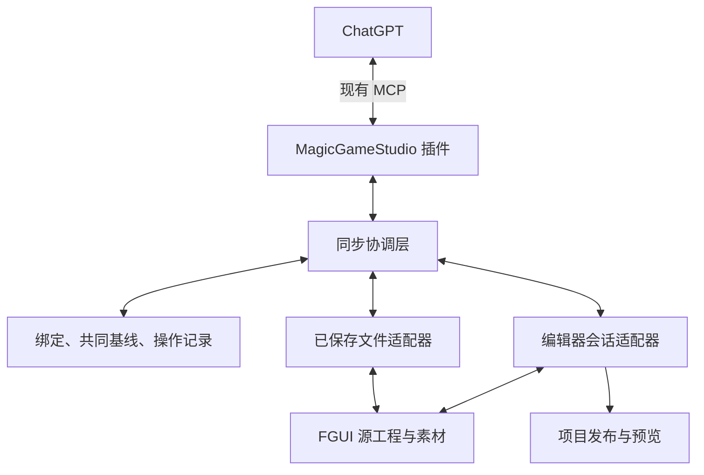
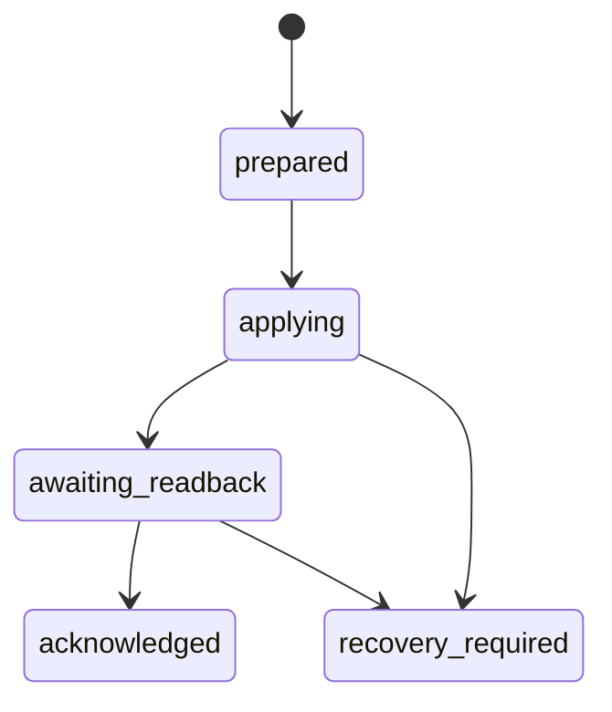

# MagicGameStudio：FGUI 与 UI 工作流双向更新方案

状态：研究提案，尚未实现。日期：2026-10-10。

架构更新：用户进一步提出所有 PSD、FGUI、Unity、Cocos 目标围绕同一作者标准生成和回写。总体方向见 [统一 UI 作者格式与多目标双向适配](ui-canonical-format-proposal.zh-CN.md)。本文作为 FGUI 首个适配器的具体研究；其中的共同基线为该 FGUI 绑定与中心作者工程的基线，不是要求所有目标同时保持一个确认版本。本文第 12 节的 job 目录是旧存储草案，实施时改为独立 document/binding 归属，并保留既有 job/native namespace 的迁移映射。

插件研究基线：`ac4c92a548249640271618feceb6855624cfd496`，CLI 0.2.0。FGUI/工作台证据来自上一轮真实验收保存的源码副本；本轮 Windows MCP 返回 `Internal error`，没有重新确认现场代码和运行中的编辑器状态。实施前需要重新核对源码指纹与实际宿主接口。

## 1. 推荐决策

在现有 MagicGameStudio 插件中增加围绕 **统一 UI 作者格式的同步协调层**，在编辑器或源工程工作台中增加 **FGUI 适配层**。PSD、Unity、Cocos 后续实现同一适配契约，各端以有范围的变更回写中心作者文档。ChatGPT 继续通过现有 MCP 入口工作。

MCP 负责工具发现和调用；项目身份、共同基线、冲突合并、保存确认属于另行定义的 UI 领域协议。采用同一种调用协议，不会自动解决两端对同一个按钮的不同修改。

建议按以下顺序交付：

1. **已保存工程同步**：把实际 FGUI 源工程与原 job 绑定，回读修改，产生差异和新的 Scene 修订，重新生成交付物。
2. **有版本检查的增量写回**：在受控源工程副本或已协调的编辑会话中应用已预览计划，保存并实际回读。
3. **编辑器会话同步**：接入当前选区、未保存文档、文档修订和真实编辑命令；经核实后提供撤销能力。
4. **项目发布与预览联动**：调用项目自己的 FGUI 发布、资源刷新和游戏预览流程，单独报告结果。

第一版应优先覆盖“同一界面的布局、普通文字、已知控件属性和图片修改”。任意历史 FGUI 工程的全量反向转换、所有特殊编辑器功能和多人实时协同，不宜作为第一版承诺。

## 2. 当前代码能证明什么

### 2.1 插件现状

| 依据 | 已有能力 | 同步缺口 |
| --- | --- | --- |
| [workflow.ts](../src/ui/workflow.ts)：`Job`、`setScene`、`revision` | 持久化任务、当前作者 Scene、任务级乐观并发 | 没有绑定活跃源工程、冻结共同基线和目标文档版本 |
| 同文件：`reserveInput`、`commitInput` | 同路径同 hash 幂等；不同内容使用新输入路径 | 回读变更需保持素材逻辑 ID，同时登记新的不可变内容 |
| 同文件：`buildJob` | 共享 Scene 生成 PSD、PNG、FGUI；历史 build 保留 Scene 与清单 | 历史 build 不等于工程实际采用的共同基线 |
| 同文件：`deliverJob`、`verifyReceipt` | 新目录交付，拒绝覆盖已被修改的交付目录 | 应新增源工程同步操作，保留 delivery 原有语义 |
| [tools.ts](../src/ui/tools.ts)：`ui_workflow_info` | 查询任务、产物、配置等元数据 | 当前 `job` 结果没有完整作者 Scene；需有界读取当前 Scene、hash 和映射 |
| [fgui.ts](../src/ui/fgui.ts)：`exportFgui`、`FguiExportReport` | Scene 到原生 XML，资源/对象映射与静态校验 | 没有 FGUI 到 Scene 的反向投影器 |
| [native.ts](../src/ui/native.ts)、[magicgamestudio-browser.mjs](../examples/native-validators/magicgamestudio-browser.mjs) | 对隔离副本执行实际打开、保存、重开、渲染和交互验证 | 不连接用户当前打开的文档，旧报告不是活跃工程的写回确认 |
| [http.ts](../src/mcp/http.ts) | 每个请求创建服务和 transport，公开端点不保存会话状态 | 不能假设跨请求内存保存了同步上下文，也没有现成的持续通知流 |

现有 `job.revision` 不覆盖全部事件。例如原生验证会产生新产物清单，但不增加 job revision。凡依赖产物的计划，必须同时固定内容 hash，不能只比较修订号。

### 2.2 实际 FGUI/工作台基础

以下路径相对于实际 MagicGameStudio 工作区；该部分依据已保存的真实源码，而不是演示项目名称。

| 源码位置与符号 | 已确认的基础 | 必须保留的边界 |
| --- | --- | --- |
| `MagicGameClient/src/app/game-ui/contracts/source-project.ts`：`OriginalProjectArchive`、`OriginalProjectFile` | 原始相对路径、字节、SHA256、长度、空目录归档 | 归档是来源材料，不是绕过文档命令直接编辑的第二份作者模型 |
| 同文件：`SourceIdentityMapping` | 源工程、包、组件、对象、图片与业务文档/节点/资源之间的映射 | 业务身份不能从当前文件名或目录猜测 |
| 同文件：`SourceProjectMutation`、`SourceItemRemap` | 导入/替换 PNG、重命名、移动、复制、删除、跨包迁移和替换引用等 typed intent | 仍须定位真实宿主 handler，不能把类型声明等同于已可调用接口 |
| 同文件：`SourceSavedCheckpoint`、`SourceDocumentsCloseResult` | 明确保存检查点、modified 状态与关闭选择 | 读取和预览不能隐式保存未保存修改 |
| 同文件：`SourceProjectOwnerUpdate` | 包级变更与 object Undo 明确分开；owner 有各自确认结果 | 不能假设跨包、图片文件与对象修改已经全局原子化 |
| `fgui/domain/source-project-importer.ts`：`importSourceComponent` | 按源包/组件身份构造隔离导入候选 | 调用者负责资源持久化及提交文档基线；缓存仅覆盖前 400 行 |
| `fgui/domain/source-project-loader.ts` | 来源、文件 hash、路径和 ID 核对 | 不得修改 provenance 来强行接受不匹配内容 |
| `fgui/codec/component-xml.ts` | 支持范围内的原生作者 XML 读写 | 白名单拒绝部分原编辑器字段，不能宣称全量无损往返 |
| `fgui/domain/source-runtime-scene.ts`：`prepareSourceRuntimeScene` | 从作者文档生成一次性运行时投影 | 预览中的拖动、数值和本地化状态不自动写回作者文档 |
| `publishing/laya/encode-package.ts`：`encodeSavedPackage` | 捕获明确 revision、recordVersion、序列化内容及素材 hash 后编码 | 源工程保存、运行时发布和游戏热重载是不同阶段 |
| `FguiProject/.../FairyEditor/FPackage.cs`、`FPackageItem.cs`：`Touch` | 磁盘变化后刷新、递增版本/清 hash、通知变化 | 尚未确认它与 dirty 文档之间的合并规则 |
| `FPackage.cs`：`BeginBatch`、`EndBatch`、`Save` | 批次延迟保存，最终逐文件写入 | 没有证据说明这是可回滚或可一次 Undo 的事务 |

本轮没有取得 `DocumentGraph` 命令执行器、撤销栈及当前 host/frame handler 的完整源码。因此，live revision CAS、事务和撤销只能列作待接入能力，不能报告已实现。

## 3. FGUI 适配器的两种模式与连接关系

下图只展开总体架构中的 FGUI 目标。其他目标也连接中心协调层，不互相直接转换完整工程。



**已保存文件适配器**只读取磁盘已经保存的内容。这个阶段可以复用现有 Node bridge，不必先在 FGUI 编辑器里运行完整 MCP 服务。写回必须针对受控副本或已确认没有竞争写入的工程；单纯在写前比较 hash，不能阻止未协作编辑器随后覆盖文件。

**编辑器会话适配器**放在实际编辑器宿主中。它提供当前文档身份、选区、dirty 状态、会话修订、真实命令应用和保存回读。MagicGameClient 工作台应接 authoring host/文档端口；独立 FairyGUI Editor 则需验证它实际提供的扩展入口，再实现同一适配契约。

`.fairy`、`package.xml` 和组件 XML 是源数据，不是运行服务的宿主。同步协议、日志和身份映射应放在插件状态或单独的工程辅助目录，明确排除在 FGUI 资源登记、发布与导入根之外。当前实际导入器对整个选中源根计算文件数和字节数，额外 sidecar 会消耗其预算。

内层可以采用本机 JSON-RPC/IPC，长期编辑会话可使用本机 WebSocket。首选复用现有公开 MCP、鉴权和工作区边界，编辑器接口只在本机可达。若以后需要 Codex、其他 AI 客户端或 CI 直接使用编辑器，可为相同适配层再加标准 MCP 外壳；同步规则仍由同一协调层执行。

MCP 规范有资源订阅等可选能力，但必须由实际双方支持。当前插件的公开 handler 没有持续服务端流；第一版使用显式刷新/有界轮询即可。文件监听事件只提示“需要重新采集”，不直接触发 AI 生成或自动覆盖。

## 4. 用户操作应怎样工作

### 4.1 在 FGUI 中移动按钮后，再让 GPT 换按钮图片

1. 首次导出安装到实际工程后，建立绑定并读取真正落盘的 ID 和内容。
2. 用户在 FGUI 中移动按钮并保存。
3. GPT 收到“换这个按钮的图片”后，先读取工程当前版本，再与共同基线比较。
4. 工程中的位置修改进入候选 Scene；GPT 的图片修改保持同一素材槽位和控件身份。
5. 展示合并后的预览，按已授权范围应用。
6. 保存、回读、验证后，生成新版本 PSD/PNG/FGUI 交付，旧版本保留。

目标效果是保留用户刚刚调整的位置，同时更新图片。无需用户重新上传整个设计稿或重复描述所有坐标。

### 4.2 双方同时修改同一属性

共同基线中的按钮 x 为 140；FGUI 改为 160，GPT 草稿改为 180。此时展示这一个冲突，让用户选择工程值、插件值或新值。明确独立的修改可合并，时间戳不能代替冲突判断。

### 4.3 用户只希望更新某个实例

每个修改必须表达“组件定义”或“某个实例/状态”的范围。改共享按钮模板可能影响多个界面；改当前实例的标题、图标或位置应只作用于对应实例。影响列表和预览必须列出所有受影响实例。

### 4.4 工程还没保存

文件模式明确只看已保存版本。会话模式才允许读取未保存快照；该快照应携带 dirty 状态和 session revision，不能冒充已持久化基线。读取与预览不自动保存文档。

## 5. 作者数据与交付物的关系

| 数据 | 角色 | 更新原则 |
| --- | --- | --- |
| 实际 FGUI 作者源工程 | 工程当前编辑结果 | 回读其中可表达的作者属性，保留来源和未支持内容 |
| 插件完整作者文档（现有 Scene，拟升级） | AI 语义、高清素材来源、业务绑定说明和统一布局 | 作为共同作者标准，与 FGUI 有范围的变更合并；不能从截图、运行时对象或 PSD 叶层重造全部语义 |
| 该 FGUI 绑定的共同基线 | 此目标与中心最后实际接受的投影 | 内容必须冻结，实际回读确认后才推进；其他目标各有自己的确认版本 |
| 初始批准设计稿 | 原始视觉依据 | 保留原文件及 hash；新布局使用独立修订预览，不覆盖原批准记录 |
| PSD、PNG ZIP、FGUI ZIP | 对某次修订的交付物 | 按所选目标生成，新目录交付；人工修改须先回读合并；旧交付与 receipt 保留 |
| 游戏运行时投影 | 分支、本地化、状态、拖动、动画等临时效果 | 默认不反写源设计；源更新、发布更新、游戏刷新分别报告 |

PSD 现有图层是展开后的 RGBA 叶层，透明度可能已乘入，裁剪和 Loader 溢出会改变栅格边界，文本可能是参考 PNG，图层整数 ID 又按导出顺序分配。因此第一版采用 FGUI 源工程回读；PSD 继续作为可交付的美术文件。后续 PSD 回写使用同一作者变更协议，加上 PSD 专用投影和稳定图层/实例映射；不另建一套冲突协议，也不视作已有能力。

## 6. 身份映射与版本

### 6.1 保留稳定身份

建议绑定对象的原生主键为：

```text
(sourceProjectId, sourcePackageId, ownerComponentResourceId, sourceObjectId)
```

作者 Scene 节点键是 `(componentId, nodeId)`。素材、字体、组件有各自 semantic ID。文件名、目录、显示名称和图片 hash 都不是节点身份。

当前 exporter 的规则可以复用：

```text
namespace = MagicGameStudio/ui-production/v1/{jobId}/{scene.id}
packageId = SHA256(namespace + "/package")[0:8]
projectId = SHA256(namespace + "/project")[0:32]
resourceId = kind[0] + SHA256(kind + "/" + semanticId)[0:12]
objectId = "n" + SHA256(componentId + "/" + nodeId)[0:12]
```

这些 hash 用于确定性身份映射，与图片内容 hash 不同。继续同一 job 修订可保持包与对象身份；重新创建 job 会改变包命名空间。下一版如需跨 job 延续同一工程，必须显式继承绑定的 native namespace，而不是重新生成身份后覆盖项目。

首次安装到已有工程时，应核对实际安装结果：包 ID 是否改变、资源是否被移动、是否发生 copy/remap、运行代码是否通过 `ui://` 或对象名称访问它。以 `FguiExportReport.resources/nodes` 与实际 `SourceIdentityMapping/SourceItemRemap` 建立对应关系。对无法确认的迁移只建立待确认映射，不通过名称相似度自动认领对象。

第一版保持拓扑与主键稳定。当前 Controller 用名称引用，List item 以名称区分，部分实例 property override 使用名称路径；这些位置的改名、跨组件移动和双方重排需要显式迁移，不能按数组下标或新名称猜测。

### 6.2 各种“版本”分开保存

| 版本/指纹 | 用途 |
| --- | --- |
| MCP 版本、SDK 版本 | 调用协议兼容；本需求不隐式升级已有 SDK |
| `syncProtocolVersion` | 新 UI 领域协议的结构与语义 |
| `mappingVersion`、`projectionVersion` | 身份映射和规范化规则 |
| FGUI 源格式、适配器/源码指纹 | 确定读取、写入和验证规则 |
| `jobRevision`、`sceneHash` | 当前插件作者状态 |
| `editorSessionId`、`documentRevision` | 活跃编辑会话及其中的版本；重开不能只复用旧数字 |
| `baseId` | 最近共同接受的内容快照 |
| `sourceTreeHash` | 实际源文件集合的路径、长度和字节 hash |
| `projectionHash` | 支持属性经过规范化后的语义 hash |
| `planId/planHash`、`operationId` | 已预览计划和一次应用操作 |

现有 `workspace.id` 从绝对目录派生，搬目录会改变；绑定需要自己的稳定 `linkId`，目录移动需要显式重新定位。`buildInputHash` 没有包含 job ID，而导出 namespace 包含 job ID，所以不能跨 job 只凭构建 hash 认定为同一源工程。

插件与编辑器适配层的软件版本不必完全相同，但需要协商兼容的领域协议和能力。建议发现结果同时返回实际运行的插件/适配器版本、支持的协议主版本、Scene/投影版本、FGUI 源格式和能力列表；只有磁盘安装版本更新，不等于当前进程已加载新能力。不支持的主版本应明确拒绝；基线结构迁移应保留旧快照并重新核对投影，不能修改旧 hash 来迁移成功状态。

## 7. 共同基线和三方合并

保存三份可读取内容：

- **B**：最近实际确认的共同基线。
- **L**：当前插件作者 Scene 的可同步投影。
- **R**：工程磁盘或明确编辑会话的当前投影。

基线需要同时保存完整作者 Scene、原始源文件字节、文件清单、映射和同步投影。单独一个 hash 不能提供三方合并所需的旧值。

| 情况 | 合并规则 |
| --- | --- |
| 只有 R 改变 | 采用工程修改 |
| 只有 L 改变 | 采用插件修改 |
| 两边结果相同 | 合并为一个结果 |
| 两边改不同且独立的字段 | 合并，并验证依赖与图结构 |
| 同一字段被改成不同值 | 记录冲突 |
| 一边删除，另一边修改或新增引用 | 记录删除/修改冲突 |
| 原生 ID 改变但没有 remap | 身份冲突，停止自动认领 |
| 出现不可表达字段或未知类型 | 保留原始材料，列为不可自动编辑范围 |

独立字段的判断必须考虑语义。例如以下集合需要联合校验：

- `min/max/value`、整数模式、滑块和最大填充尺寸。
- 节点父级、局部坐标、轴心、关联和 Controller 的位置 gear。
- 图片像素尺寸、Loader 填充、九宫格中心矩形和引用该图的全部控件。
- 字体、字号、自动尺寸、换行和文本框尺寸。
- 控件类型、扩展配置、必要子对象名称和点击区域。
- 资源或页面删除、所有引用以及业务绑定。

层序按稳定对象顺序比较；不以 XML tag 类型分组。当前 `parseNativeXml()` 使用普通对象模式，没有启用 `preserveOrder`，适合现有静态读取用途，不能直接作为交错 `image/text/component` 的完整层序回收器。需要保留顺序的读取器或实际作者 codec。

还需拆分编辑器查看状态与运行时默认状态。当前 exporter 用同一个 `selectedPageId` 同时生成 Controller 的 `selected` 和 `homePage`。用户只是在编辑器里切换查看页后保存，不一定要求游戏默认页改变。回读模型应分别保存编辑器当前页、运行时默认页和各页 gear；在 Scene 尚不能分别表达时，应保留该差异并停止有损全量重导出。

FGUI 保存器可能改变空白、属性顺序和默认值省略。以规范化投影判断业务差异，同时保留全部原始字节清单。未知内容不能从投影 hash 中消失后就被当作“没有修改”。

## 8. 未知 XML 与业务绑定保真

实际 `FComponent.Write_editMode()` 会保存 `customExtention`、`scriptData`、mask、设计参考、备注、声音等信息；当前 MagicGameClient codec 和插件 Scene 只支持其中一部分。

因此不能将整个已使用工程转换为当前 Scene 后再全量覆盖。应遵循：

1. 未涉及的文件保留原始字节。
2. 对受管、可表达属性做明确增量更新。
3. 未支持内容随原始快照保存，标记保留范围；需要修改这些范围时先阻断或扩展适配器。
4. 保留原生资源/对象 ID、标准部件名、页面和引用关系。
5. 对名称访问、生成绑定代码和项目扩展类进行影响检查；回读不编造业务回调。
6. 原始 archive 的存在本身不保证当前 writer 会原样写回未知字段。

文件级增量编辑如采用 token/CST 保留策略，必须真正验证未修改片段、顺序、注释和属性均保留，不能用正则替换冒充完整 XML 编辑器。编辑器会话模式则应通过实际作者命令处理，不能绕过正常命令直接替换整份 DocumentGraph。

保留未知源文件不等于插件已经能够重建其中的完整 PSD。若入口包含当前 Scene 无法表达的内容，应明确限制到可支持的受管范围，或将完整界面导出列为待补充能力；不能用保留原始字节作为“整页视觉和语义已同步”的证明。

## 9. 素材修改与派生数据失效

### 9.1 同名图片也可能是新内容

用逻辑 `assetId` 表示图片槽位，用 SHA256 表示该槽位的当前内容。图片原位覆盖后，即使文件名和 mtime 看起来没变，也应从实际字节识别变化。导入新的不可变 job 输入路径，保留原 assetId；不要让所有引用突然变成新的资源身份。

同一图片被多个控件引用时，预览应列出全部影响。字节相同的两个独立逻辑资源不能自动合并身份。

### 9.2 高清原图与 FGUI 变体

现有 `SceneAsset.fgui`、`SceneFont.fgui` 明确分离工程专用变体。回读到小尺寸纹理或字体子集的修改，只能先标记为该变体更新。

必须明确选择或生成相应策略：保持显示框/比例、更新哪一份原图、重建高清版还是允许原生专用差异。九宫格仍以变体真实像素表示中心矩形；Loader 比例、字体覆盖和许可也需重新检查。不能用小图静默覆盖高清原稿。

### 9.3 文字参考图过期

[render.ts](../src/ui/render.ts) 的 `renderScene()` 遇到 `referenceAssetId` 会直接使用该 PNG，目前只检查参考图尺寸，不校验图片中文字是否与 `node.text` 一致。

因此 text/style/对应 Controller 页面文案变化后：

- 普通文字具有真实字体时，清除过期参考绑定并重新排版栅格化。
- 特殊富文本需要新参考图时，标记待重建，完成前不能报告 PSD 已同步。
- 参考图应绑定文字、样式、字体内容和文字框的输入 hash。

字号不变、文字框大小不变也可能需要重建，不能只检查宽高。

### 9.4 重建与验证

作者内容变化后复用 `invalidate()` 的原则，使旧构建和验证结果失效。重新生成 PSD、散图、布局和原生包到新目录，保留原始设计参考和旧交付。画布变化需要明确新的设计参考和布局策略，不能自动拉伸原稿来满足旧检查。

后续可以按依赖缩小验证范围；第一版以完整受管界面重建和必要原生验收为准。生成源工程、实际保存回读、原生渲染、交互验证和游戏发布均有各自内容指纹及状态。

构建缓存也要纳入实际导出器、渲染器与依赖的实现指纹。当前缓存包含插件 `VERSION`，开发中只修改实现而不改版本号仍可能复用旧构建。源文件树 hash 与最终 ZIP hash 分别保留，避免归档封装元数据的差异被当成设计变化。

## 10. 预览、应用、回读确认

### 10.1 不可变计划

`preview` 固定共同基线、插件版本、目标源文件集合、原生 ID、适配器版本及观察到的编辑状态，返回候选 Scene、字段变化、文件变化、影响实例、冲突和同尺寸预览。

`apply` 接受 `planId + planHash`。解决冲突或再次编辑后生成新计划，不能在应用时混入未预览操作。

以下仅是新领域协议的结构示意，不是当前 MCP 工具或原生 XML：

```json
{
  "syncProtocolVersion": 1,
  "linkId": "link_example",
  "operationId": "op_example",
  "planId": "plan_example",
  "planHash": "<计划内容的 SHA256>",
  "baseId": "base_example",
  "expected": {
    "jobRevision": 8,
    "sceneHash": "<作者 Scene hash>",
    "sourceTreeHash": "<目标文件集合 hash>",
    "editorSessionId": null,
    "documentRevision": null
  },
  "changeSummary": {
    "objects": 1,
    "assets": 1,
    "conflicts": 0,
    "unsupportedChanges": 0
  }
}
```

内部领域操作按原生身份定位，例如 `setProperties`、`replaceAssetContent`、`setChildOrder`。JSON Patch 可用于按稳定 ID 建模的归一化对象比较；它不是 FGUI XML 的现成更新协议，也不自带跨文件回滚。若使用 RFC 6902，`test` 可表达旧值前置条件，实际原子应用仍由适配层实现。

### 10.2 应用前重新核对

必须重新确认：job/Scene/base、源文件集合与新建路径、工程与包 ID、资源依赖、映射版本、适配器指纹、目标目录边界，以及编辑器 session revision/dirty 状态。

文件监听、mtime 或插件私有锁不能代替这些条件。未经协调的外部编辑器可能在检查后继续写入；文件模式应在独占的工作副本中完成，或使用编辑器合作的保存/写入窗口。无法证明写入窗口受控时，可回读并生成候选包，保留活跃工程应用为待执行。

### 10.3 保存与恢复

建议操作状态为：



这只是状态表示。需要真正实现暂存、写前日志、预期 hash、旧内容保存及崩溃恢复。多个文件逐个 rename 不构成整个工程的原子事务；`FPackage.BeginBatch/EndBatch` 也不能提供这一保证。

编辑器对象命令如支持分组撤销，应明确其范围。图片、包迁移和其他 owner 变更可能不在 object Undo 内，需要单独补偿记录，不能承诺统一一次撤销。

### 10.4 实际回读 ACK

写入后重新从实际目标持久化位置读取，核对保存结果的文件清单和投影。只有目标和插件都达到计划的共同结果，才推进基线。

ACK 必须绑定 link、operation、plan、旧 base、实际工程 ID、应用前后文件 hash、作者 Scene hash、回读投影和适配器指纹，由受信适配器根据真实执行生成。不能开放一个让模型提交 `passed` 的确认工具。

`sourceReadback`、`editorImport`、`runtimeInteraction`、`publish`、`gameReload` 分开记录。仅保存成功，或隔离验证器成功，不等于活跃工程和游戏已经更新。

### 10.5 幂等与回环

相同 operationId 重试应查询已记录结果或恢复未完成阶段，不重复导入。文件变化事件重新采集实际内容后，与本次已确认结果比较；`origin` 只辅助追踪。

不得使用“忽略下一次文件事件”或“忽略若干秒”来防回环，这会吞掉随后的人工修改。崩溃恢复和回滚也必须比较当前内容；遇到第三方新版本时转入恢复冲突，不覆盖后来作业。

## 11. 建议的最小工具与适配接口

以下均为提议名称，当前 0.2.0 没有这些同步工具。

工具名与参数需要按总体作者标准统一：FGUI 是目标 binding 的一种类型，其他适配器复用作者读取、差异、合并、应用和操作查询的语义，不复制一套不兼容的协议。

| 对话侧能力 | 作用 |
| --- | --- |
| 读取作者 Scene/绑定状态 | 有界读取准确 Scene、版本、映射与 pending 操作 |
| `ui_sync_link` | 绑定实际源工程和受管包，核对安装身份，准备初始基线 |
| `ui_sync_snapshot` | 明确选择 saved/editor，采集稳定快照与差异提示 |
| `ui_sync_preview` | 三方合并、冲突列表、影响范围和候选预览 |
| `ui_sync_apply` | 条件应用已准备计划，保存与实际回读 |
| `ui_sync_operation` | 查询或恢复同一操作，返回明确完成阶段 |

会话适配层内部能力可包括 `discover`、`getOpenDocument`、`getSelection`、`captureSnapshot`、`applyChanges`、`save`、`readback`、`render`、`subscribeChanges`。它应公开已验证的能力，而不是默认所有编辑器都支持。

后续如加入回退，应从旧操作生成逆向变更计划并重新做版本检查；不能直接覆盖成旧目录。日常已授权、无冲突的更新可连续执行，只有真正影响结果的冲突或范围歧义需要用户选择。

## 12. 持久化布局建议

以下为最初针对现有 job 的存储草案，保存在插件管理的状态根，不进入 FGUI 导入根。按新的总体架构实施时，作者文档和 binding 应脱离 job 存续，job 只引用它们；既有路径与身份通过显式迁移继承：

```text
jobs/{jobId}/sync/{linkId}/binding.json
jobs/{jobId}/sync/{linkId}/bases/{baseId}/scene.json
jobs/{jobId}/sync/{linkId}/bases/{baseId}/projection.json
jobs/{jobId}/sync/{linkId}/bases/{baseId}/mapping.json
jobs/{jobId}/sync/{linkId}/bases/{baseId}/inventory.json
jobs/{jobId}/sync/{linkId}/bases/{baseId}/source-files/...
jobs/{jobId}/sync/{linkId}/plans/{planId}.json
jobs/{jobId}/sync/{linkId}/operations/{operationId}.json
```

这是建议目录结构，不是已经存在的实现。绑定中的路径由工作区边界或本机配置解析。输出目录授权不自动等于活跃源工程覆盖授权；两者在工具语义中明确区分。

旧交付可以提供初始迁移材料：`layout.json.scene`、`Reports/fgui_static.json`、FGUI 源包和 receipt。但实际安装可能已改 ID 或内容，必须交叉核对。找不到可信共同历史时进入首次采用流程，不能虚构基线。

当前 TargetProfile 混合了格式依据和可编辑 UI 样例，`verifyTargetProfile()` 会将其修改视作过期；它也不是完整工程树扫描。新实现应拆分“解析器/SDK 格式依据”和“受管内容快照”，通过明确重检保持两者有效，不能忽略 stale 错误来实现同步。

## 13. 实施划分与验收

### 阶段 A：回读与差异

增加有界 Scene 读取、稳定绑定、冻结基线、顺序保真的源投影及差异预览。先覆盖原插件生成并已绑定的单包界面，保持拓扑稳定。

### 阶段 B：合并与受控写回

增加字段合并、素材版本、过期栅格处理、计划 hash、目标前置条件、操作日志、保存回读及新交付。首轮回读可先更新插件修订并交付候选源包；直接写活跃工程以受控写入窗口为验收前提。

### 阶段 C：编辑器会话

核对真实宿主源码和扩展入口，接选区、未保存快照、session revision、命令和保存。分别证明对象撤销、资源补偿和多 owner 行为，明确未支持能力。

### 阶段 D：发布联动

绑定实际项目发布配置与运行时资源路径，执行固定快照发布和游戏刷新。发布行为与源编辑保持单独的授权范围及报告。

| 验收场景 | 应得到的结果 |
| --- | --- |
| FGUI 只移动按钮 | 原控件 ID、类型与引用保持，位置回读到 Scene 和 PSD |
| GPT 换图片，FGUI 改位置 | 两个独立变更合并，影响实例清楚 |
| 两边改同一位置 | 明确冲突，不按时间覆盖 |
| 同名 PNG 内容改变 | 识别实际字节变化，保留资源逻辑 ID |
| 图片像素尺寸/九宫格改变 | 联合校验比例、中心矩形与全部引用 |
| 文字改变，旧参考图同尺寸 | 原文字栅格失效，PSD 与 FGUI 文案一致 |
| 原生紧凑变体改变 | 不静默覆盖高清源，清楚标注重建或差异策略 |
| displayList 交错多种标签 | 回读层序不变 |
| Controller 页面与实例覆盖 | 保留页面关系和作用范围，默认值与当前值分开 |
| 只切换编辑器查看页后保存 | 不意外改变游戏运行时默认页 |
| 特殊/未知 XML 存在 | 未改范围保留；不能保真时停止对应写入 |
| 删除被引用资源 | 依赖冲突，原工程保持可恢复 |
| 预览后目标再次被修改 | 旧计划拒绝，重新采集与合并 |
| 编辑器有未保存作业 | 文件模式明确其范围；会话模式用真实版本处理 |
| 复制、跨包移动或节点改名 | 第一版检测并阻断未支持的身份迁移，保留原始数据；实现对应能力后按真实 remap 应用 |
| 保存中断或连接断开 | 查询操作并恢复，不重复写入或吞掉人工新版本 |
| 重复事件与相同操作重试 | 不产生更新回环，不重复导入 |
| 旧交付目录被人工修改 | 继续拒绝覆盖，改走源工程同步流程 |
| Git 切分支或目录迁移 | 重新校验绑定与快照，不使用旧路径/hash 写回 |
| Native 旧验证通过后内容变更 | 旧结果失效，新内容重新验证 |
| 源保存成功但发布失败 | 源与发布状态分别显示，不报告游戏已更新 |

每轮至少报告静态检查、源保存回读、编辑器导入/渲染和运行时交互；未执行的阶段标记未验证。上述场景按阶段验收：第一版支持范围内必须实际通过；扩展场景须证明能检测、保留原始数据并明确未支持，实现对应能力后再验证成功路径。工具列表或协议 JSON 本身不构成验收。

## 14. 主要依据

- 当前插件源码基线 `ac4c92a`：[ui-workflow.md](ui-workflow.md)、[scene.ts](../src/ui/scene.ts)、[fgui.ts](../src/ui/fgui.ts)、[workflow.ts](../src/ui/workflow.ts)、[render.ts](../src/ui/render.ts)、[psd.ts](../src/ui/psd.ts)、[target.ts](../src/ui/target.ts)、[native.ts](../src/ui/native.ts)、[storage.ts](../src/ui/storage.ts)。
- 实际目标缓存：`contracts/source-project.ts`、`source-project-loader.ts`、`source-project-importer.ts`（前 400 行）、`component-xml.ts`、`source-runtime-scene.ts`、`encode-package.ts`、`session.ts`，以及 `FairyEditor/FComponent.cs`、`FPackage.cs`、`FPackageItem.cs`。能力边界见第 2 节，实施时重新核对现场。
- [MCP Architecture（2026-07-28）](https://modelcontextprotocol.io/specification/2026-07-28/architecture)：host/client/server 分工和能力协商；领域同步是本提案的应用层设计。
- [MCP Resources（2026-07-28）](https://modelcontextprotocol.io/specification/2026-07-28/server/resources)：资源读取与可选订阅能力；是否可用以实际客户端/服务端能力为准。
- [Git merge 官方文档](https://git-scm.com/docs/git-merge)：共同祖先与三方比较提供思路；本提案按 UI 语义字段实施，不能用普通文本 merge 代替原生控件合并。
- [RFC 6902](https://www.rfc-editor.org/rfc/rfc6902)：JSON Patch 与 `test` 条件；不宣称标准自动提供 FGUI 文件事务。

本次产出是研究方案与实施边界，没有新增同步工具、变更 FGUI 解析器或操作用户的活跃工程。
